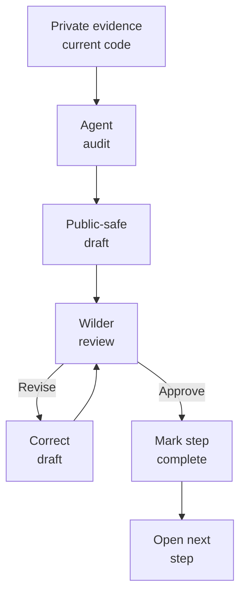

# Millenova Public Facade Implementation Plan

**Status:** 🟡 ACTIVE — PF-8 MPlayer under review · architecture correction sweep applied 2026-10-13  
**Private implementation authority:** `wilderruiz/millenova`  
**Public publication authority:** `wilderruiz/millenova-project`  
**Publication boundary:** [`WHAT_IS_PUBLISHED_HERE.md`](WHAT_IS_PUBLISHED_HERE.md)  
**Shared agent guidance:** [`agents/README.md`](agents/README.md)  
**Mermaid rendering rules:** [`agents/MERMAID_GRAPH_GUIDE.md`](agents/MERMAID_GRAPH_GUIDE.md)  
**Decision owner / reviewer:** Wilder Ruiz  
**Working method:** agent drafts → Wilder reviews → corrections → Wilder approves → step closes → next step begins

---

# Top menu — publication steps

**Legend:** ✅ COMPLETE · 🟡 ACTIVE · ⬜ QUEUED · ⏸ GATED · ❌ REJECTED / RETIRED

| Step | Status | Public artifact | Purpose | Approval gate |
|---|---:|---|---|---|
| **PF-0** | ✅ | `WHAT_IS_PUBLISHED_HERE.md` | Define public/private boundary and agent rules | Boundary accepted |
| **PF-1** | ✅ | `MILLENOVA_PUBLIC_FACADE_IMPLEMENTATION_PLAN.md` | Make publication workflow explicit | Step order accepted |
| **PF-2** | ✅ | `README.md` | Technical landing/index page | Rendered README approved; architecture later corrected from private evidence |
| **PF-3** | ✅ | `docs/ENGINEERING_OVERVIEW.md` | Broad engineering map | Approved; current architecture correction applied |
| **PF-4** | ✅ | `docs/PLATFORM_ARCHITECTURE.md` | Logical architecture and state authority | Approved; current architecture correction applied |
| **PF-5** | ✅ | `docs/TECHNOLOGY.md` | Map technologies to responsibilities | Approved; current architecture correction applied |
| **PF-6** | ✅ | `docs/media/NATIVE_MEDIA_ENGINEERING.md` | First-party video + native audio/genome engineering | Approved; current architecture correction applied |
| **PF-7** | ✅ | `docs/media/DISTRIBUTED_MEDIA_NODE.md` | Native HOME/VPS delivery, replication and economics | Approved; current DMN status correction applied |
| **PF-8** | 🟡 | `docs/player/MPLAYER.md` | Native MPlayer ownership, queue/transport continuity and Stage-family boundary | Wilder reviews corrected native-vs-provider scope |
| **PF-9** | ⬜ | `docs/feed/SIGNAL_WINDOW.md` | Logical Home store, virtualization, geometry and native-scroll ownership | Preserve accepted/rejected approaches accurately |
| **PF-10** | ⬜ | `docs/feed/SEARCH_AND_DISCOVERY.md` | Home search/discovery across typed artifacts | Do not confuse mounted render window with searchable catalogue |
| **PF-11** | ⬜ | `docs/creator/STUDIO_AND_UPLOADS.md` | Native publishing, smart Link/Upload flow, replacement and lifecycle | Keep private/admin details out |
| **PF-12** | ⬜ | `docs/social/PLAYLISTS_REACTIONS_AND_COLLECTIONS.md` | Reactions, provider-scoped playback playlists, native queue semantics and universal Saved/Collection | Do not revive the retired separate Signals product |
| **PF-13** | ⬜ | `docs/social/MODERATION_AND_GOVERNANCE.md` | Reporting, moderation, governance and abuse resilience | No bypass thresholds or privileged internals |
| **PF-14** | ⬜ | `docs/engineering/ENGINEERING_LOG.md` | Public engineering decision/verification index | Evidence-grounded entries only |
| **PF-15** | ⬜ | `docs/experiments/HOME_MEDIA_NODE.md` | Home media node case study | Separate experiment, proof and measured result |
| **PF-16** | ⬜ | `docs/TESTING_AND_VERIFICATION.md` | Validation ladder from source to production/runtime proof | Claim only tests actually performed |
| **PF-17** | ⬜ | `docs/PRODUCT_EVOLUTION.md` | Artist site → Home community → native media/audio genome → Stage families/rich posts | Preserve historical truth and superseded directions |
| **PF-18** | ⏸ | `assets/` + screenshot index | Reviewed screenshots/figures | Manual safety review required |
| **PF-19** | ⏸ | Public milestone/release index | Concise chronological public progress | Opens after core docs stabilize |

> **Current next action:** review the corrected **PF-8 `docs/player/MPLAYER.md`** against the current private architecture. Do **not** start PF-9 until Wilder explicitly approves PF-8.

---

# 1. Purpose

The private repository contains production implementation and detailed engineering history. The public facade publishes architecture, decisions, experiments, failure analysis and verification history that are educational and safe to disclose without mirroring sensitive implementation detail.

The goal is a technically serious engineering record. Public documentation must distinguish current runtime, approved next architecture, active validation, queued implementation, superseded direction and rejected approach.

---

# 2. Governing publication workflow



There is no agent-only completion state. A PF step closes only when the artifact exists, claims match current private evidence, status labels are truthful, disclosure review passes, Wilder has reviewed the result and explicit approval has been given.

Architecture corrections are allowed on already-approved documents when the private implementation/roadmap evolves. A correction does **not** silently reopen or advance the active PF step; it restores public truth first.

---

# 3. Current architecture correction — 2026-10-13

The private architecture changed materially after the early public-facade documents were approved. The public repo has therefore been corrected before advancing PF-8.

The correction is grounded in the current private execution chain:

```text
1  FIRST-PARTY MEDIA + NATIVE PUBLISHING
   FP-7G runtime acceptance + FP-7G.15 Biological Cyber DNA architecture

2  STAGE FAMILIES + SMART PUBLISHING
   native / YouTube / Spotify / SoundCloud Stage families
   provider-scoped playlists

3  RICH POSTS
   text / image / link / article model + Rich Post Stage

4  HOME ORCHESTRATION
   one hybrid public Home chronology on the existing index/feed foundation

5  GOVERNANCE / POLICY CLOSEOUT
```

The durable product rule is now:

> **Home may mix artifact types. Playback environments may not.**

The earlier separate Signals product direction is retired before implementation. External-provider references and rich content belong in Home as typed posts rather than a second feed/social object.

---

# 4. `index.php` / Home publication truth

The current root `index.php` remains a server-rendered Home orchestration shell. It composes Hero, public feed state, Home search, release/community rails, signed-in playlist/reaction access, track stats, continuation state and the persistent Stage host, then loads the logical feed/pagination/window/virtualization browser subsystems.

The approved Home architecture builds on that current route instead of replacing it wholesale. Home becomes the universal chronology and capability router; provider-specific playback, native playback and Rich Post rendering belong to their own Stage domains.

Public docs must therefore avoid two opposite errors: they must not describe the current index as if rich/provider Stage families are already fully shipped, and they must not describe the current one-player compatibility architecture as if it remains the final target.

---

# 5. Native media correction — video plus audio genome

The native-media programme is no longer video-only. FP-7A through FP-7F established native MP3 architecture, creator-owned sharded audio generations, logical audio playback, the Millenova Audio Visual Engine and Studio native publishing. FP-7G is active runtime acceptance.

FP-7G.15 adds the canonical Biological Cyber DNA architecture:

```text
accepted master
→ Immune Gate
→ Sequencer
→ immutable Artifact DNA
→ stable locus / active allele
→ Ligase candidate generation
→ Genome Proofreader
→ verified genome
→ RNA Polymerase
→ mRNA manifest
→ Ribosome / native playback
```

Replacement creates a new independently sequenced allele at the same semantic locus. The old allele becomes silenced only after verified activation; historical generations stay reproducible; decommissioning is separate from replacement.

---

# 6. MPlayer correction — native authority vs provider Stage families

The existing MPlayer remains the authoritative native Millenova player and workspace. Its accepted queue semantics, Up Next/Next From, Repeat/Shuffle, mobile/desktop HUD, browser-media truth and workspace persistence remain valid.

The correction is scope: external providers are moving into provider-scoped Stage families rather than remaining permanent sub-adapters of one universal physical player. Future public docs must distinguish the current compatibility path from the accepted target architecture.

Playback playlists follow provider scope:

```text
native | youtube | spotify | soundcloud
```

Cross-provider playback-list insertion is not allowed. A universal Saved/Collection direction is a separate non-playback concept and may hold mixed Home artifact types.

---

# 7. DMN correction — native infrastructure only

DMN is a native-media delivery/storage system beneath Millenova-owned media. It is not a router for official YouTube, Spotify or SoundCloud playback.

Current private status is:

```text
DMN-1/2/3       ✅ complete
DMN-6/7/8       ✅ complete
Checkpoint B    open
DMN-4A          ✅ production HOME/VPS authorization
DMN-4B          ✅ real HOME byte-range playback
DMN-4C          ✅ VPS fallback, hard 1080p ceiling, no persistent VPS 4K
DMN-4D          🟡 active — Hero 1080p-only HOME/VPS routing
DMN-5           queued downstream
```

Public docs must use this status rather than the older DMN-4A-active snapshot.

---

# 8. Agent execution contract

Before starting any PF step, an agent must read `WHAT_IS_PUBLISHED_HERE.md`, this plan, relevant shared agent guidance and the Mermaid guide; identify the single active PF step; inspect current private plans/source/validators/tests/results; inspect already-published public docs; correct contradictions first; draft only the active artifact; run a disclosure audit; visually sanity-check Mermaid; then stop for Wilder review.

Agents must not batch-complete queued PF steps unless Wilder explicitly changes the workflow.

---

# 9. Status vocabulary

| Status | Meaning |
|---|---|
| **Production / shipped** | Implemented and validated to the stated level |
| **Implemented / validating** | Code exists but required runtime/production gate remains |
| **Active** | Current engineering work in progress |
| **Experimental** | Hypothesis/prototype under evaluation |
| **Planned / queued** | Approved direction not yet implemented |
| **Gated** | Blocked on dependency or verification gate |
| **Superseded / retired** | Historical direction no longer target architecture |
| **Rejected** | Explicitly not being pursued |

---

# 10. Architecture disclosure model

Public architecture may describe the server-rendered Home/index shell, typed artifact routing, Stage families, provider-scoped playlists, native video/audio media identity, Artifact DNA/locus/allele/generation/expression semantics, MPlayer state ownership, Home logical feed/virtualization, DMN roles, moderation boundaries and verification gates.

The public repo must omit credentials, private network coordinates, private storage paths, signing material, exploit-enabling ingest/security thresholds, sensitive user data, privileged administration details and private operational commands.

---

# 11. PF-2 through PF-7 — approved documents with current corrections

PF-2 README, PF-3 Engineering Overview, PF-4 Platform Architecture, PF-5 Technology, PF-6 Native Media Engineering and PF-7 Distributed Media Node remain approved artifacts. On 2026-10-13 they were corrected against the latest private architecture so they no longer present the retired separate-Signals direction, universal-provider-player target, old DMN-4A status or video-only first-party picture as current truth.

The corrections do not advance the publication sequence. They restore alignment before PF-8 review continues.

---

# 12. PF-8 — MPlayer

**Status:** 🟡 ACTIVE — corrected draft under Wilder review

Artifact: [`docs/player/MPLAYER.md`](docs/player/MPLAYER.md)

The corrected draft now presents MPlayer as the native Millenova playback/workspace authority. It preserves the accepted native queue/transport architecture while explaining the approved provider-scoped Stage-family boundary, native MP3 logical playback, audio-genome expression manifests, DMN delivery separation and provider-scoped playback playlists.

**Review gate:** verify current native-state ownership, queue/collection semantics, Up Next/Next From, Repeat/Shuffle, native audio/video convergence, mobile/desktop behavior, provider Stage separation and Cast status. PF-9 does not open until explicit approval.

---

# 13. PF-9 — Signal Window

**Status:** ⬜ QUEUED

Document deterministic cursor continuation, logical Home state, MPlayer decoupling, render-window virtualization, dematerialization, restoration, exact cached geometry, browser-owned native scrolling, Torch/readiness model, Native Scroll Governor experiments and superseded synthetic-pager history.

The future document must also account for the newer Home model: virtualization will eventually host typed native/provider/rich cards while remaining one chronology, and search must never use only the mounted render window as catalogue truth.

---

# 14. PF-10 — Search and discovery

**Status:** ⬜ QUEUED

Document Home search across canonical public posts, provider/native/rich capability classes, freshness and taxonomy/discovery work. Search is a catalogue concern and must not inherit Stage-family playback boundaries as if they were search partitions.

---

# 15. PF-11 — Studio and uploads

**Status:** ⬜ QUEUED

Cover the real smart native publishing flow, resumable MP4/MP3/WAV transport, Guess My Track suggestions, native preview/publish gates, audio-generation handoff, native replacement/Recombinase semantics and the later unified Link/Upload publisher from execution plan 2.

Published native replacement must preserve stable post/locus identity and historical generations; external-provider identity rules remain separately governed.

---

# 16. PF-12 — Playlists, reactions and collections

**Status:** ⬜ QUEUED

The old `PLAYLISTS_REACTIONS_AND_SIGNALS.md` target is retired with the separate Signals direction. The replacement public artifact is planned as:

`docs/social/PLAYLISTS_REACTIONS_AND_COLLECTIONS.md`

It should explain common reactions/social identity, native MPlayer collection transport, provider-scoped playback playlists and universal Saved/Collection as a separate non-playback library concept.

---

# 17. PF-13 through PF-17

PF-13 governance remains responsible for common reporting/moderation visibility across Home/search/Stage. PF-14 engineering log should preserve architecture pivots rather than rewrite history. PF-15 remains the Home media-node case study. PF-16 documents actual verification evidence. PF-17 product evolution must now include native audio/genome, Stage-family separation, Signals retirement, Rich Posts and hybrid Home orchestration.

---

# 18. Screenshot/public asset gate

**Status:** ⏸ GATED

Every public screenshot must be checked for browser chrome, URLs/query strings, consoles/logs, addresses, account identifiers, private user/creator data, credentials, tokens, filesystem paths and media/artwork rights before entering `assets/`.

---

# 19. Immediate gate

**PF-0 through PF-7 remain approved. PF-8 remains active.**

The architecture correction sweep is complete enough for PF-8 review to continue. The next action is to review the corrected `docs/player/MPLAYER.md`, with particular attention to the native MPlayer/provider-Stage boundary and native audio-genome expression model. Only after explicit approval should PF-8 become complete and PF-9 begin.