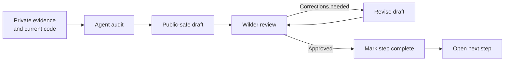
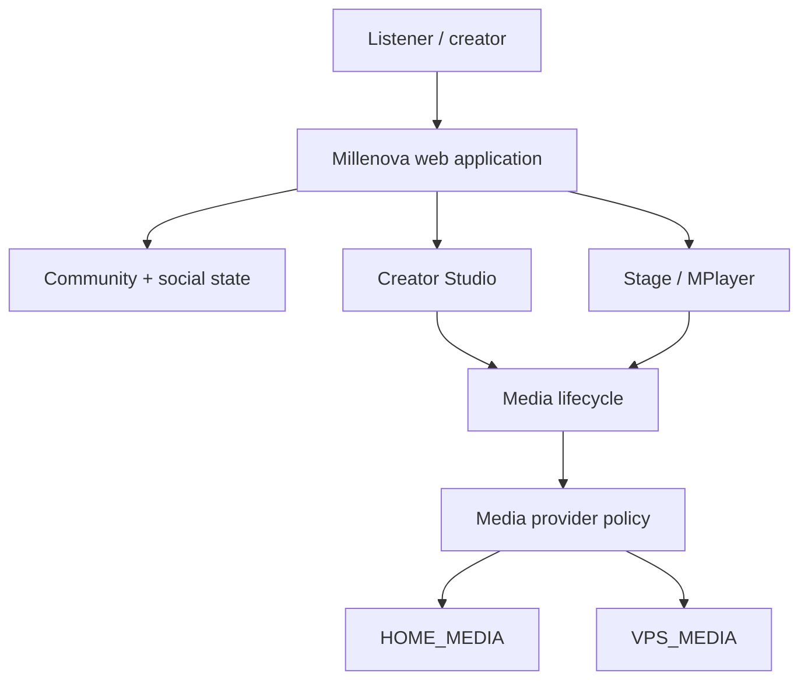
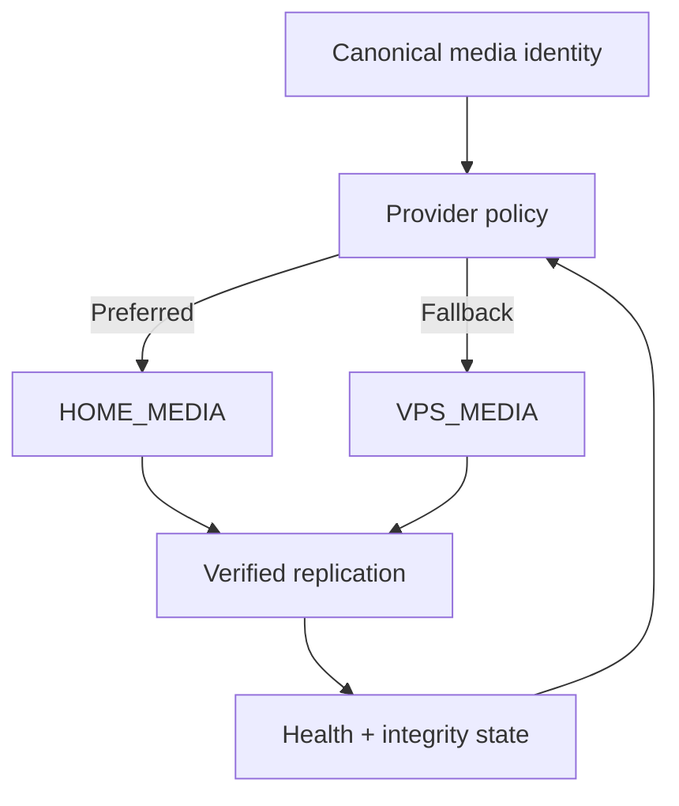
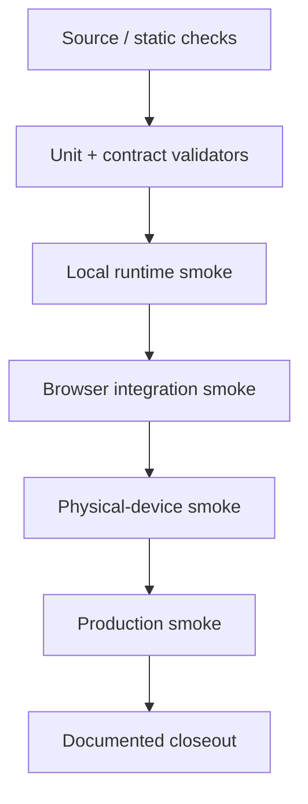

# Millenova Public Facade Implementation Plan

**Status:** 🟡 ACTIVE — PF-2 README under review  
**Private implementation authority:** `wilderruiz/millenova`  
**Public publication authority:** `wilderruiz/millenova-project`  
**Publication boundary:** [`WHAT_IS_PUBLISHED_HERE.md`](WHAT_IS_PUBLISHED_HERE.md)  
**Decision owner / reviewer:** Wilder Ruiz  
**Working method:** agent drafts → Wilder reviews → corrections → Wilder approves → step closes → next step begins

---

# Top menu — publication steps

**Legend:** ✅ COMPLETE · 🟡 ACTIVE · ⬜ QUEUED · ⏸ GATED · ❌ REJECTED / RETIRED

| Step | Status | Public artifact | Purpose | Approval gate |
|---|---:|---|---|---|
| **PF-0** | ✅ | `WHAT_IS_PUBLISHED_HERE.md` | Define the public/private boundary and agent rules | Boundary accepted before any deeper publication |
| **PF-1** | ✅ | `MILLENOVA_PUBLIC_FACADE_IMPLEMENTATION_PLAN.md` | Make the publication process itself visible, reviewable and agent-friendly | Wilder reviewed and approved the step order |
| **PF-2** | 🟡 | `README.md` | Turn the repository landing page into a concise technical/project overview | Wilder reviews/corrects the draft before PF-3 starts |
| **PF-3** | ⬜ | `docs/ENGINEERING_OVERVIEW.md` | Present the full engineering breadth at a glance | No unsafe operational detail; all claims source-backed |
| **PF-4** | ⬜ | `docs/PLATFORM_ARCHITECTURE.md` | Publish logical architecture, subsystem responsibilities, control/data planes and major state boundaries | Architecture may be explicit; exploitable configuration may not |
| **PF-5** | ⬜ | `docs/TECHNOLOGY.md` | Map technologies to responsibilities rather than listing a stack without context | Must distinguish active, legacy, planned and experimental technology |
| **PF-6** | ⬜ | `docs/media/NATIVE_MEDIA_ENGINEERING.md` | Explain first-party media identity, ingest, renditions, playback, authorization and recovery | Must not publish secrets or security-bypass details |
| **PF-7** | ⬜ | `docs/media/DISTRIBUTED_MEDIA_NODE.md` | Explain HOME_MEDIA, VPS_MEDIA, replication, failover, integrity and bandwidth/storage economics | Public architecture allowed; private network coordinates forbidden |
| **PF-8** | ⬜ | `docs/player/MPLAYER.md` | Document Stage/MPlayer, native playback, quality, queue ownership and state continuity | Must separate shipped behavior from future transport/Cast work |
| **PF-9** | ⬜ | `docs/feed/SIGNAL_WINDOW.md` | Explain the logical feed store, virtualization, geometry conservation, native-scroll ownership and readiness model | Include accepted and rejected approaches where educational |
| **PF-10** | ⬜ | `docs/feed/SEARCH_AND_DISCOVERY.md` | Explain deterministic search/discovery boundaries, freshness, Beats isolation and future taxonomy work | Avoid pretending queued ranking work is already implemented |
| **PF-11** | ⬜ | `docs/creator/STUDIO_AND_UPLOADS.md` | Explain creator Studio, publishing, resumable ingest and media lifecycle | User data and privileged admin details stay private |
| **PF-12** | ⬜ | `docs/social/PLAYLISTS_REACTIONS_AND_SIGNALS.md` | Explain social state, playlists, queue semantics, Signals and playback continuity | Must preserve distinctions between external Signals and owned media |
| **PF-13** | ⬜ | `docs/social/MODERATION_AND_GOVERNANCE.md` | Explain reporting, moderation, governance and abuse-resilience principles | No bypass-enabling thresholds or privileged moderation internals |
| **PF-14** | ⬜ | `docs/engineering/ENGINEERING_LOG.md` | Create the public engineering decision index and verification history | Each entry must link to real evidence/outcomes |
| **PF-15** | ⬜ | `docs/experiments/HOME_MEDIA_NODE.md` | Turn the current home-storage/server experiment into an educational engineering case study | Must clearly distinguish experiment, implementation and measured result |
| **PF-16** | ⬜ | `docs/TESTING_AND_VERIFICATION.md` | Show how build checks, validators, browser smoke, physical-device smoke and production smoke fit together | Tests claimed only when actually run |
| **PF-17** | ⬜ | `docs/PRODUCT_EVOLUTION.md` | Show Millenova's evolution from artist site into native-media creator/discovery platform | Historical states must not be rewritten as if always planned |
| **PF-18** | ⏸ | `assets/` + screenshot index | Add selected screenshots/figures/diagrams after document structure is stable | Every image manually checked for private/sensitive information |
| **PF-19** | ⏸ | Public milestone/release index | Add a concise chronological public progress record | Only after core engineering docs are reviewed |

> **Current next action:** review the **PF-2 `README.md` draft**. Correct it if needed. Do **not** start PF-3 until Wilder explicitly approves PF-2.

---

# 1. Purpose

The private Millenova repository contains the real implementation and a large amount of technical history. That is valuable engineering evidence, but publishing it automatically would mix safe architecture, sensitive configuration, internal operational details, unfinished work and historical experiments.

The public facade therefore follows a deliberate publication process.

The goal is not a sanitized marketing site. The goal is a **technically serious, educational and transparent engineering record** that can explain how Millenova works, why systems were designed the way they were, what failed, what changed, and how the platform is being evolved — without weakening production security or exposing sensitive data.

---

# 2. Governing publication workflow

Every planned document follows the same state machine:



There is no agent-only completion state.

A step is complete only when:

1. the artifact exists;
2. its claims match current private-repository evidence;
3. planned/experimental/shipped status is accurate;
4. disclosure review passes;
5. Wilder has reviewed it;
6. requested corrections are applied;
7. Wilder explicitly approves moving on;
8. the top-menu status is updated in the same publication cycle.

---

# 3. Agent execution contract

Before starting any PF step, the agent must:

1. read `WHAT_IS_PUBLISHED_HERE.md`;
2. read this implementation plan;
3. identify the single active PF step;
4. inspect the relevant private Millenova plans, implementation files, validators, tests and production-result notes;
5. inspect already-published public docs to avoid contradiction or duplication;
6. produce a source-backed draft;
7. run a disclosure audit against the publication boundary;
8. stop for Wilder's review rather than starting the next PF step automatically.

Agents must not batch-complete multiple queued PF steps unless Wilder explicitly changes the workflow.

This deliberately keeps publication understandable and reviewable even when several development projects are active simultaneously.

---

# 4. Status vocabulary for public documents

The public facade should preserve implementation truth using explicit vocabulary.

| Status | Meaning |
|---|---|
| **Production / shipped** | Implemented and production-validated to the stated level |
| **Implemented / validating** | Code exists but a required smoke/production gate remains |
| **Active** | Current engineering work is in progress |
| **Experimental** | A hypothesis/prototype is being tested and may be rejected |
| **Planned / queued** | Approved direction but not yet implemented |
| **Gated** | Cannot proceed until another dependency or verification gate passes |
| **Superseded** | Historical approach retained for engineering context but no longer target architecture |
| **Rejected** | Tested or considered and explicitly not being pursued |

Do not collapse these into vague phrases such as "supports" when the feature is only planned.

---

# 5. Public documentation design rules

The repository should be technically dense but easy to navigate.

Preferred presentation tools:

- concise overview paragraphs;
- Markdown tables;
- Mermaid flowcharts;
- Mermaid state diagrams;
- sequence diagrams when useful;
- compact mathematical models when they materially explain behavior;
- before/after architecture comparisons;
- decision tables;
- verification ladders;
- failure/recovery diagrams;
- timelines;
- screenshots with explanatory captions;
- links between related engineering documents.

Diagram rule:

> **Use diagrams to expose system thinking, not operational secrets.**

Mermaid nodes should use short labels and explicit line breaks so GitHub rendering does not crop text.

---

# 6. Architecture disclosure model

Unlike the Zomniverse public facade, Millenova does not need to hide the existence or logical composition of its architecture.

The public repository may show real architectural concepts such as:

- PHP/browser application surfaces;
- Node media services;
- logical provider routing;
- first-party media identity;
- native playback;
- upload/rendition lifecycle;
- creator Studio;
- Home feed logical store;
- render-window virtualization;
- Stage/MPlayer ownership;
- reactions/playlists;
- search/discovery boundaries;
- moderation/governance layers;
- HOME_MEDIA/VPS_MEDIA provider roles;
- replication state;
- fallback semantics;
- health/readiness state;
- future CDN/edge placement;
- testing and deployment gates.

The public repository must abstract or omit security-sensitive coordinates and secrets according to `WHAT_IS_PUBLISHED_HERE.md`.

---

# 7. ZGitPet as a publication accelerator

Millenova development occurs alongside multiple active repositories and projects. Context switching itself becomes an engineering cost.

ZGitPet is part of the working method used to reduce that cost.

Its role in this public-facade programme is to help with:

```text
project switching
      ↓
repository-state visibility
      ↓
review of local vs remote work
      ↓
controlled Get / Save / Send workflows
      ↓
public/private repository separation
      ↓
agent-assisted publication without automatic mirroring
```

ZGitPet is an accelerator, not the publication authority.

The authority chain remains:

```text
private Millenova evidence
        ↓
agent draft
        ↓
Wilder review / correction
        ↓
Wilder approval
        ↓
public repository
```

This matters because the same workstation may be handling Millenova, Zomniverse, ZGitPet, deployment tooling, career/project workspaces and other repositories at the same time. ZGitPet helps keep the individual repository boundaries visible while preserving deliberate human review.

A later engineering-log entry may document this workflow itself as an example of tooling used to coordinate multi-project AI-assisted development.

---

# 8. PF-2 — README

**Status:** 🟡 ACTIVE — draft published for Wilder review

The starter README has been rewritten into the public landing page.

Current draft includes:

- concise statement of what Millenova is today;
- concise explanation of its evolution;
- high-level engineering surface diagram;
- current active engineering focus;
- links to the accepted public boundary and implementation plan;
- explicit note that the implementation repository remains private;
- no exaggerated scale/user claims;
- no unsupported performance claims.

The README should remain brief enough to scan but strong enough that a technical reader immediately sees this is more than a basic music website.

**Review gate:** Wilder reads the rendered GitHub README, requests corrections if needed, then explicitly approves PF-2 before PF-3 opens.

---

# 9. PF-3 — Engineering overview

**Status:** ⬜ QUEUED

Create the broad technical map before deep-diving individual subsystems.

Expected sections:

- engineering-at-a-glance table;
- platform capability mindmap;
- major subsystem inventory;
- shipped vs active vs experimental matrix;
- cross-cutting concerns;
- reliability principles;
- performance/resource constraints;
- multi-device behavior;
- testing/verification overview;
- why the engineering is multidisciplinary.

This document should establish the vocabulary used by all later documents.

---

# 10. PF-4 — Platform architecture

**Status:** ⬜ QUEUED

This is intentionally more explicit than the Zomniverse architecture publication.

Expected public-safe logical architecture:



The final diagram must be grounded in the current implementation and refined during the PF-4 audit.

It may show logical service boundaries and technology choices, but not secret network coordinates.

---

# 11. PF-5 — Technology map

**Status:** ⬜ QUEUED

Map technologies by engineering responsibility.

Likely categories to audit:

- PHP/server-rendered application surfaces;
- JavaScript/ES modules;
- CSS and responsive UI architecture;
- Node.js media services;
- SQL/persistence;
- FFmpeg/FFprobe media processing;
- resumable uploads;
- browser media APIs;
- OAuth/identity providers at a safe level;
- testing/validator tooling;
- SEO/analytics tooling;
- Git/GitHub/ZGitPet development workflow.

Do not publish a dependency just because it appears in a lockfile; confirm active responsibility first.

---

# 12. PF-6 — Native media engineering

**Status:** ⬜ QUEUED

This should explain the move from external-provider-only playback toward first-party owned media.

Expected topics:

- canonical media identity;
- source/master relationship;
- 2160p / 1080p / short preview renditions;
- source analysis;
- benchmarking;
- rendition processing;
- playback authorization;
- HTTP range/seek behavior;
- attachment manifests;
- native autoplay constraints;
- fallback behavior;
- Stats for Nerds / truthful quality state;
- testing and production-smoke progression.

Security-sensitive token implementation stays private.

---

# 13. PF-7 — Distributed Media Node

**Status:** ⬜ QUEUED

This is one of the strongest current engineering stories and should be documented deeply.

Core concept:



Topics:

- why VPS-only storage/egress becomes limiting;
- 4K/1080p/preview storage economics;
- home-owned storage as preferred capacity;
- VPS as independent fallback;
- home machine not becoming a single point of failure;
- health checks;
- provider selection;
- control plane vs data plane;
- upload fallback;
- checksums and replica verification;
- recovery after outage;
- bandwidth accounting;
- future edge/CDN option;
- hardware/storage scaling questions;
- actual DMN phase status at publication time.

Do not describe it as "free bandwidth" without qualification: home egress still consumes residential upstream/network capacity even when it avoids VPS egress charges.

---

# 14. PF-8 — MPlayer

**Status:** ⬜ QUEUED

Explain the player as a stateful platform subsystem rather than a `<video>` element.

Topics to audit:

- one playback owner;
- Stage expansion/minimization;
- native/external provider adapters;
- queue occurrence identity;
- NEXT FROM / UP NEXT;
- Repeat/Shuffle semantics;
- quality state;
- player continuity across surfaces;
- mobile/desktop HUD differences;
- autoplay policy;
- failure recovery;
- future Cast/remote playback status.

---

# 15. PF-9 — Signal Window

**Status:** ⬜ QUEUED

Turn the Home feed development history into an educational systems article.

Key public concepts already worth exploring:

- deterministic cursor continuation;
- logical feed store independent of DOM;
- player decoupling from mounted cards;
- moving render window;
- dematerialization;
- bidirectional restoration;
- geometry conservation;
- browser-owned native scrolling;
- preparation corridors;
- cached placeholders vs server-unknown placeholders;
- readiness boundaries;
- scroll-governor experiments;
- superseded synthetic paging approaches;
- physical-device smoke testing.

Preserve rejected/superseded designs because they show the engineering discovery process.

---

# 16. PF-10 through PF-13 — discovery, creator and social systems

**Status:** ⬜ QUEUED

These steps document product-level systems only after the core media/player/feed architecture has established shared terminology.

They should focus on engineering responsibilities and state ownership, not merely feature lists.

Cross-references should prevent each document from re-explaining the same player/media architecture.

---

# 17. PF-14 — Engineering log

**Status:** ⬜ QUEUED

Create a concise index over dated public engineering notes.

Suggested schema:

| Date | System | Problem | Decision | Verification | Outcome | Detail |
|---|---|---|---|---|---|---|

The log should preserve failures and corrections rather than showing only successful final states.

Possible early entries after review:

- first-party media cutover;
- native autoplay recovery;
- mobile Stats-for-Nerds portal/stacking correction;
- Signal Window native-scroll pivot;
- DMN provider architecture;
- replication/recovery work;
- public-facade creation itself;
- use of ZGitPet to coordinate review-first multi-project publication.

---

# 18. PF-15 — Home media node case study

**Status:** ⬜ QUEUED

This should read like an engineering experiment report.

Use the structure:

```text
Problem
↓
Constraints
↓
Hypothesis
↓
Architecture
↓
Prototype
↓
Failure modes
↓
Verification
↓
Measured result
↓
Next decision
```

Do not pre-claim success for phases that have not been smoked in the real deployment path.

---

# 19. PF-16 — Testing and verification

**Status:** ⬜ QUEUED

Show that Millenova uses multiple validation layers.

Expected ladder:



Not every feature uses every level; the document must describe actual evidence, not an idealized process.

---

# 20. PF-17 — Product evolution

**Status:** ⬜ QUEUED

Document Millenova's architectural evolution rather than pretending the current platform sprang fully formed from an original master plan.

Likely eras:

1. artist-site foundation;
2. structured catalogue;
3. community backend;
4. publishing/discovery;
5. persistent player/social layer;
6. first-party native media;
7. distributed media infrastructure;
8. platform hardening/public-launch preparation.

The final chronology must be grounded in implementation plans and commit/result records.

---

# 21. Screenshot/public asset gate

**Status:** ⏸ GATED

Do not mass-upload screenshots early.

Before any image enters `assets/`:

- inspect browser chrome for personal information;
- inspect URLs and query strings;
- inspect consoles/logs;
- inspect IPs/hostnames;
- inspect account names/emails;
- inspect private creator/user data;
- inspect tokens/keys;
- inspect local filesystem paths;
- confirm copyright/publication rights for visible media/artwork.

Screenshots should illustrate an accepted engineering document, not become an uncontrolled dump.

---

# 22. Plan maintenance rule

This plan is itself a public engineering artifact.

Whenever a PF step changes state:

1. update the **Top menu** status;
2. update the relevant detailed section if the accepted scope changed;
3. record material corrections or rejected directions where educational;
4. keep **Current next action** accurate;
5. do not silently mark multiple future steps complete.

The public history should show how the documentation was built, reviewed and refined.

---

# 23. Success definition

The Millenova public facade succeeds when a technical reader can understand:

- what Millenova is;
- how it evolved;
- which major systems exist;
- how those systems interact logically;
- why key design decisions were made;
- what is shipped vs experimental vs planned;
- how media, player, feed, social and creator state are governed;
- how the distributed-media experiment works;
- how failures and rejected approaches informed later design;
- how verification is performed;
- how ZGitPet and agent-assisted development accelerate a multi-project workflow without removing human review;
- and where the security/publication boundary is drawn.

It should communicate engineering depth through evidence and clarity rather than promotional claims.

---

# 24. Immediate gate

**PF-0 and PF-1 are approved and complete. PF-2 is active.**

The full public `README.md` draft has been published from private-repository evidence and is now waiting for Wilder's review.

Next actions:

1. review the rendered `README.md` on GitHub;
2. request any corrections or additions;
3. re-check the publication boundary after corrections;
4. explicitly approve PF-2 when satisfied.

Only then mark **PF-2 ✅ COMPLETE**, set **PF-3 🟡 ACTIVE**, and begin `docs/ENGINEERING_OVERVIEW.md`.
