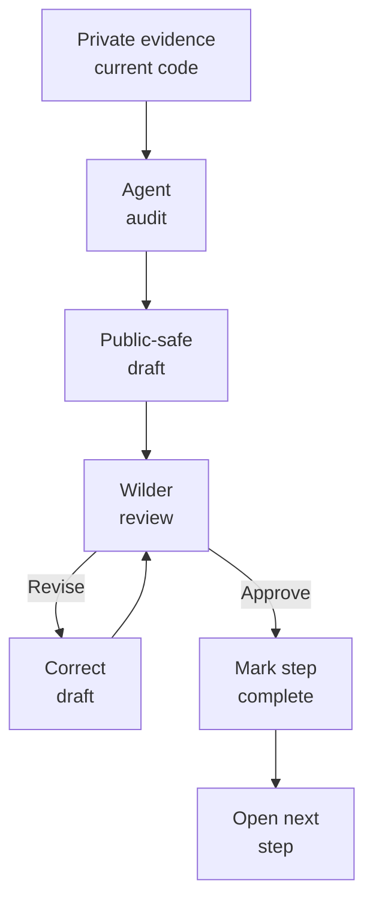
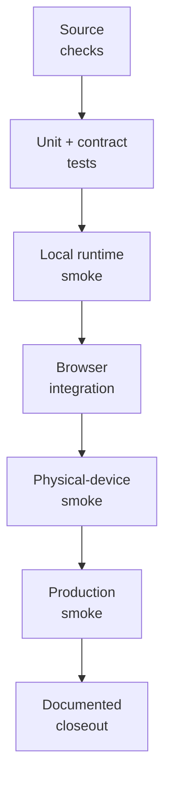

# Millenova Public Facade Implementation Plan

**Status:** 🟡 ACTIVE — PF-7 Distributed Media Node under review  
**Private implementation authority:** `wilderruiz/millenova`  
**Public publication authority:** `wilderruiz/millenova-project`  
**Publication boundary:** [`WHAT_IS_PUBLISHED_HERE.md`](WHAT_IS_PUBLISHED_HERE.md)  
**Shared agent guidance:** [`agents/README.md`](agents/README.md)  
**Mermaid rendering rules:** [`agents/MERMAID_GRAPH_GUIDE.md`](agents/MERMAID_GRAPH_GUIDE.md)  
**Decision owner / reviewer:** Wilder Ruiz  
**Working method:** agent drafts → Wilder reviews → corrections → Wilder approves → step closes → next step begins

---

# Top menu — publication steps

**Legend:** ✅ COMPLETE · 🟡 ACTIVE · ⬜ QUEUED · ⏸ GATED · ❌ REJECTED / RETIRED

| Step | Status | Public artifact | Purpose | Approval gate |
|---|---:|---|---|---|
| **PF-0** | ✅ | `WHAT_IS_PUBLISHED_HERE.md` | Define the public/private boundary and agent rules | Boundary accepted before deeper publication |
| **PF-1** | ✅ | `MILLENOVA_PUBLIC_FACADE_IMPLEMENTATION_PLAN.md` | Make the publication process visible, reviewable and agent-friendly | Wilder approved the step order |
| **PF-2** | ✅ | `README.md` | Technical landing page and public entry point | Wilder approved the rendered README and Mermaid corrections |
| **PF-3** | ✅ | `docs/ENGINEERING_OVERVIEW.md` | Present the engineering breadth at a glance | Wilder approved claims, status labels, diagrams and emphasis |
| **PF-4** | ✅ | `docs/PLATFORM_ARCHITECTURE.md` | Logical architecture, subsystem responsibilities, control/data planes and major state boundaries | Wilder approved architecture accuracy, state ownership, public safety and diagrams |
| **PF-5** | ✅ | `docs/TECHNOLOGY.md` | Map technologies to responsibilities | Wilder approved active/development/planned technology boundaries and technical accuracy |
| **PF-6** | ✅ | `docs/media/NATIVE_MEDIA_ENGINEERING.md` | First-party media identity, ingest, renditions, playback, authorization and recovery | Wilder approved technical accuracy, benchmark disclosure, status labels and security boundary |
| **PF-7** | 🟡 | `docs/media/DISTRIBUTED_MEDIA_NODE.md` | HOME_MEDIA, VPS_MEDIA, replication, failover, integrity and storage/egress economics | Wilder reviews current DMN status, provider/tier policy, diagrams and disclosure boundary |
| **PF-8** | ⬜ | `docs/player/MPLAYER.md` | Stage/MPlayer, native playback, queue ownership and continuity | Separate shipped behavior from future transport/Cast work |
| **PF-9** | ⬜ | `docs/feed/SIGNAL_WINDOW.md` | Logical feed store, virtualization, geometry conservation and native-scroll ownership | Preserve accepted and rejected approaches where educational |
| **PF-10** | ⬜ | `docs/feed/SEARCH_AND_DISCOVERY.md` | Search/discovery boundaries, freshness, Beats isolation and taxonomy work | Do not present queued ranking work as implemented |
| **PF-11** | ⬜ | `docs/creator/STUDIO_AND_UPLOADS.md` | Studio, publishing, resumable ingest and media lifecycle | Keep user data and privileged admin detail private |
| **PF-12** | ⬜ | `docs/social/PLAYLISTS_REACTIONS_AND_SIGNALS.md` | Social state, playlists, queue semantics, Signals and playback continuity | Preserve external-Signal vs owned-media distinction |
| **PF-13** | ⬜ | `docs/social/MODERATION_AND_GOVERNANCE.md` | Reporting, moderation, governance and abuse resilience | No bypass thresholds or privileged moderation internals |
| **PF-14** | ⬜ | `docs/engineering/ENGINEERING_LOG.md` | Public engineering decision index and verification history | Each entry grounded in real evidence/outcomes |
| **PF-15** | ⬜ | `docs/experiments/HOME_MEDIA_NODE.md` | Home storage/server experiment as an engineering case study | Distinguish experiment, implementation and measured result |
| **PF-16** | ⬜ | `docs/TESTING_AND_VERIFICATION.md` | Validation ladder from source checks to production smoke | Claim tests only when actually run |
| **PF-17** | ⬜ | `docs/PRODUCT_EVOLUTION.md` | Evolution from artist site to creator/discovery platform | Preserve historical truth instead of rewriting intent |
| **PF-18** | ⏸ | `assets/` + screenshot index | Reviewed screenshots and figures | Every image manually checked for sensitive information |
| **PF-19** | ⏸ | Public milestone/release index | Concise chronological public progress record | Opens after core engineering docs stabilize |

> **Current next action:** review **PF-7 `docs/media/DISTRIBUTED_MEDIA_NODE.md`**. Correct it if needed. Do **not** start PF-8 until Wilder explicitly approves PF-7.

---

# 1. Purpose

The private Millenova repository contains the production implementation and its detailed engineering history. The public facade exists to publish the architecture, decisions, experiments, failure analysis and verification history that are educational and safe to disclose without turning the private implementation repository into a public mirror.

The goal is not a sanitized marketing site. The goal is a **technically serious, educational and transparent engineering record** showing what Millenova is, how it works logically, what is shipped, what is still active, what failed, what was superseded and how the system is being evolved.

---

# 2. Governing publication workflow



There is no agent-only completion state.

A PF step closes only when the artifact exists, claims match current private-repository evidence, shipped/active/experimental/planned status is truthful, disclosure review passes, Wilder has reviewed the result, corrections are applied and Wilder explicitly approves moving on.

---

# 3. Agent execution contract

Before starting any PF step, an agent must:

1. read `WHAT_IS_PUBLISHED_HERE.md`;
2. read this implementation plan;
3. read `agents/README.md` and any relevant shared guide;
4. identify the single active PF step;
5. inspect relevant private plans, implementation files, validators, tests and production-result notes;
6. inspect already-published public docs to avoid contradiction or duplication;
7. draft only the active artifact;
8. run a disclosure audit;
9. apply `agents/MERMAID_GRAPH_GUIDE.md` to every Mermaid block;
10. stop for Wilder review instead of automatically advancing.

Agents must not batch-complete queued PF steps unless Wilder explicitly changes the workflow.

---

# 4. Status vocabulary

| Status | Meaning |
|---|---|
| **Production / shipped** | Implemented and production-validated to the stated level |
| **Implemented / validating** | Code exists but a required smoke/production gate remains |
| **Active** | Current engineering work is in progress |
| **Experimental** | A hypothesis/prototype is being tested and may be rejected |
| **Planned / queued** | Approved direction but not implemented |
| **Gated** | Blocked on another dependency or verification gate |
| **Superseded** | Historical approach retained for engineering context but no longer target architecture |
| **Rejected** | Tested/considered and explicitly not being pursued |

Public documents must not collapse these into vague statements such as "supports" when a feature is only planned.

---

# 5. Documentation design rules

Preferred presentation tools include concise overview paragraphs, Markdown tables, Mermaid flowcharts/state diagrams, sequence diagrams, compact mathematical models, before/after comparisons, decision tables, verification ladders, failure/recovery diagrams, timelines, reviewed screenshots and strong cross-links between related technical documents.

> **Diagram rule:** expose system thinking, not operational secrets.

Mermaid nodes must follow [`agents/MERMAID_GRAPH_GUIDE.md`](agents/MERMAID_GRAPH_GUIDE.md): short labels, explicit `<br/>` wrapping, TD layouts when width is risky, and visual inspection after GitHub rendering.

---

# 6. Architecture disclosure model

Millenova may publish real logical architecture including PHP/browser application surfaces, Node media services, logical provider routing, first-party media identity, native playback, upload/rendition lifecycle, Creator Studio, Home logical feed store, render-window virtualization, Stage/MPlayer state ownership, reactions/playlists, search/discovery boundaries, moderation/governance layers, HOME_MEDIA/VPS_MEDIA roles, replication/integrity state, fallback semantics, health/readiness state and testing/deployment gates.

The public repo must omit credentials, private network coordinates, private filesystem paths, signing material, sensitive user data and exploit-enabling security detail.

---

# 7. ZGitPet as a publication accelerator

Millenova development happens alongside several active repositories. ZGitPet reduces context-switching cost by keeping repository scope and state visible while preserving deliberate human review.

```text
project switching
      ↓
repository-state visibility
      ↓
review local vs remote work
      ↓
controlled Get / Save / Send
      ↓
public/private separation
      ↓
agent-assisted publication
```

ZGitPet accelerates the process but is not the publication authority. The authority chain remains private evidence → agent draft → Wilder review/correction → Wilder approval → public repository.

---

# 8. PF-2 — README

**Status:** ✅ COMPLETE

The README provides the concise public technical landing page. Mermaid clipping discovered during review was fixed and converted into reusable agent guidance under `agents/MERMAID_GRAPH_GUIDE.md`.

---

# 9. PF-3 — Engineering overview

**Status:** ✅ COMPLETE

Artifact: [`docs/ENGINEERING_OVERVIEW.md`](docs/ENGINEERING_OVERVIEW.md)

Wilder approved the engineering overview after review of its technical emphasis, status wording, public-safety boundary and rendered Mermaid diagrams.

---

# 10. PF-4 — Platform architecture

**Status:** ✅ COMPLETE

Artifact: [`docs/PLATFORM_ARCHITECTURE.md`](docs/PLATFORM_ARCHITECTURE.md)

Wilder approved the architecture document after review of logical system shape, state authorities, failure-domain separation, server/browser boundaries, community/creator state, Home feed ownership, Stage/MPlayer playback authority, media lifecycle, control/data planes, provider policy, persistence scopes and disclosure safety.

---

# 11. PF-5 — Technology map

**Status:** ✅ COMPLETE

Artifact: [`docs/TECHNOLOGY.md`](docs/TECHNOLOGY.md)

Wilder approved the technology map after review of its responsibility-first framing, production/development/active/planned boundaries, browser/media/runtime ownership and public-safety boundary.

---

# 12. PF-6 — Native media engineering

**Status:** ✅ COMPLETE

Artifact: [`docs/media/NATIVE_MEDIA_ENGINEERING.md`](docs/media/NATIVE_MEDIA_ENGINEERING.md)

Wilder approved the native-media deep dive after review of its first-party identity model, resumable 4K transport, source analysis, benchmark/rendition wording, source-retention rules, playback authorization, native browser ownership, Stage/MPlayer boundary, verification trail and public-safety treatment.

---

# 13. PF-7 — Distributed Media Node

**Status:** 🟡 ACTIVE — draft published for Wilder review

Artifact: [`docs/media/DISTRIBUTED_MEDIA_NODE.md`](docs/media/DISTRIBUTED_MEDIA_NODE.md)

The draft documents:

- why distributed media is a separate infrastructure problem from native playback;
- product/media semantics vs physical-provider semantics;
- current DMN checkpoint/phase status;
- control plane vs data plane;
- HOME_MEDIA and VPS_MEDIA responsibilities;
- the canonical Preview / 1080p / 4K placement policy;
- HOME-available vs HOME-unavailable upload paths;
- deferred premium/4K work as a durable non-failure state;
- backend-owned provider selection;
- health, reachability and verified-rendition readiness;
- checksum/metadata verified replication;
- fallback vs recovery semantics;
- the 1080p Hero ceiling vs higher-quality Stage policy;
- storage and egress economics;
- preview-bandwidth economics;
- upload-provider routing without a second ingest lifecycle;
- public-safe diagnostics without topology disclosure;
- private transport as an implementation detail beneath logical provider identity;
- future edge/CDN compatibility;
- failure-domain separation;
- current complete/active/queued/gated DMN boundaries.

**Current private-programme truth represented in the draft:** DMN-1/2/3 and DMN-6/7/8 are complete; Checkpoint B is open; DMN-4A is active; DMN-5 remains downstream of DMN-4 proof; catalogue-scale migration remains gated.

**Review gate:** Wilder checks provider/tier policy, current-status accuracy, storage/egress wording, fallback/recovery semantics, Mermaid rendering and whether any infrastructure detail should be made more or less explicit before PF-8 opens.

---

# 14. PF-8 — MPlayer

**Status:** ⬜ QUEUED

Explain one playback owner, Stage expansion/minimization, native/external provider adapters, queue occurrence identity, NEXT FROM / UP NEXT, Repeat/Shuffle semantics, quality state, navigation continuity, mobile/desktop HUD differences, autoplay policy, failure recovery and future Cast/remote-playback status.

---

# 15. PF-9 — Signal Window

**Status:** ⬜ QUEUED

Turn Home feed development into an educational systems article covering deterministic cursor continuation, logical feed state, player decoupling, moving render windows, dematerialization, bidirectional restoration, geometry conservation, browser-owned native scrolling, readiness boundaries, placeholder models, scroll-governor experiments, superseded synthetic paging and physical-device smoke. Rejected/superseded designs remain useful evidence and should not be erased.

---

# 16. PF-10 through PF-13 — discovery, creator and social systems

**Status:** ⬜ QUEUED

These documents cover search/discovery, Studio/uploads, playlists/reactions/Signals and moderation/governance after core architecture vocabulary is stable. They should focus on state ownership, boundaries and failure semantics rather than merely listing features.

---

# 17. PF-14 — Engineering log

**Status:** ⬜ QUEUED

Create a tabulated index over dated engineering notes using columns such as Date, System, Problem, Decision, Verification, Outcome and Detail. Preserve failures/corrections, including native autoplay recovery, Signal Window pivots, DMN provider architecture, replication/recovery and the public-facade workflow itself.

---

# 18. PF-15 — Home media node case study

**Status:** ⬜ QUEUED

Structure the experiment as Problem → Constraints → Hypothesis → Architecture → Prototype → Failure modes → Verification → Measured result → Next decision. Do not pre-claim success for unsmoked deployment phases.

---

# 19. PF-16 — Testing and verification

**Status:** ⬜ QUEUED



Not every feature uses every rung; the final document must describe actual evidence, not an idealized process.

---

# 20. PF-17 — Product evolution

**Status:** ⬜ QUEUED

Document the real progression from artist-site foundation → structured catalogue → community backend → publishing/discovery → persistent player/social layer → first-party native media → distributed media infrastructure → platform hardening/public-launch preparation.

---

# 21. Screenshot/public asset gate

**Status:** ⏸ GATED

Before an image enters `assets/`, inspect browser chrome, URLs/query strings, consoles/logs, IPs/hostnames, account names/emails, private creator/user data, tokens/keys, filesystem paths and visible media/artwork rights. Screenshots must illustrate an accepted technical document, not become an uncontrolled dump.

---

# 22. Plan maintenance rule

Whenever a PF step changes state: update the Top menu; update the relevant detailed section; keep Current next action accurate; preserve material corrections/rejected directions when educational; and do not silently mark multiple future steps complete.

---

# 23. Success definition

The public facade succeeds when a technical reader can understand what Millenova is, how it evolved, which major systems exist, how they interact logically, why key decisions were made, what is shipped vs experimental/planned, how media/player/feed/social/creator state are governed, how distributed media works, what failed and changed, how verification is performed, how ZGitPet and agents accelerate multi-project work, and where the security boundary sits.

Engineering depth should be communicated through evidence and clarity rather than promotional claims.

---

# 24. Immediate gate

**PF-0 through PF-6 are approved and complete. PF-7 is active.**

The Distributed Media Node deep dive has been drafted from the current private DMN implementation plan, canonical media-tier policy and Checkpoint-B opening record and published for Wilder review.

Next actions:

1. review rendered `docs/media/DISTRIBUTED_MEDIA_NODE.md`;
2. check HOME_MEDIA/VPS_MEDIA responsibilities and the hard 1080p VPS ceiling;
3. verify Preview / 1080p / 4K placement semantics;
4. verify that DMN-4A is described as active rather than already production-closed;
5. check deferred HOME/4K behavior and no-reupload semantics;
6. inspect storage/egress formulas and Hero-vs-Stage policy;
7. inspect every Mermaid diagram for clipping/readability;
8. request corrections if needed;
9. explicitly approve PF-7 when satisfied.

Only then mark **PF-7 ✅ COMPLETE**, set **PF-8 🟡 ACTIVE**, and begin `docs/player/MPLAYER.md`.
