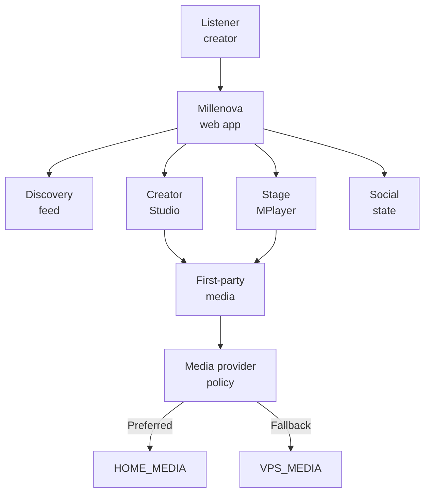
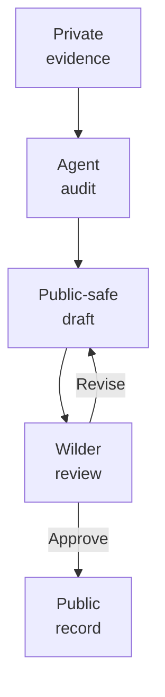

# Millenova

**Public engineering, architecture, experiments and development record for Millenova — a native-media music discovery and creator platform.**

Millenova began as an artist website and has been evolving into a broader music platform with creator publishing, discovery, persistent playback, social state, first-party media, moderation, search, playlists and distributed media infrastructure.

This repository is the **public engineering facade** for that work. The production implementation remains private; the architecture, engineering decisions, experiments, failure analysis and verification history are published here when they are safe and useful to make public.

> **Publication rule:** architecture is public; exploitable configuration is private.

## Engineering surface

This diagram is deliberately logical rather than operational. It shows the public engineering model without publishing production network coordinates, credentials, secrets or other exploit-enabling configuration.

## What is being engineered

| Area | Engineering focus |
|---|---|
| **Native media** | First-party media identity, source analysis, renditions, resumable ingest, playback authorization, HTTP range/seek behavior and recovery |
| **Distributed media** | Preferred home-owned media capacity with independent VPS fallback, health checks, verified replication, recovery and bandwidth/storage observability |
| **Stage / MPlayer** | Persistent playback ownership, queue semantics, native/external media adapters, quality state, mobile/desktop controls and transport continuity |
| **Home feed** | Deterministic continuation, logical feed state independent of the DOM, render-window virtualization, geometry conservation and browser-owned native scrolling |
| **Creator workflow** | Studio publishing, upload lifecycle, media attachment and controlled transition from creator input to playable media |
| **Discovery** | Search, freshness, Beats isolation, structured music metadata and evolving taxonomy/discovery work |
| **Social systems** | Reactions, playlists, persistent Now Playing state, queue continuity and shared community surfaces |
| **Governance** | Reporting, moderation, abuse resilience, public policy surfaces and controlled administration |
| **Verification** | Static checks, validators, automated tests, local/browser smoke, physical-device smoke and production smoke where required |

## Current engineering focus

The current infrastructure programme is the **Distributed Media Node (DMN)**: separating logical media identity from physical storage so Millenova can prefer a trusted home media node for storage/processing while retaining the VPS as an independent fallback. Foundation, provider modeling, upload routing, replication and accounting are established; real delivery switching remains gated by player-side transport dependencies.

A related media-policy direction is to avoid spending full 1080p bandwidth on small hover surfaces: card previews are intended to use dedicated short low-resolution preview renditions rather than the full playback rendition.

The broader platform continues to evolve in parallel across first-party playback, Stage/MPlayer transport, feed virtualization/readiness, creator workflows and public-launch hardening.

## Why the public repository exists

Millenova has accumulated substantial implementation plans, validators, smoke-test records, rejected approaches and subsystem-specific architecture. Publishing the private repository directly would mix useful engineering material with credentials, private configuration, user data, operational details and unfinished experiments.

This repository therefore follows a review-first process:

ZGitPet is used as an accelerator for multi-project repository work, project switching and controlled Get / Save / Send flows, but it does not replace human review or publication approval.

## Start here

- [Engineering overview](docs/ENGINEERING_OVERVIEW.md) — broad technical map, subsystem inventory, current status, constraints and verification model.
- [Platform architecture](docs/PLATFORM_ARCHITECTURE.md) — logical system boundaries, state authorities, media control/data planes, provider policy and cross-system request flows.
- [Technology map](docs/TECHNOLOGY.md) — maps PHP, JavaScript, SQL, Node, media tooling, browser APIs, identity, analytics, testing and operations to their actual engineering responsibilities.
- [What is published here](WHAT_IS_PUBLISHED_HERE.md) — the public/private boundary and agent rules.
- [Public facade implementation plan](MILLENOVA_PUBLIC_FACADE_IMPLEMENTATION_PLAN.md) — the step-by-step, review-first programme used to build this repository.
- [Shared agent workspace](agents/README.md) — reusable process guidance for agents working on the public facade.

The deeper engineering documents are being added one at a time and reviewed before the next publication step begins. Planned topics include the native-media pipeline, Distributed Media Node, MPlayer, Signal Window, creator workflows, social systems, moderation, testing and product evolution.

## Implementation boundary

The live implementation repository is private. This public repository may document real subsystem names, logical architecture, state machines, provider roles, failure modes, benchmarks, experiments and engineering decisions, but it does not publish secrets, private production addresses, credentials, sensitive user data, private filesystem paths, exploit-enabling security configuration or other restricted operational material.

Millenova is active research and development software; documentation distinguishes shipped, validating, active, experimental, planned, gated, superseded and rejected work rather than presenting all roadmap items as completed features.