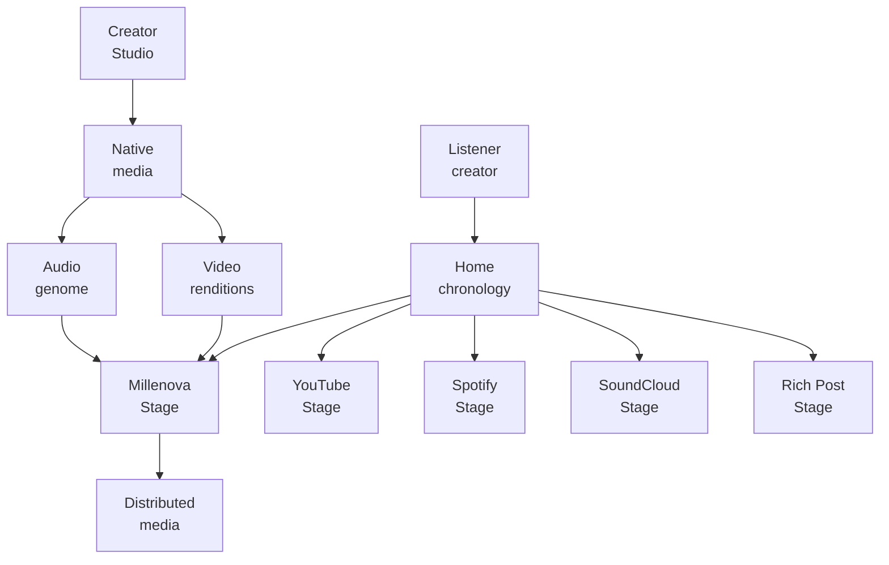
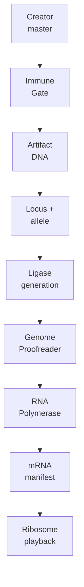
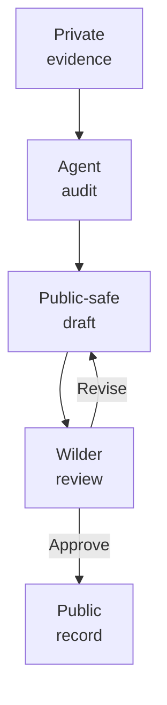

# Millenova

**Public engineering, architecture, experiments and development record for Millenova — a native-media, provider-aware music discovery and creator platform.**

Millenova began as an artist website and has evolved into a broader community platform with creator publishing, one public Home chronology, persistent playback, social state, first-party media, provider-specific playback surfaces, moderation, search, playlists and distributed media infrastructure.

This repository is the **public engineering facade** for that work. The production implementation remains private; architecture, decisions, experiments, failure analysis and verification history are published here when they are safe and useful to make public.

> **Publication rule:** architecture is public; exploitable configuration is private.

## The architecture changed

Millenova no longer treats every playable Home item as something that should collapse into one universal physical player. **Home is the universal discovery surface; playback is capability-scoped.** Native Millenova media belongs to Millenova Stage, YouTube/YouTube Music belongs to a YouTube Stage, Spotify belongs to a Spotify Stage, SoundCloud belongs to a SoundCloud Stage, and rich/text/image content belongs to a Rich Post Stage.

That shift also retires the earlier separate **Signals** product direction before implementation. External-provider references and future rich/text/image/link/article posts belong in the same approved Home chronology rather than a second feed or second social graph. Provider-scoped playback playlists remain strongly typed, while a universal Saved/Collection concept may later hold mixed artifact types without promising mixed-provider continuous playback.

The diagram is logical, not operational. Provider-specific Stage families and Rich Post Stage are the approved architecture direction; implementation is deliberately sequenced behind the current first-party native-media acceptance work rather than being claimed as fully shipped already.

## Current `index.php` / Home reality

The current production Home entry point is still a server-rendered PHP orchestration shell, not a client-only application and not a provider-specific Stage. It composes the Hero spotlight, community principles, a Millenova release rail, signed-in playlist and reaction-library access, track statistics, the **Freshly released** feed, Home search, deterministic continuation, hover-preview hooks and the persistent Stage host/deep-link contract. Its JavaScript layer then adds the logical Home store, pagination, render-window/virtualization work and browser-owned scrolling without making the mounted DOM the canonical feed authority.

That current index matters because the new architecture is being layered onto a working Home rather than replacing it wholesale. The approved Home orchestration plan keeps one public chronology and makes the index route artifacts into the correct capability family; it does **not** turn `index.php` into a second player, a second publication feed or a place where provider-specific playback rules are invented ad hoc.

## What is being engineered

| Area | Engineering focus |
|---|---|
| **Home / index orchestration** | One public chronology, deterministic cursor/snapshot state, search, virtualization, common post identity and capability-based Stage routing |
| **Stage families** | Native Millenova, YouTube, Spotify, SoundCloud and Rich Post Stage boundaries with provider-scoped playback semantics |
| **Native video** | First-party media identity, resumable ingest, source analysis, verified renditions, range playback, quality truth and recovery |
| **Native audio genome** | Canonical audio normalization, creator sprite generations, immutable Artifact DNA, stable loci/alleles, verified evolution and expression manifests |
| **Audio Visual Engine** | Browser-side Web Audio analysis with adaptive WebGL/Canvas/CSS visual rendering that never becomes required for audio playback |
| **Distributed media** | HOME_MEDIA preference, VPS_MEDIA fallback, verified replication, delivery routing, recovery and storage/egress observability |
| **Creator workflow** | Smart native publishing, MP4/MP3 upload, metadata suggestions, preview/publish gates and later provider-aware unified publishing |
| **Social systems** | Reactions, provider-scoped playback playlists, persistent Now Playing state and universal non-playback Saved/Collection direction |
| **Governance** | Reporting, moderation, abuse resilience and common visibility authority across Home/search/Stage |
| **Verification** | Static checks, validators, automated tests, browser/device smoke and production/runtime acceptance where required |

## Current engineering focus

The primary execution chain has moved beyond the earlier DMN-first snapshot. **Execution plan 1 is currently finishing FP-7G runtime acceptance and the FP-7G.15 Biological Cyber DNA architecture for native audio**, while DMN continues in parallel beneath the native media contract. FP-7A through FP-7F are complete; the active audio work treats accepted creator masters as immutable Artifact DNA, preserves stable semantic track loci across replacement, builds verified generations, and expresses playback through the conceptual `RNA Polymerase → mRNA manifest → Ribosome` path.

The distributed-media programme has also advanced: HOME/VPS authorization and real HOME byte-range playback plus the hard VPS 1080p fallback path are complete through DMN-4C, while the Hero-specific 1080p routing slice is active. These are infrastructure concerns beneath native media; they do not decide Home post identity or provider-family membership.

After the first-party native contract is accepted, the numbered architecture proceeds deliberately: **Stage Families + Smart Publishing → Rich Posts → Home Orchestration → Governance/Policy closeout.** This order prevents Home/index, provider playback, rich content and policy from being developed against unstable media semantics.

## Native audio: immutable genome, derived expression

For native MP3/WAV, Millenova now separates the accepted creator artifact from later encoded playback generations. An accepted master receives immutable **Artifact DNA**; a published semantic track owns a stable **locus**; replacement creates a new independently verified **allele** at that locus instead of rewriting the old artifact. Active members are assembled into a candidate generation, proofread against deterministic boundary evidence, and only then become expression-eligible.

Old healthy generations remain immutable and reproducible. Replaced or legacy alleles can be silenced from future expression without pretending they never existed, and later decommissioning is explicitly separated from replacement so historical, rollback and recovery references can be respected before physical purge.

## Why the public repository exists

Millenova has accumulated substantial implementation plans, validators, smoke-test records, rejected approaches and subsystem-specific architecture. Publishing the private repository directly would mix useful engineering material with credentials, private configuration, user data, operational details and unfinished experiments.

This repository therefore follows a review-first process:

ZGitPet is used as an accelerator for multi-project repository work, project switching and controlled Get / Save / Send flows, but it does not replace human review or publication approval.

## Start here

- [Engineering overview](docs/ENGINEERING_OVERVIEW.md) — broad technical map, subsystem inventory, current status, constraints and verification model.
- [Platform architecture](docs/PLATFORM_ARCHITECTURE.md) — logical state boundaries, current Home/index ownership, Stage-family direction and native/distributed-media architecture.
- [Technology map](docs/TECHNOLOGY.md) — maps PHP, JavaScript, SQL, Node, media tooling, browser APIs, identity, analytics, testing and operations to engineering responsibilities.
- [Native media engineering](docs/media/NATIVE_MEDIA_ENGINEERING.md) — first-party video plus the newer native-audio/sprite/genome architecture.
- [Distributed Media Node](docs/media/DISTRIBUTED_MEDIA_NODE.md) — HOME/VPS routing, tier placement, replication, fallback/recovery and storage/egress economics.
- [MPlayer](docs/player/MPLAYER.md) — current native Stage/MPlayer authority plus the corrected boundary with the upcoming provider-scoped Stage-family architecture.
- [What is published here](WHAT_IS_PUBLISHED_HERE.md) — the public/private boundary and agent rules.
- [Public facade implementation plan](MILLENOVA_PUBLIC_FACADE_IMPLEMENTATION_PLAN.md) — the review-first programme used to build and correct this repository.
- [Shared agent workspace](agents/README.md) — reusable process guidance for agents working on the public facade.

## Implementation boundary

The live implementation repository is private. This public repository may document real subsystem names, logical architecture, state machines, provider roles, failure modes, benchmarks, experiments and engineering decisions, but it does not publish secrets, private production addresses, credentials, sensitive user data, private filesystem paths, exploit-enabling security configuration or other restricted operational material.

Millenova is active research and development software. Public documentation distinguishes current runtime, approved next architecture, active validation, queued implementation, superseded directions and rejected approaches instead of flattening them into one misleading picture.