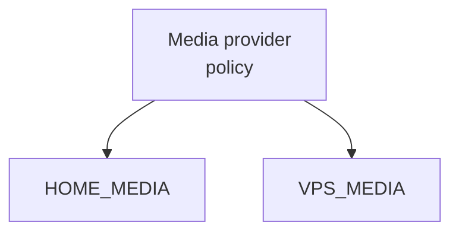
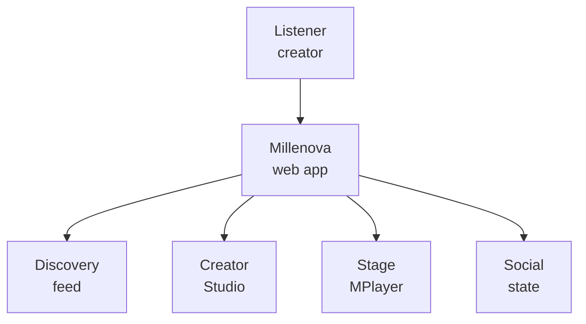
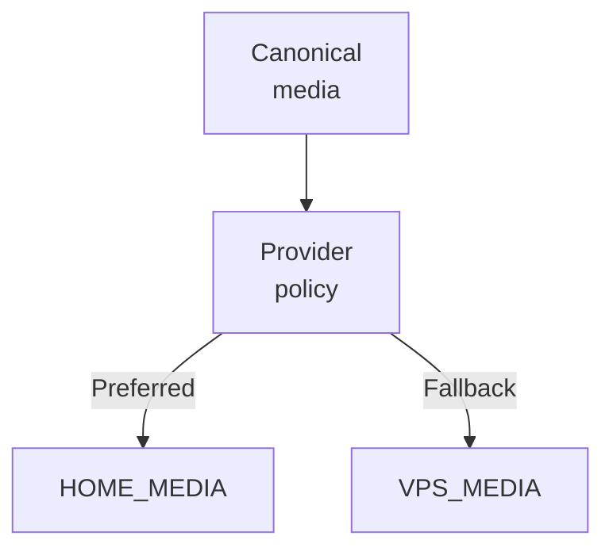
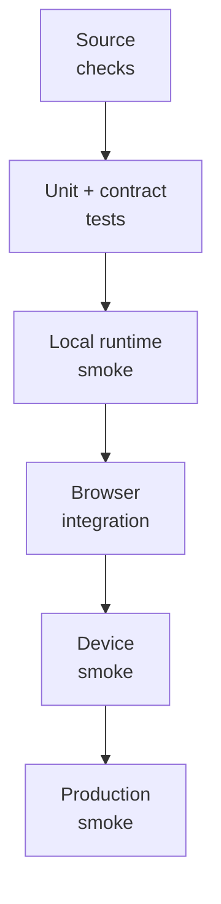
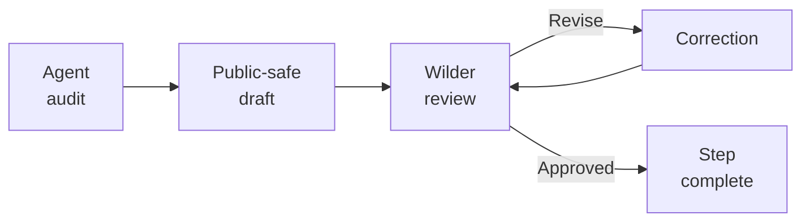

# Mermaid graph guide for GitHub

**Purpose:** shared agent guidance for producing readable Mermaid diagrams in the Millenova public repository without cropped labels, unreadable density, or accidental disclosure of sensitive operational detail.

This guide exists because GitHub's Mermaid renderer can visually crop or compress long node labels even when the Mermaid source is syntactically valid.

---

## 1. Core rule

> **Keep diagram nodes short; move explanation into prose.**

A Mermaid node is a visual label, not a paragraph.

Preferred:



Avoid:

```text
Media provider policy and fallback routing for all playback and upload requests
```

Long labels are harder to scan and are more likely to crop in GitHub's renderer.

---

## 2. Node-length rule

For normal flowcharts:

- target **1–3 words per line**;
- target **1–2 lines per node**;
- use `<br/>` for intentional wrapping;
- use prose below the diagram for detailed semantics;
- use edge labels only when the relationship itself matters.

Preferred examples:

```text
["Creator<br/>Studio"]
["First-party<br/>media"]
["Provider<br/>policy"]
["Verified<br/>replication"]
["Production<br/>smoke"]
```

---

## 3. Layout choice

Use `flowchart TD` by default for diagrams with several medium-length labels.

Use `flowchart LR` when:

- the sequence is short;
- the progression itself is the main idea;
- the total diagram remains comfortably within a normal GitHub content width.

If an LR diagram begins to stretch horizontally, switch it to TD rather than shrinking meaning into unreadable labels.

---

## 4. Split dense diagrams

Do not force several architectural ideas into one graph.

Prefer:

1. platform surface;
2. media lifecycle;
3. provider/failover model;
4. testing ladder;
5. state transition model;

as separate diagrams when necessary.

A smaller diagram with a clear message is better than one giant graph that technically contains everything but cannot be read.

---

## 5. Edge labels

Keep edge labels very short.

Preferred:

```text
Preferred
Fallback
Approved
Revise
Healthy
Unavailable
```

Avoid sentence-length edge labels.

If an edge condition requires explanation, document it immediately below the graph.

---

## 6. Public-architecture rule

Millenova architecture may be shown publicly, but Mermaid diagrams must still follow `WHAT_IS_PUBLISHED_HERE.md`.

Diagrams may show:

- logical components;
- subsystem ownership;
- control/data-plane relationships;
- state transitions;
- provider roles;
- failure and fallback semantics;
- media lifecycle;
- verification stages;
- technology responsibilities.

Do not place in diagrams:

- credentials or secrets;
- private IP addresses;
- private hostnames;
- exact firewall configuration;
- signing material;
- sensitive filesystem paths;
- production-only tokens;
- exploitable security bypass details;
- private user/creator information.

Architecture is public; exploitable configuration remains private.

---

## 7. Reusable patterns

### Platform surface



### Provider policy



### Verification ladder



### Review workflow



---

## 8. Agent pre-publication checklist

Before committing a Mermaid block, the agent should check:

- [ ] Is every node short enough to scan quickly?
- [ ] Are long concepts split with `<br/>`?
- [ ] Would TD be clearer than LR?
- [ ] Can any detail move into prose instead of the node?
- [ ] Are edge labels short?
- [ ] Is the graph focused on one main engineering idea?
- [ ] Does it avoid sensitive operational information?
- [ ] Does the diagram distinguish shipped, active, experimental or planned concepts where that matters?
- [ ] Does it match the surrounding text and current private-repository evidence?

After publication, visually inspect the rendered GitHub diagram. **Syntactically valid Mermaid is not sufficient validation.** If text is cropped, fix the diagram before closing the documentation step.

---

## 9. Maintenance rule

When a new Mermaid rendering problem is discovered and solved, update this guide so later agents inherit the correction instead of rediscovering it.

This file is shared process memory for the Millenova public-documentation workflow.
