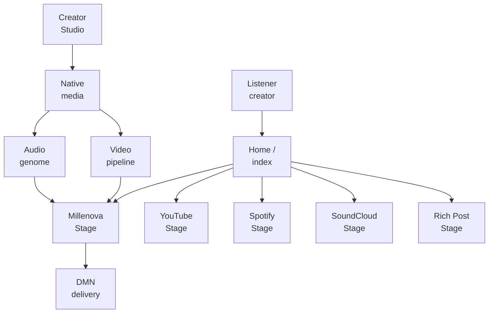
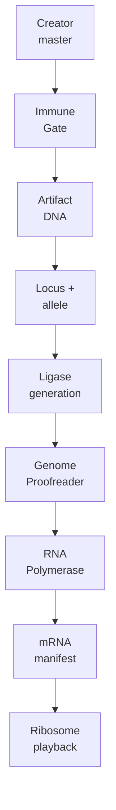
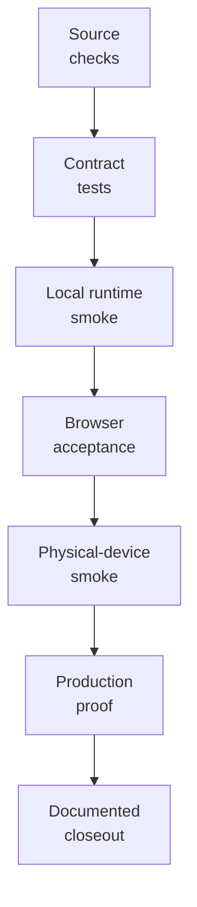

# Millenova Engineering Overview

**Status:** ✅ PF-3 approved · architecture correction applied 2026-10-13  
**Private implementation authority:** `wilderruiz/millenova`  
**Public publication authority:** `wilderruiz/millenova-project`  
**Publication rule:** architecture is public; exploitable configuration is private.

Millenova is evolving from an artist website into a hybrid Home-based music and creator platform. The current engineering spans a server-rendered PHP application, one public Home chronology, typed Stage routing, persistent native playback, first-party video and audio, an evolving audio-genome model, distributed native-media delivery, creator publishing, feed virtualization, social state, moderation and multi-layer verification.

The most important correction to the earlier overview is that **Home is now the universal discovery/publication surface, while playback environments are capability-scoped**. Native Millenova media, YouTube, Spotify, SoundCloud and future rich/text/image content can coexist in Home without being forced into one universal physical player or one mixed-provider playback queue.

---

## Engineering at a glance

| Area | Current engineering responsibility | State |
|---|---|---|
| **Application foundation** | Server-rendered PHP surfaces, shared bootstrap/resources, structured catalogue data and deployment boundaries | **Shipped foundation** |
| **Home / index** | Hero, public chronology, search, continuation, social state, Stage host, feed virtualization and future capability-based routing | **Shipped foundation / active orchestration programme** |
| **Stage families** | Native Millenova, YouTube, Spotify, SoundCloud and Rich Post capability domains | **Approved next architecture / execution plan 2** |
| **Creator Studio** | Smart native publishing, upload lifecycle, metadata suggestions, preview/publish gates and later unified Link/Upload routing | **Native foundation complete / active handoff** |
| **Native video** | Canonical media identity, resumable ingest, source analysis, optimized renditions, range playback and quality truth | **Production-proven core** |
| **Native audio** | Canonical normalization, per-creator sharded generations, logical segment playback and Audio Visual Engine | **Foundation complete / runtime acceptance active** |
| **Audio genome** | Immutable Artifact DNA, stable loci/alleles, verified evolution, expression manifests and decommission lifecycle | **Active architecture / implementation advancing** |
| **MPlayer** | Persistent native Stage playback, queue semantics, Up Next/Next From, Repeat/Shuffle, native quality and workspace continuity | **Production core** |
| **Distributed Media Node** | Native-media provider routing, HOME_MEDIA, VPS fallback, replication, delivery and accounting | **DMN-4A/B/C complete · DMN-4D active** |
| **Home Signal Window** | Logical feed ownership, render-window virtualization, geometry conservation and browser-owned native scrolling | **Active programme** |
| **Rich posts** | Text/image/link/article post types plus Rich Post Stage | **Approved / queued execution plan 3** |
| **Social systems** | Reactions, provider-scoped playback playlists, Now Playing and future universal Saved/Collection | **Active / evolving** |
| **Governance** | Reporting, moderation and policy synchronization across Home/search/Stage | **Active** |
| **Verification** | Static checks, validators, browser/device smoke, production/runtime acceptance and documented closeout | **Cross-cutting** |

---

## Platform capability map



The Stage-family and Rich Post branches are the approved direction, not a claim that every branch is already production-complete. The current runtime still contains compatibility paths while the numbered execution chain closes the new boundaries in order.

---

## Current Home / `index.php`

**The root index is a real orchestration surface, not a placeholder landing page.** It is server-rendered through PHP and composes the Hero spotlight, community principles, a Millenova release rail, signed-in playlists/reaction libraries, track statistics, the Freshly released feed, Home search, deterministic continuation and the persistent Stage host/deep-link state. JavaScript then layers on the logical feed store, pagination, moving render windows, virtualization and viewport-readiness behavior while the server retains authoritative public data and eligibility.

The architectural shift does not throw this structure away. The approved Home plan keeps the existing index/feed foundation and makes it the universal public chronology that can later contain typed native, provider and rich-post artifacts. What changes is routing: Home should identify the post capability and open the correct Stage family instead of inventing one universal playback surface inside the index.

---

## One Home, typed artifact experiences

**Home can be universal without pretending every artifact behaves the same.** Native media, YouTube, Spotify, SoundCloud and rich/text/image posts can share chronology, canonical post identity, reactions, comments, reporting, creator identity, search and sharing. Their open/play behavior remains typed: native media enters Millenova Stage, each external provider enters its own provider-scoped Stage, and rich content enters Rich Post Stage.

This is also why the earlier separate Signals direction is now retired before implementation. External-provider references and rich content belong in Home as typed posts rather than a second feed or social graph.

---

## Stage families and playlist scope

**The long-term playback model is no longer one universal provider-neutral player.** Millenova-native MPlayer stays authoritative for native audio/video; YouTube, Spotify and SoundCloud move into provider-scoped Stage families using official supported players and capability boundaries. Shared Millenova shell behavior can remain consistent, but provider-required controls, branding and supported playback semantics stay provider-owned.

Playback playlists follow the same split. A playback playlist has a provider scope — `native`, `youtube`, `spotify` or `soundcloud` — and server-side insertion succeeds only when the item scope matches. A future universal Saved/Collection object may contain mixed Home artifacts because it is not promising continuous cross-provider playback.

---

## Native video

**Native video remains a first-party media lifecycle rather than a file attached directly to a post.** Large creator masters move through resumable ingest, FFprobe-class source analysis, rendition generation, verification, same-post attachment and bounded playback authorization. Browser-native media elements own real time, seeking, buffering and `ended`, while MPlayer owns the product-level native queue and transport state.

The 4K pilot established the production workflow with a real large master and verified 2160p/1080p outputs. Source/master material remains protected by explicit retention/cleanup gates rather than being deleted just because one rendition became playable.

---

## Native audio and the Millenova Audio Visual Engine

**Native audio is no longer modeled as “just another MP3 file.”** Incoming audio is normalized into a canonical browser-safe profile and assembled into creator-owned sharded generations with authoritative logical segment geometry. MPlayer consumes each segment as an ordinary logical track even though physical bytes may live inside a larger generation object.

The visual experience is rendered in the listener's browser using the Web Audio API / `AnalyserNode` and an adaptive Millenova-owned visual engine. Capable devices can use WebGL/Three.js-style rendering, constrained or reduced-motion devices can use a lighter path, and a Canvas/CSS/static fallback remains possible. **Audio playback must never depend on the visualizer succeeding.**

---

## Biological Cyber DNA architecture

**The newest native-audio architecture makes ingest evidence immutable and later playback generations derived.** An accepted creator master receives immutable Artifact DNA containing canonical source/sample/boundary evidence. A published semantic track owns a stable locus; replacement uploads create new alleles at that locus rather than mutating the old artifact or changing semantic track order.



Evolution, expression and decommissioning are separate. A healthy replacement is verified before the previous allele is silenced; historical generations remain reproducible; silenced material can later pass through Genome Custodian quarantine/purge eligibility without rewriting old Artifact DNA. Failed replacement leaves the current healthy allele untouched.

---

## Home Signal Window

**The Home feed is a logical system independent of mounted DOM count.** Deterministic cursor continuation, a logical feed store, MPlayer decoupling, moving render windows, dematerialization, exact cached geometry and browser-owned scroll remain the accepted direction. Synthetic paging experiments are retained as historical evidence rather than future movement authority.

The newer Home orchestration model increases the importance of this boundary because the feed will eventually contain more than one artifact type. Rich cards must fit the same bounded render-window model without mounting full articles, and Home search must query the complete public catalogue rather than whatever happens to be materialized.

---

## Distributed Media Node

**DMN is native-media infrastructure, not a universal provider router.** HOME_MEDIA and VPS_MEDIA exist beneath Millenova-owned media identity; they do not choose whether a Home post is YouTube, Spotify or SoundCloud and they do not proxy official provider playback. The backend selects verified native origins while the browser consumes a logical media contract.

The programme has advanced beyond the earlier public status: DMN-4A production authorization, DMN-4B real HOME byte-range playback and DMN-4C verified VPS fallback with the hard 1080p ceiling are complete. DMN-4D, which applies the 1080p-only policy to Hero routing on HOME/VPS, is the active delivery slice.

---

## Current five-plan execution chain

```text
1  FIRST-PARTY MEDIA + NATIVE PUBLISHING
   FP-7G runtime acceptance + FP-7G.15 audio-genome work

2  STAGE FAMILIES + SMART PUBLISHING
   provider autodetection, provider-scoped Stages/playlists, unified Link/Upload surface

3  RICH POSTS
   text/image/link/article model + Rich Post Stage

4  HOME ORCHESTRATION
   integrate typed artifacts into the existing Home/index foundation

5  GOVERNANCE / POLICY CLOSEOUT
   synchronize moderation and policy with the finished capability model
```

The sequence is deliberate. Later-plan code may already exist structurally, but it is not treated as runtime-accepted architecture until upstream contracts are stable.

---

## Shipped, active and queued matrix

| Capability | Status | Public interpretation |
|---|---|---|
| Server-rendered application + catalogue | **Production / shipped** | Original foundation retained |
| Current Home/index chronology + search/continuation | **Production / shipped foundation** | Existing public orchestration shell |
| Logical Home store + virtualization | **Shipped foundation / active validation** | DOM no longer defines feed identity |
| Native video asset/rendition path | **Production-proven** | First-party video works through native lifecycle |
| Native Stage/MPlayer core | **Production complete** | Native queue/transport/workspace authority |
| Native MP3 sprite/generation foundation | **Complete foundation** | Logical audio path exists |
| Audio Visual Engine | **Complete foundation / runtime acceptance active** | Browser-side visual layer over native audio |
| Artifact DNA + audio genome evolution contract | **Active architecture** | Replacement/evolution and expression rules are being implemented/validated |
| DMN provider foundation + upload/replication/accounting | **Complete** | Native provider abstraction established |
| DMN-4A/B/C | **Complete** | Real native delivery/fallback proof advanced |
| DMN-4D | **Active** | Hero 1080p-only native routing |
| Provider-scoped Stage families | **Approved next architecture** | Execution plan 2 |
| Rich Posts / Rich Post Stage | **Approved / queued** | Execution plan 3 |
| Hybrid Home orchestration | **Approved / queued behind upstream plans** | Execution plan 4 |
| Separate Signals product | **Retired / superseded** | Rich/provider posts stay in Home |
| Automated moderation service | **Planned later** | Not production today |

---

## Cross-cutting engineering concerns

| Concern | Why it matters |
|---|---|
| **Canonical identity** | Post, artifact, locus, allele, rendition, generation, queue occurrence and physical provider must remain distinct |
| **Capability scope** | Home can mix artifacts while playback environments and playlists stay strongly typed |
| **State ownership** | Feed, playback, genome evidence, social state and moderation each need a clear authority |
| **Failure isolation** | Media, provider delivery, player, feed and governance should not all change in one debugging surface |
| **Reversibility** | Healthy source/allele state is preserved until replacement, replication or cleanup is verified |
| **Truthful UI** | Progress, quality, provider class, readiness and deferred work must reflect actual system state |
| **Browser ownership** | Native media and native scrolling use browser primitives for physical truth |
| **Security boundary** | Public architecture is explicit while private topology, credentials and bypass details remain private |
| **Verification depth** | Runtime/browser/device evidence matters when build success cannot prove media or interaction behavior |

---

## Performance and resource constraints

Large 4K masters, continuous Hero playback, sharded native-audio generations, browser visual effects, Home virtualization and residential/native-media egress all create real physical constraints. That is why Millenova separates preview from full playback, makes the Audio Visual Engine adaptive, keeps browser audio independent of rendering success, bounds DOM work, measures provider storage/egress and retains VPS fallback rather than treating privately owned storage as infinite free infrastructure.

---

## Verification overview



The active FP-7G work is a good example of why this ladder matters: repository structure and validators can prove a contract exists, but real MP3/MP4 upload, Stage playback, logical boundaries, queue/repeat/seek and desktop/mobile behavior still require runtime acceptance.

---

## Documentation path

This overview stays broad. The deeper public documents currently include [Platform architecture](PLATFORM_ARCHITECTURE.md), [Technology map](TECHNOLOGY.md), [Native media engineering](media/NATIVE_MEDIA_ENGINEERING.md), [Distributed Media Node](media/DISTRIBUTED_MEDIA_NODE.md) and [MPlayer](player/MPLAYER.md). Future feed, creator, social, governance and verification documents should use the corrected architecture above rather than reviving the retired universal-provider-player or separate-Signals assumptions.