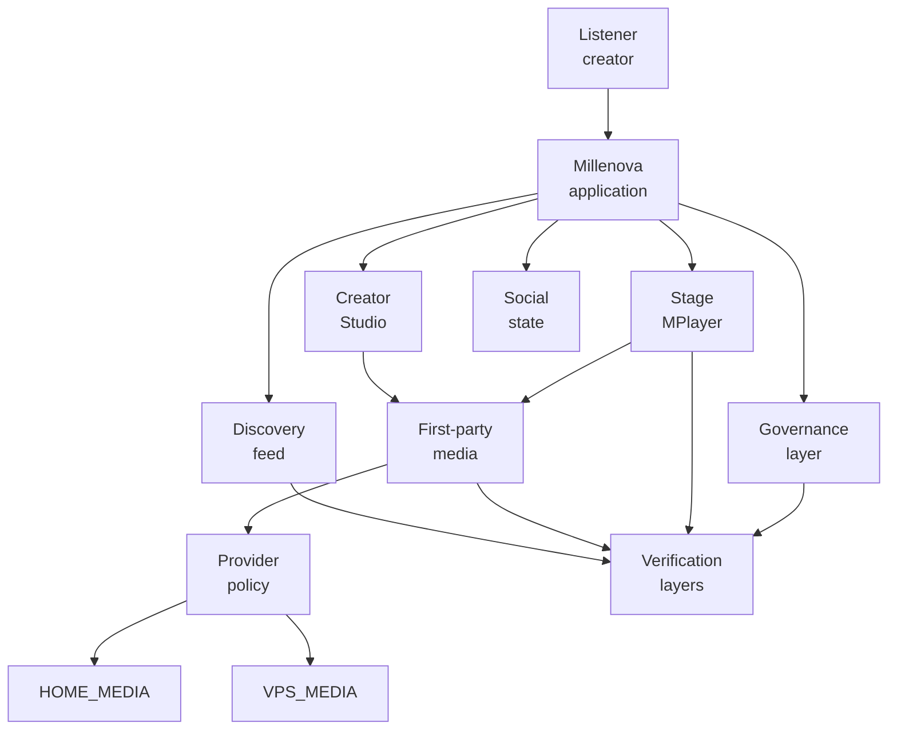
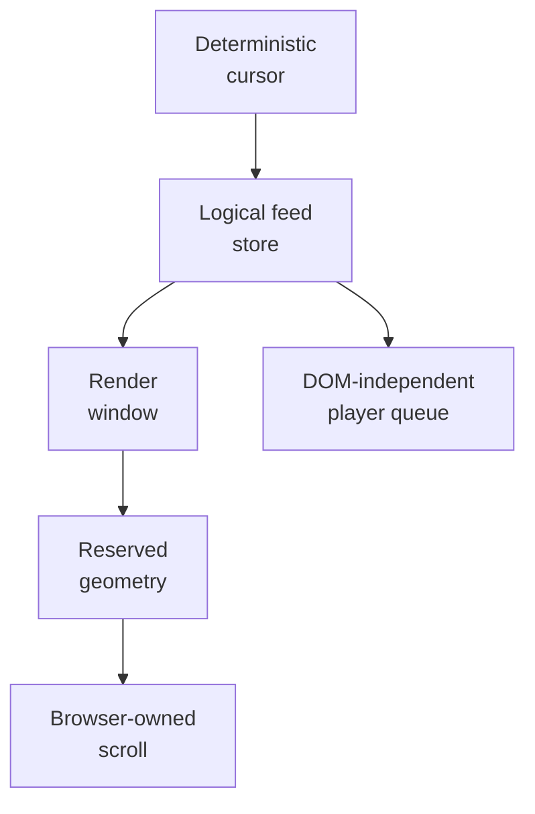
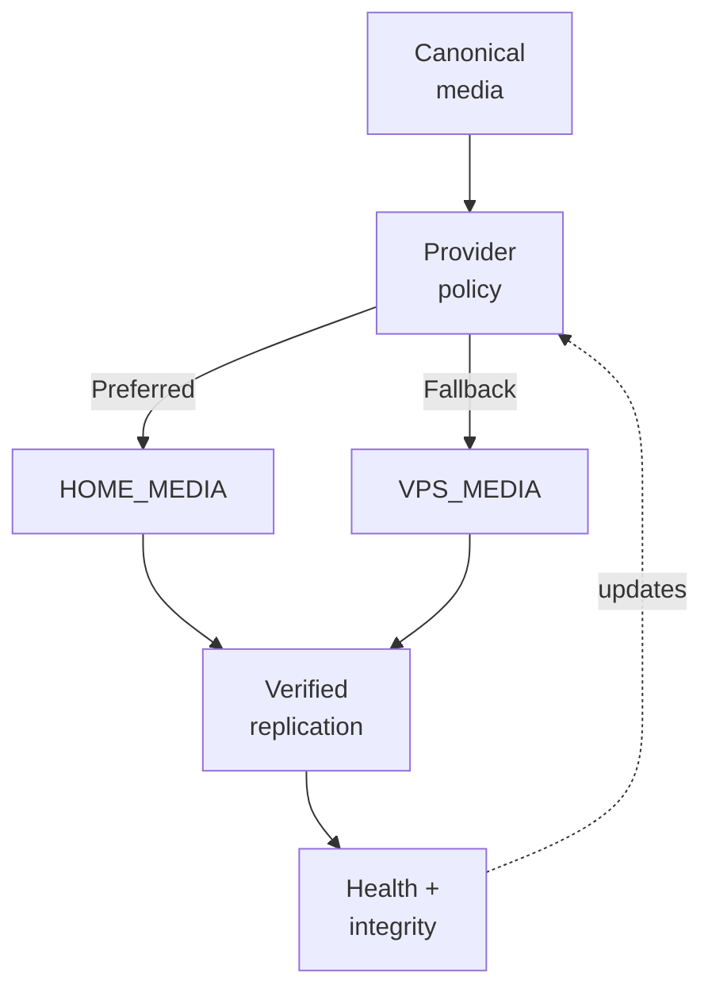
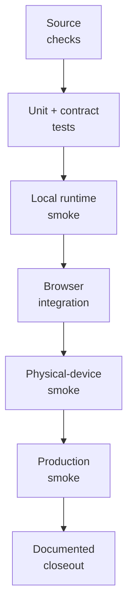

# Millenova Engineering Overview

**Status:** PF-3 draft — under Wilder review  
**Private implementation authority:** `wilderruiz/millenova`  
**Public publication authority:** `wilderruiz/millenova-project`  
**Publication rule:** architecture is public; exploitable configuration is private.

Millenova is evolving from an artist website into a native-media music discovery and creator platform. The engineering now spans server-rendered application architecture, persistent community state, creator publishing, native media ingest and playback, distributed storage/origin work, feed virtualization, search/discovery, moderation, responsive interaction design and multi-layer verification.

This document is the broad technical map. Later documents go deeper into architecture, media, the player, the Home feed, creator workflows and distributed media infrastructure.

---

## Engineering at a glance

| Area | Current engineering responsibility | State |
|---|---|---|
| **Application foundation** | Server-rendered PHP surfaces, shared bootstrap/resources, reusable partials, structured catalogue data and deployment boundaries | **Shipped foundation** |
| **Community backend** | Accounts, identity, creator/community persistence, public posting and social state | **Shipped foundation / active expansion** |
| **Discovery** | Public feed, deterministic continuation, search boundaries, freshness and structured discovery work | **Shipped + active** |
| **Home Signal Window** | Logical feed ownership, DOM-independent state, render-window virtualization, geometry conservation and browser-owned native scrolling | **Active programme** |
| **Creator Studio** | Publishing, editing, upload lifecycle, owned-media attachment and creator-facing media state | **Shipped foundation / active media work** |
| **First-party media** | Canonical media identity, resumable ingest, source analysis, optimized renditions, native playback and authorization | **Shipped core / active UX** |
| **Stage / MPlayer** | Persistent playback ownership, queue semantics, transport state, native/external media adapters and responsive controls | **Production core / continuing polish** |
| **Distributed Media Node** | Logical provider routing, HOME_MEDIA preference, VPS_MEDIA fallback, replication, integrity and accounting | **Active infrastructure programme** |
| **Social systems** | Reactions, playlists, Now Playing persistence, queue continuity and shared community surfaces | **Active** |
| **Governance** | Reporting, moderation foundation and abuse-control hardening | **Active** |
| **Verification** | Static checks, validators, automated tests, browser/device smoke and production smoke | **Cross-cutting** |
| **Public engineering process** | Review-first publication using the private repo as evidence and ZGitPet as a multi-project accelerator | **Active** |

---

## Platform capability map

The map is intentionally logical. It shows subsystem responsibility without publishing production coordinates, secrets or exploit-enabling configuration.

---

## Major subsystem inventory

### Application and catalogue foundation

Millenova retains a server-rendered PHP core with shared bootstrap/resource management, reusable partials and structured catalogue data. The original artist-site surfaces remain part of the system, but they now sit beside creator/community, discovery and player infrastructure.

The architectural direction favors progressive enhancement rather than requiring a large client-side framework for every surface. JavaScript is used where persistent or highly interactive state is needed, while catalogue and public page rendering can remain server-authoritative.

### Community and creator state

The community layer adds persistent accounts, identity, creator ownership, public posting, reactions, playlists, reporting and per-user playback/workspace state. This creates a different engineering problem from the original catalogue: state now has to survive navigation, rematerialization, device differences and shared playback surfaces.

### Home discovery and Signal Window

The Home feed is not treated as "just infinite scroll." Its current architecture separates logical feed identity from mounted DOM cards.

The development history includes deterministic cursor continuation, a logical Home-feed store, MPlayer decoupling, moving render windows, dematerialization, bidirectional restoration, geometry conservation and a deliberate return to browser-owned native scrolling after synthetic paging experiments proved too restrictive.

A key current principle is that virtualization may prepare or replace content, but it must not become a hidden queue of future physical scroll commands.

### First-party media

Millenova has moved beyond provider-only playback into owned-media infrastructure.

The media programme includes:

- canonical `media_asset` identity separated from posts;
- resumable large-master ingest;
- source analysis with FFprobe-classification semantics;
- benchmarked rendition generation;
- optimized 2160p and 1080p playback renditions;
- preservation of source/master material while cleanup remains explicitly gated;
- native browser media playback as the source of truth for time, duration, seeking, buffering and `ended`;
- authorization and lifecycle boundaries between the public application and media services;
- a short low-resolution preview-rendition direction for hover/card surfaces rather than spending full 1080p bandwidth there.

The first production 4K pilot established the workflow with a real large master, source analysis, visual comparison and full rendition verification. Public documentation intentionally describes the engineering result without exposing private authorization internals.

### Stage / MPlayer

Stage/MPlayer is a platform subsystem, not a thin `<video>` wrapper.

Its responsibilities include persistent playback ownership, queue semantics, native/external provider adaptation, transport controls, quality state, playlist behavior, navigation continuity and mobile/desktop control differences.

The Home feed can therefore virtualize or unmount cards without making mounted DOM the authority for what is currently playing or what comes next.

### Distributed Media Node

The current distributed-media programme separates **logical media identity** from **physical storage/origin location**.

The goal is not to make a home machine the only server. The home node is being developed as preferred storage/processing capacity while the VPS remains an independent fallback. The player should consume the same logical playback contract regardless of which provider serves the bytes.

The programme has completed its foundation, provider-model, upload-routing, replication and accounting phases; real delivery switching remains gated by player-side transport dependencies. This preserves failure isolation: media-provider work is not allowed to destabilize queue/repeat/mobile playback work at the same time.

### Governance and moderation

Reporting/moderation foundations are present and abuse-control hardening continues. The public architecture can describe governance boundaries and state ownership, but privileged moderator internals, bypass thresholds and security-sensitive controls remain private.

---

## Shipped, active and experimental matrix

| Capability | Status | Public interpretation |
|---|---|---|
| Structured catalogue + artist-site foundation | **Production / shipped** | Original product base retained and evolved |
| Community persistence + shared identity | **Production / shipped foundation** | Core account/community state exists |
| Public publishing | **Production / shipped** | Discovery now operates on community content |
| Deterministic Home continuation | **Production / shipped** | Complete eligible snapshot can be reached without the old fixed ceiling |
| Logical Home feed store | **Production / shipped** | Feed identity/state is no longer defined by mounted DOM count |
| Home virtualization | **Active / validating** | Native-scroll readiness and stress behavior continue to evolve |
| First-party media asset model | **Production / shipped foundation** | Owned media has canonical identity and lifecycle |
| Resumable 4K ingest | **Production-proven** | Large interrupted uploads can resume through the established contract |
| 2160p + 1080p rendition generation | **Production-proven** | Full verified pilot generation exists |
| Rendition-processing creator UX | **Active** | Partial-readiness/progress experience is still being refined |
| Native media adapter | **Complete** | Browser media element owns playback truth |
| Stage/MPlayer native cutover | **Production complete** | Accepted Stage/player behavior now runs on the native playback heart |
| Distributed Media Node foundation | **Complete through DMN-8** | Provider abstraction, upload routing, replication and accounting are established |
| DMN real delivery switching/recovery | **Gated** | Waits for player transport gates rather than coupling two active failure domains |
| Signals external-link model | **Planned / queued** | External references remain distinct from Millenova-owned media |
| Automated moderation service | **Planned / queued** | Not represented as shipped |
| Platform-wide public launch gate | **Queued** | Final whole-platform hardening remains future work |

---

## Cross-cutting engineering concerns

Millenova repeatedly has to solve the same classes of systems problem across different product surfaces:

| Concern | Why it matters |
|---|---|
| **Canonical identity** | Posts, media assets, queue occurrences and provider locations must not be conflated |
| **State ownership** | Playback, feed order, reactions and playlists need a clear authority independent of transient DOM |
| **Failure isolation** | Media-provider routing, player transport and feed virtualization should not all change at once |
| **Fallback semantics** | A preferred provider may disappear without turning the whole platform into a single point of failure |
| **Reversibility** | Migration, attachment and cleanup operations are gated so working source material is not destroyed prematurely |
| **Truthful UI** | Progress, quality, readiness and playback state should reflect the real backend/browser state rather than optimistic labels |
| **Geometry stability** | Virtualized feed swaps must preserve document geometry to avoid viewport jumps |
| **Browser ownership** | Native scrolling and native media behavior are treated as platform primitives rather than unnecessarily reimplemented |
| **Security boundaries** | Public application state, media authorization, moderation and operational infrastructure remain intentionally separated |
| **Verification depth** | Build success alone is not sufficient for media, player, scrolling or device-specific interaction changes |

---

## Reliability principles

### 1. Logical identity before physical location

Media identity survives provider changes. HOME_MEDIA and VPS_MEDIA are delivery/storage roles beneath the same logical asset.

### 2. One authoritative owner per state

Examples include browser-native playback time for native media, the logical Home store for feed identity and provider policy for physical-media selection.

### 3. Preserve working paths while introducing new ones

First-party media, distributed storage and feed virtualization have been introduced behind explicit checkpoints instead of replacing several mature systems simultaneously.

### 4. Make fallback independent

The preferred home node is useful only if the VPS remains capable of preserving availability when home infrastructure is unavailable.

### 5. Treat failed designs as engineering evidence

Synthetic Home paging and earlier scroll-control experiments remain documented as superseded discovery history rather than silently disappearing from the engineering record.

---

## Performance and resource constraints

Several architectural decisions are driven by physical constraints rather than abstract preference:

- large 4K masters are expensive to store, process and repeatedly transfer;
- a continuously rotating Hero can create sustained delivery demand;
- hover/card previews should not consume full playback-rendition bandwidth;
- browser DOM size must stay bounded even when logical feed history grows;
- mobile scrolling can outrun content preparation if geometry/readiness is not managed carefully;
- home-owned storage can reduce dependence on VPS storage/egress economics, but it still consumes real residential upload capacity and must not be treated as cost-free networking;
- provider fallback and replica verification are necessary because home hardware cannot be assumed to be continuously available.

These constraints are part of the architecture, not afterthoughts.

---

## Multi-device behavior

Millenova treats mobile and desktop as different interaction environments rather than assuming responsive CSS alone solves the problem.

Examples include:

- mobile Home being intentionally feed-focused;
- Stage/player HUD behavior differing across touch and pointer environments;
- physical-device smoke being required for scroll physics that desktop emulation cannot reliably prove;
- mobile Signal Window readiness work using browser-owned touch/inertia behavior;
- mobile/desktop navigation and social surfaces having different ownership boundaries where needed.

---

## Testing and verification overview

Not every change requires every rung, but claims in this public repository should reflect the verification that was actually performed. Media, autoplay, scroll physics and mobile interaction are examples where local build success is insufficient evidence.

---

## Why the engineering is multidisciplinary

Millenova crosses several engineering domains at once:

- **web application engineering** — PHP rendering, browser state, progressive enhancement, shared resources;
- **media systems** — large uploads, source inspection, transcoding/renditions, range playback, native media events;
- **distributed systems** — provider abstraction, readiness, health, replication, fallback and integrity;
- **frontend systems** — persistent player state, virtualization, touch behavior, responsive ownership boundaries;
- **data/state design** — canonical identity, creator ownership, reactions, playlists, queue occurrences and attachment state;
- **security engineering** — authorization boundaries, replay resistance, rights gates, governance and restricted operational details;
- **observability and operations** — health/readiness, storage/egress accounting, deployment smoke and production verification;
- **product engineering** — balancing creator workflow, listener continuity, discovery, moderation and bandwidth economics;
- **tool-assisted development** — ZGitPet coordinates review-first work across private/public repositories and multiple concurrent projects without turning publication into automatic mirroring.

The complexity comes less from any single technology than from the number of stateful systems that must remain coherent while the platform continues to evolve.

---

## Documentation path

This overview intentionally stays broad. The next public documents are planned to separate the detail into focused technical records:

1. `PLATFORM_ARCHITECTURE.md`
2. `TECHNOLOGY.md`
3. `media/NATIVE_MEDIA_ENGINEERING.md`
4. `media/DISTRIBUTED_MEDIA_NODE.md`
5. `player/MPLAYER.md`
6. `feed/SIGNAL_WINDOW.md`
7. creator, social, governance and verification deep-dives

Each is drafted from private implementation evidence, reviewed against [`WHAT_IS_PUBLISHED_HERE.md`](../WHAT_IS_PUBLISHED_HERE.md), visually checked using the shared [`MERMAID_GRAPH_GUIDE.md`](../agents/MERMAID_GRAPH_GUIDE.md), and stopped for Wilder review before the next publication step opens.
