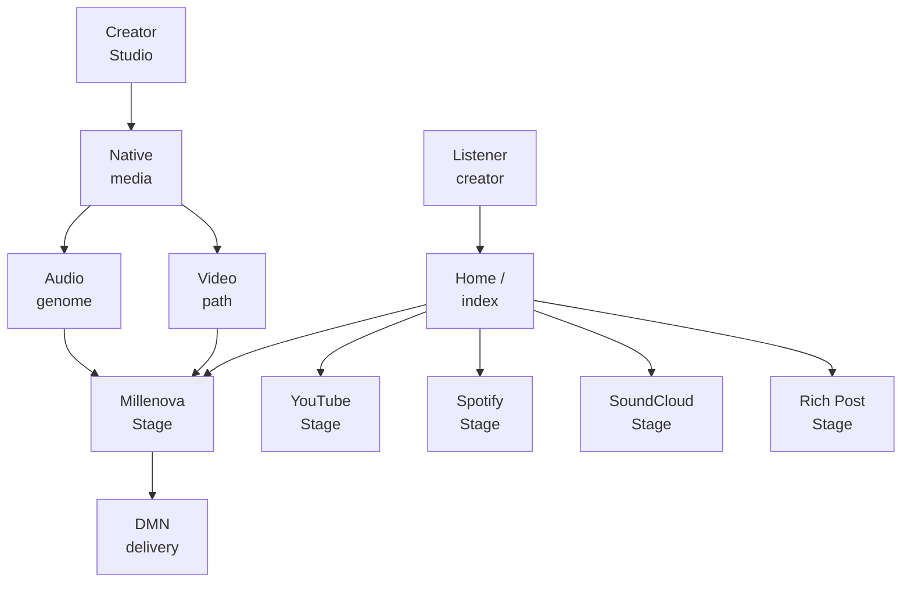
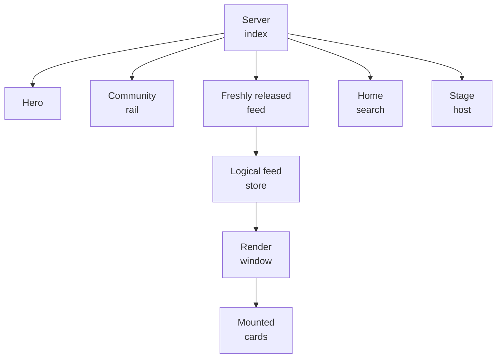
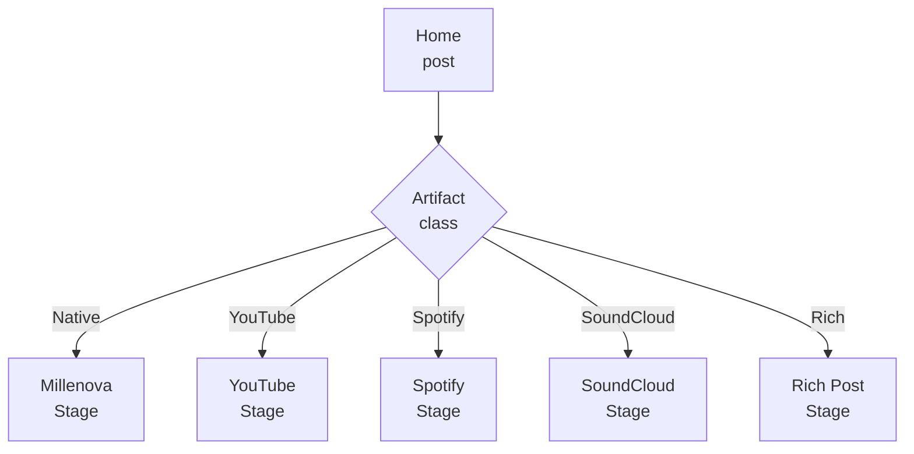
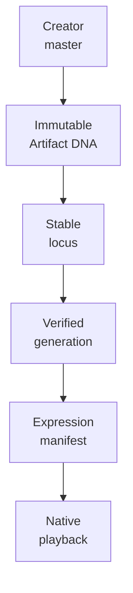
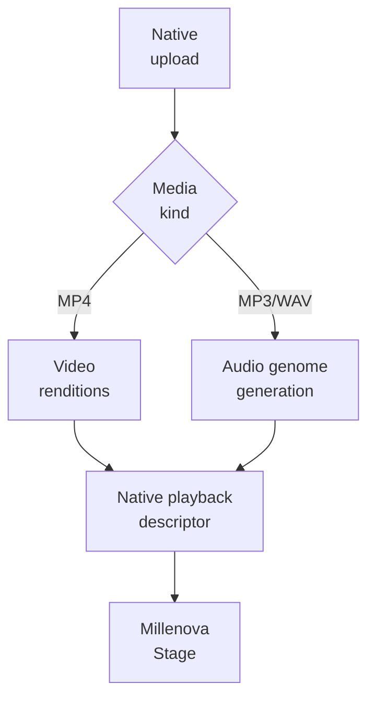
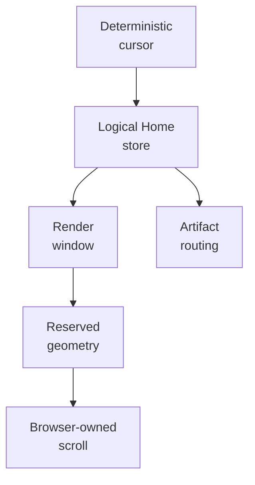

# Millenova Platform Architecture

**Status:** ✅ PF-4 approved · architecture correction applied 2026-10-13  
**Private implementation authority:** `wilderruiz/millenova`  
**Public publication authority:** `wilderruiz/millenova-project`  
**Publication rule:** architecture is public; exploitable configuration is private.

Millenova is best understood as a set of state authorities connected by one public chronology rather than as one universal player wrapped around a feed. The architecture now separates **Home publication/discovery**, **artifact-specific Stage families**, **native media evolution**, **provider-specific playback**, **social state**, and **physical media delivery** more sharply than the earlier public snapshot did.

This correction matters because the live `index.php` still represents the current Home shell, while several newer private plans define the approved next architecture that will be layered onto it. The public record therefore distinguishes **what runs now** from **what has been accepted as the next system boundary**.

---

## 1. Current system shape and approved direction



The current runtime has one established Home/index shell and one mature Stage/MPlayer lineage. The approved architecture evolves that shell into a **hybrid Home with typed artifact routing**, while keeping native Millenova playback separate from official YouTube, Spotify and SoundCloud playback environments. Rich/text/image content joins Home as typed post content and opens into a Rich Post Stage rather than a second external-link product.

The durable rule is:

> **Home may mix artifact types. Playback environments may not.**

---

## 2. `index.php` is Home orchestration, not playback authority

The current root `index.php` is a server-rendered orchestration surface. It loads the shared application bootstrap, SEO metadata, Hero resources, the current Home feed page, viewer reactions/playlists, release data and Stage deep-link state before rendering the public shell. It also registers the Home search, feed store, pagination, render-window, virtualization, viewport-pager, Stage deep-link and statistics resources that progressively enhance the server output.

The important architectural consequence is that **Home owns discovery and routing, not media mechanics**. The current index composes the Hero spotlight, principles ticker, left Millenova rail, signed-in user library access, track statistics, the Freshly released feed, search, continuation state and the persistent Stage host. As the new Stage-family architecture lands, this same Home route should decide which artifact family a post belongs to and hand the post to the correct Stage; it should not absorb YouTube, Spotify, SoundCloud, native-audio or rich-article playback/rendering internals into one giant index controller.



The existing index is therefore a **working orchestration foundation**, not obsolete code waiting to be replaced by a client-side app. The architecture is evolving around that foundation.

---

## 3. Home becomes one hybrid public chronology

The approved Home model places all approved public artifacts into one chronology: native Millenova media, YouTube/YouTube Music posts, Spotify posts, SoundCloud posts, and later approved text/image/rich-article posts. Common post identity, chronology, reactions, comments, moderation, creator identity, search and sharing can be shared even when the artifact experience is different.

This replaces the earlier separate Signals direction. Signals is now historical/superseded product thinking rather than a queued second feed. External-provider references and rich content belong in Home, which remains the publication source of truth from which typed Stage experiences are projected.

```text
HOME
├─ native Millenova media
├─ YouTube / YouTube Music
├─ Spotify
├─ SoundCloud
├─ text
├─ image
└─ rich article
```

The architecture deliberately avoids creating one social identity in Home and a second identity inside a Stage. The same canonical post remains the object seen in Home, search, creator surfaces, moderation and the appropriate Stage.

---

## 4. Stage families replace the universal-provider-player target

The earlier public architecture described Stage/MPlayer as one product-level player with several provider adapters. That accurately described the existing compatibility architecture, but it is **not the final approved provider model anymore**. The new Stage Families plan keeps the Millenova-native player as the owner of native media while external providers move into provider-scoped Stage families using their official supported players and capability boundaries.

### Millenova Stage

Millenova Stage owns first-party native audio/video, native playlists, native queue/Up Next/Next From semantics, native fullscreen, minimized/background behavior, native Media Session integration and DMN-backed delivery. This is where the existing Stage/MPlayer work remains authoritative.

### YouTube, Spotify and SoundCloud Stages

Each external provider receives a provider-scoped Stage using the official supported player surface for that provider. Shared Millenova shell elements such as post metadata, reactions, reporting, analytics framing and history can remain consistent, but provider-required controls, branding, visibility/autoplay behavior and exposed playback capabilities remain provider-owned.

### Rich Post Stage

Rich/text/image content is not forced through a media player. The Rich Post Stage is an editorial destination where the selected article/post becomes the hero artifact and other approved rich posts can continue beneath it.



The current runtime should therefore be read as a mature foundation being separated into stronger capability domains, not as proof that every future provider must remain behind one physical player.

---

## 5. Playlist governance follows provider scope

Once playback environments are separated, continuous-playback playlists must be strongly typed too. A native Millenova playlist is not a generic bag of URLs, and a YouTube playlist inside Millenova is a Millenova object containing YouTube references rather than a mutation of the listener's YouTube account.

The target invariant is simple:

```text
playlist.provider_scope === item.provider_scope
→ playback-list insertion allowed
```

Provider scopes are `native`, `youtube`, `spotify` and `soundcloud`. Cross-provider insertion is rejected server-side even if a stale or manipulated client attempts it. A future universal Saved/Collection object can hold mixed Home artifacts because it is a library/bookmark concept rather than a continuous-playback promise.

This correction removes an important ambiguity from the earlier architecture: **shared Home chronology does not imply mixed-provider queue semantics**.

---

## 6. Canonical identity now includes native audio genome identity

Millenova already separated post identity, media-asset identity, rendition identity, provider location and queue occurrence. Native audio now adds another important distinction: **artifact evidence, semantic track locus, active allele, playback generation and expression manifest are different identities too**.

An accepted MP3/WAV creator master receives immutable Artifact DNA at trusted ingest. A published semantic track owns a stable locus, and later replacement creates a new allele at that same locus rather than mutating the old artifact. Active alleles are assembled into a candidate generation, proofread against deterministic boundary evidence and only then become eligible for playback expression.



This gives Millenova a durable replacement model: the public post/locus can remain stable while the active creator master changes, historical generations remain reproducible, and failed replacement never destroys the last healthy active allele.

---

## 7. Native audio evolution and expression are separate processes

The biological architecture is not decorative naming around a playlist. It separates **evolution**, **expression** and **decommissioning** so later encoded playback generations cannot rewrite the evidence of what a creator originally submitted.

```text
EVOLUTION
creator master
→ Immune Gate
→ Sequencer
→ Artifact DNA
→ Recombinase
→ Ligase
→ Genome Proofreader
→ verified active genome

EXPRESSION
verified active genome
→ RNA Polymerase
→ mRNA manifest
→ Ribosome
→ playback

DECOMMISSIONING
silenced allele
→ Genome Custodian
→ quarantine
→ purge eligibility
→ Nuclease
```

The **Ribosome** is the runtime expression layer: logical/native Stage playback consumes a derived manifest and obeys track boundaries. It does not mutate Artifact DNA. The **Genome Proofreader** verifies that encoded generations still express the intended boundaries after lossy encoding, and failed candidates fail closed rather than rewriting the DNA reference until the output passes.

---

## 8. Native video and native audio share post/media authority but not processing shape

Native video continues through large-master resumable ingest, source analysis, rendition generation, verification, same-post attachment and range-capable playback. Native audio now uses canonical normalization, creator-owned sharded sprite generations, logical segment manifests, immutable Artifact DNA and browser-side visual expression.

The two paths meet at the product boundary rather than being artificially forced through one processing pipeline:



The first-party programme currently prioritizes finishing that stable MP4/MP3 native contract before Stage Families, Rich Posts and Home orchestration are allowed to depend on it.

---

## 9. Audio Visual Engine is presentation, never playback authority

Native audio Stage includes a Millenova-owned reactive visual experience driven by browser audio analysis. The conceptual path is `HTMLAudioElement → Web Audio API / AnalyserNode → normalized signal frame → adaptive visual preset → WebGL/Canvas/CSS rendering`.

Audio playback remains valid even if the visualizer fails, reduced motion is requested, the GPU is constrained or WebGL is unavailable. This is a strict boundary: the visual engine may visualize sound, but it must never become the authority for logical time, audio continuity or track identity.

---

## 10. Home Signal Window remains a rendering/state subsystem

The Home feed still separates logical order from mounted DOM. Deterministic cursor continuation, the logical feed store, MPlayer decoupling, moving render windows, dematerialization, geometry conservation and browser-owned scrolling remain valuable foundations even as the content model broadens beyond playable media.



Future rich cards therefore need to respect the same feed invariants without forcing full article bodies into the virtualization window. Search likewise must operate against the complete public catalogue, not merely the currently mounted cards.

---

## 11. Distributed Media Node stays beneath native media

The DMN programme still separates logical media identity from physical storage/origin placement, but its status has advanced beyond the earlier public snapshot. DMN-1/2/3 and DMN-6/7/8 are complete, Checkpoint B is open, DMN-4A/4B/4C are complete and DMN-4D — Hero-specific 1080p routing — is active.

The persistent VPS catalogue ceiling remains 1080p, while durable creator masters and 2160p/4K belong to HOME_MEDIA. The backend, not the browser, owns provider selection; range-capable HOME delivery and verified VPS fallback are infrastructure decisions beneath the native Stage contract.

This separation remains crucial under the new Stage-family model because DMN is a **Millenova-native delivery system**, not a routing layer for official YouTube, Spotify or SoundCloud playback.

---

## 12. State authority matrix

| State | Architectural authority |
|---|---|
| Public post / Home chronology identity | Community/application persistence |
| Current Home feed snapshot/order | Server continuation + logical Home store |
| Artifact family / Stage routing | Server-authoritative post capability descriptor |
| Native video timing/seek/ended | Browser media element |
| Native audio logical segment time | Native logical audio adapter / browser audio element |
| Native queue / Up Next / Next From | Millenova Stage/MPlayer runtime |
| Provider playback mechanics | Provider-scoped Stage / official provider API |
| Playback playlist membership | Provider-scoped playlist authority |
| Artifact DNA | Immutable ingest evidence |
| Locus / active allele | Native audio genome persistence |
| Generation validity | Ligase + Genome Proofreader result |
| Playback expression descriptor | RNA Polymerase-derived transient manifest |
| Physical native-media provider | DMN backend policy |
| Creator ownership | Server-side community/Studio authority |
| Moderation visibility | Governance layer |

The repeated design rule is that transient DOM, provider widgets, temporary capabilities and encoded playback artifacts must not quietly become the canonical owner of durable product identity.

---

## 13. Current five-plan execution chain

The private roadmap now enforces a strict cross-plan order so later surfaces do not stabilize around an unfinished media contract:

```text
1  FIRST-PARTY MEDIA + NATIVE PUBLISHING
   current: FP-7G runtime acceptance + FP-7G.15 audio-genome evolution

2  STAGE FAMILIES + SMART PUBLISHING
   provider autodetection, scoped Stages/playlists, unified Link/Upload publishing

3  RICH POSTS
   text/image/link/article persistence + Rich Post Stage

4  HOME ORCHESTRATION
   hybrid Home integration on the existing index/feed foundation

5  GOVERNANCE / POLICY CLOSEOUT
   synchronize final product capabilities with moderation/policy
```

Structural code that already exists in a later plan is not treated as runtime acceptance. The architecture deliberately closes each blocking contract before the next numbered programme becomes authoritative.

---

## 14. Security and publication boundary

This document explains state ownership and system relationships but intentionally omits production credentials, private addresses, tunnel coordinates, storage roots, signing material, privileged endpoints, private user data, exact security thresholds and operational bypass procedures.

The biological audio terminology is also published at the architecture level rather than exposing attack-relevant ingest limits or private media object coordinates. The public value is the identity/evolution model, not a recipe for bypassing the ingest or authorization boundary.

> **Show the state machine. Protect the keys and coordinates.**

---

## 15. Architectural evolution

Millenova's path is now better described as:

```text
artist site
  ↓
structured catalogue
  ↓
community persistence
  ↓
Home publishing + discovery
  ↓
persistent native Stage/MPlayer
  ↓
first-party video
  ↓
first-party native audio + audio genome
  ↓
distributed native-media delivery
  ↓
provider-scoped Stage families
  ↓
rich posts + unified hybrid Home
```

This is an incremental architecture, not a ground-up rewrite. Old foundations remain useful, but their responsibilities are being narrowed as the product becomes more explicit about artifact type, provider capability and native-media identity.

---

## 16. Related public documents

- [Engineering overview](ENGINEERING_OVERVIEW.md)
- [Technology map](TECHNOLOGY.md)
- [Native media engineering](media/NATIVE_MEDIA_ENGINEERING.md)
- [Distributed Media Node](media/DISTRIBUTED_MEDIA_NODE.md)
- [MPlayer](player/MPLAYER.md)
- [Public facade implementation plan](../MILLENOVA_PUBLIC_FACADE_IMPLEMENTATION_PLAN.md)
- [Mermaid graph guide](../agents/MERMAID_GRAPH_GUIDE.md)

The next public deep-dives should preserve the same distinction used here: **current runtime truth, accepted next architecture and queued implementation are different things**.