# Millenova Platform Architecture

**Status:** PF-4 draft — under Wilder review  
**Private implementation authority:** `wilderruiz/millenova`  
**Public publication authority:** `wilderruiz/millenova-project`  
**Publication rule:** architecture is public; exploitable configuration is private.

This document describes Millenova as a set of logical systems and state authorities rather than as a list of pages or source files. It is intentionally more explicit than the Zomniverse public architecture record: the goal is to show how Millenova is composed, where state lives, how media flows through the platform, how failure is isolated, and which boundaries must remain stable as the product evolves.

It does **not** publish production credentials, private addresses, tunnel coordinates, filesystem locations, signing material, privileged admin routes, private user data or exploit-enabling security configuration.

---

## 1. Architectural shape

Millenova currently combines four broad layers:

1. a server-rendered application and catalogue foundation;
2. a persistent community/creator state layer;
3. a client-side interaction layer for feed, Studio, Stage/MPlayer and responsive state;
4. a first-party media infrastructure layer with logical provider routing beneath one canonical media identity.

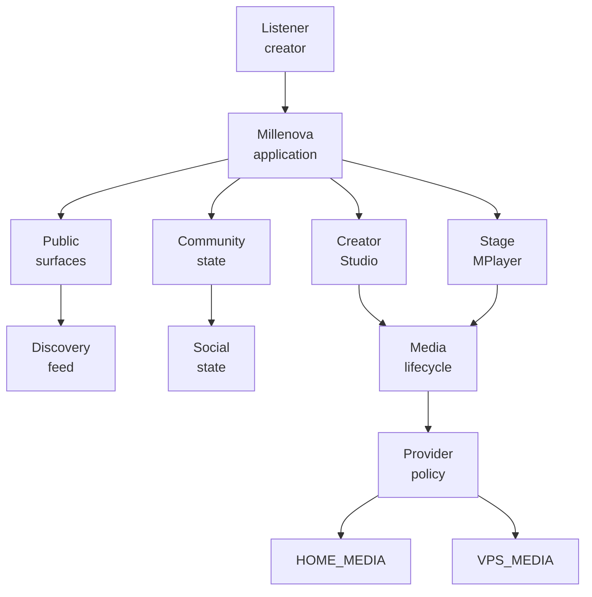

The important boundary is that public application behavior does not depend on the browser knowing where a media file physically lives. The application exposes logical post/media identity and the backend owns provider selection.

---

## 2. Architectural principles

### 2.1 Canonical identity is separated from presentation and storage

Millenova distinguishes several identities that must not be collapsed into one another:

- a **post** is a public/community content identity;
- a **media asset** is an owned first-party media identity;
- a **rendition** is a playable/processed form of that asset;
- a **provider** describes where a rendition may currently be stored or served;
- a **queue occurrence** describes playback order/context;
- an external provider URL remains source/attribution metadata even when native media becomes playback authority.

This separation allows one post to retain reactions, playlists, search identity and social history while its playback authority or physical delivery location changes underneath it.

### 2.2 One authoritative owner per state

Examples:

| State | Architectural authority |
|---|---|
| Public post identity | Community/application persistence |
| Feed order and logical membership | Home logical feed store / server continuation contract |
| Native playback time, duration, seek and ended | Browser media element |
| Queue / NEXT FROM / UP NEXT semantics | Stage/MPlayer runtime |
| Physical media-provider selection | Backend provider policy |
| Replica integrity | Media infrastructure verification state |
| Creator ownership | Server-side community/Studio authority |
| Moderation/report state | Governance layer |

The design repeatedly avoids letting transient DOM or provider-specific widgets become the canonical owner of durable product state.

### 2.3 Failure domains are deliberately separated

Player transport, feed virtualization, media-provider routing, creator uploads and moderation do not all move forward through one monolithic release path. Each has explicit gates so a failure in one subsystem does not force simultaneous debugging of another.

The Distributed Media Node programme is a clear example: provider-routing and replication work can progress beneath the player, while real delivery switching remains gated until the current player-transport dependency is stable.

---

## 3. Application and rendering boundary

Millenova retains a server-rendered PHP foundation. Public pages, catalogue surfaces, metadata and shared structural UI can be rendered authoritatively on the server, while JavaScript is used for persistent or highly interactive state.

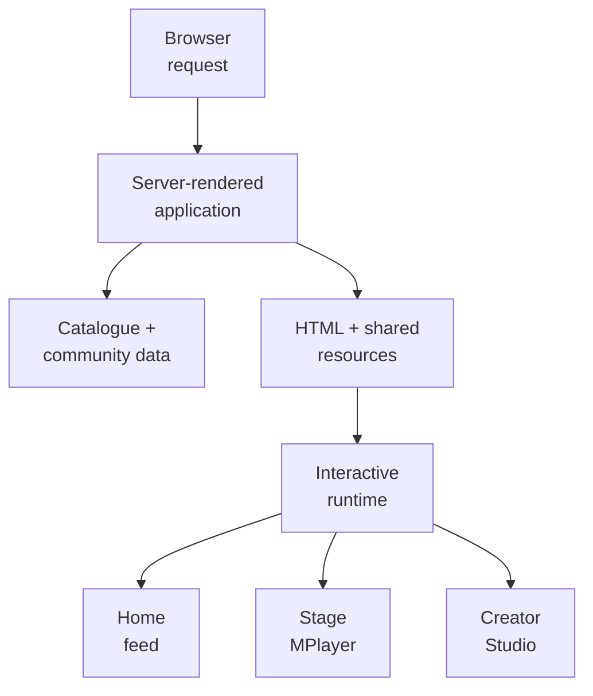

This keeps simple public content usable without requiring a full client-side application shell, while allowing richer stateful subsystems to own their own runtime behavior.

The architecture therefore favors **progressive enhancement plus explicit stateful islands** rather than forcing every page into a single frontend framework.

---

## 4. Community and creator state

The original artist/catalogue foundation became a stateful community system when accounts, creator ownership, publishing, reactions, playlists, reporting and per-user playback/workspace state were added.

Conceptually:

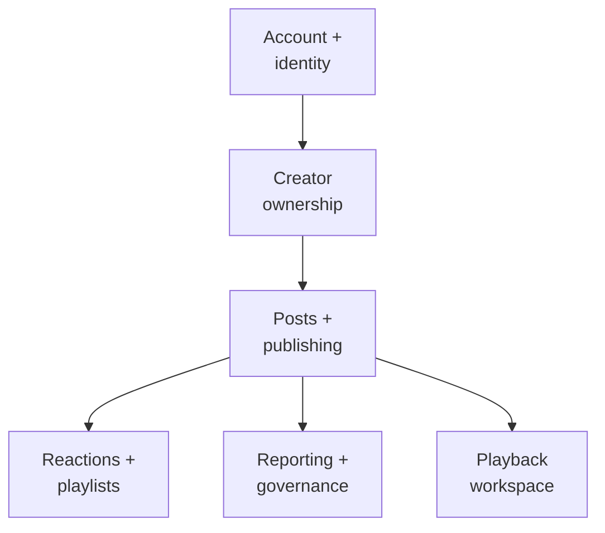

The server remains authoritative for ownership and write permission. Client-side UI may optimistically present interaction state, but durable social and creator state must reconcile against server authority.

Studio uses this boundary rather than creating a second content model. Publishing, editing and media attachment all operate on the same canonical post identity used by public discovery and playback.

---

## 5. Discovery and Home architecture

The Home feed has evolved from a simple mounted-card list into a logical feed system where ordered identity is independent of the currently mounted DOM.

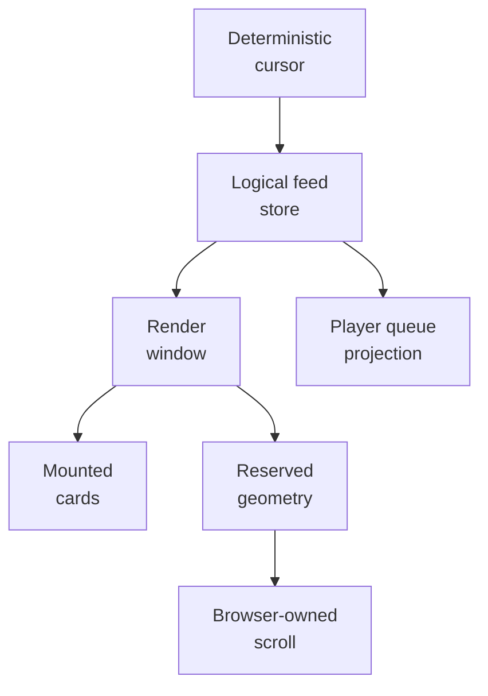

Key architectural consequences:

- feed completeness is not defined by how many cards are currently mounted;
- MPlayer can keep queue state when a card has been dematerialized;
- virtualization can reclaim DOM without destroying logical order;
- placeholders preserve geometry rather than representing queued physical movement;
- the browser remains the physical scrolling engine;
- synthetic programmatic paging is retained only as historical/superseded discovery work.

This boundary lets the feed optimize rendering and memory without becoming the authority for playback or durable social state.

---

## 6. Stage / MPlayer architecture

Stage/MPlayer is one persistent playback subsystem with one queue/transport authority and multiple playback adapters.

The native-media cutover deliberately changed only the playback heart for posts with verified first-party media. Existing Stage behavior, queue semantics, playlists, reactions, navigation, source attribution and workspace persistence remained the surrounding product authority.

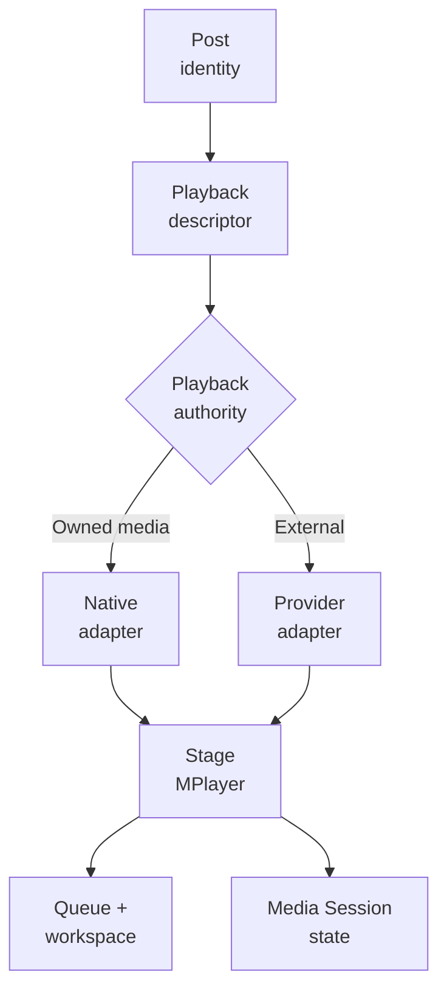

For native media, the browser media element owns real timing, seeking, buffering and `ended`. MPlayer owns the surrounding transport semantics and presentation.

For external providers, provider-specific adapters conform to the player-facing operational contract rather than forcing Stage to become provider-specific.

The important rule is:

> **Playback authority may change without changing post identity.**

---

## 7. First-party media lifecycle

First-party media introduces a lifecycle that is deliberately distinct from ordinary post metadata.

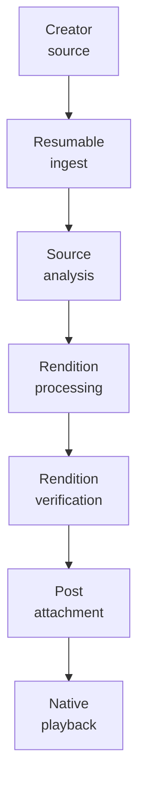

Current engineering includes large-master resumable upload, source analysis, rendition benchmarking, full rendition generation, attachment to an existing post, native playback and creator-facing processing state.

The media lifecycle preserves source/master material until cleanup is explicitly authorized. A successful playback rendition is not by itself permission to destroy the original.

Public product state therefore distinguishes:

- source/master preservation;
- processing/rendition state;
- readiness for attachment;
- readiness for playback;
- later cleanup/migration decisions.

---

## 8. Media control plane and data plane

The Distributed Media Node architecture makes a strong distinction between **control** and **data**.

### Control plane

The control plane answers questions such as:

- which provider is healthy;
- which rendition exists where;
- which provider should handle a new request;
- whether a replica is verified;
- whether processing capacity is available;
- what storage/egress state is being observed;
- whether deferred work should resume after recovery.

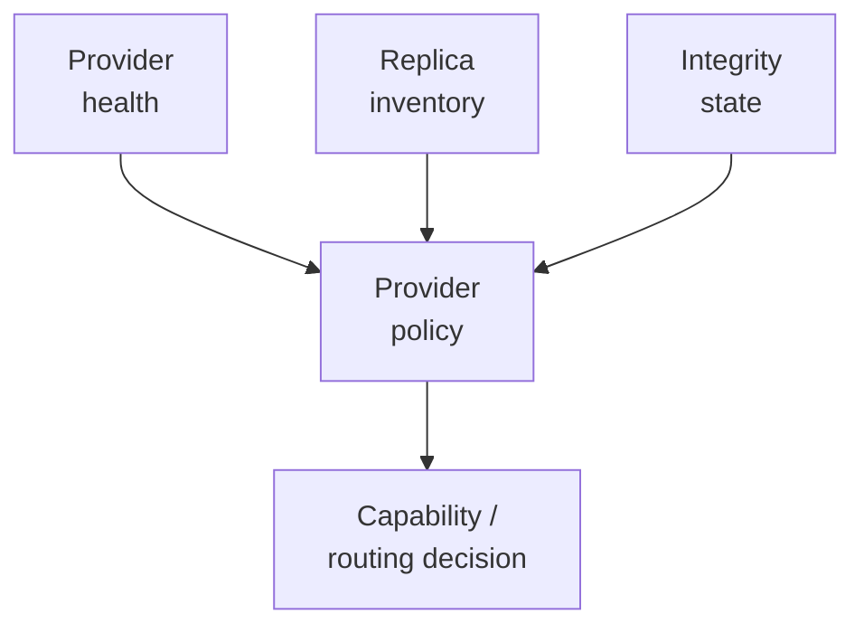

### Data plane

The data plane carries the actual heavy bytes:

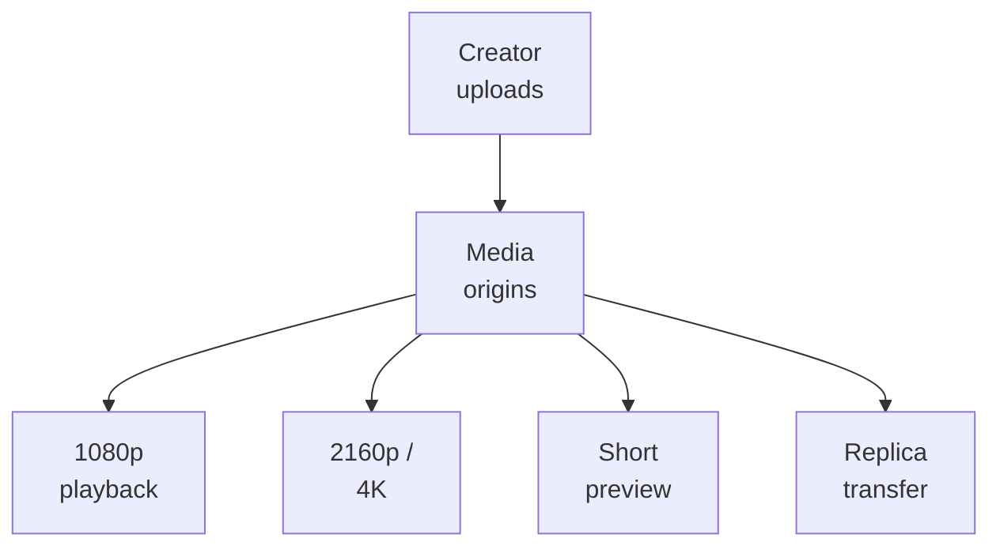

Keeping these concerns separate allows future infrastructure changes — including a later edge/CDN layer — without rewriting the player-facing logical media contract.

---

## 9. Logical provider model

Millenova treats physical media locations as logical providers beneath the canonical media asset.

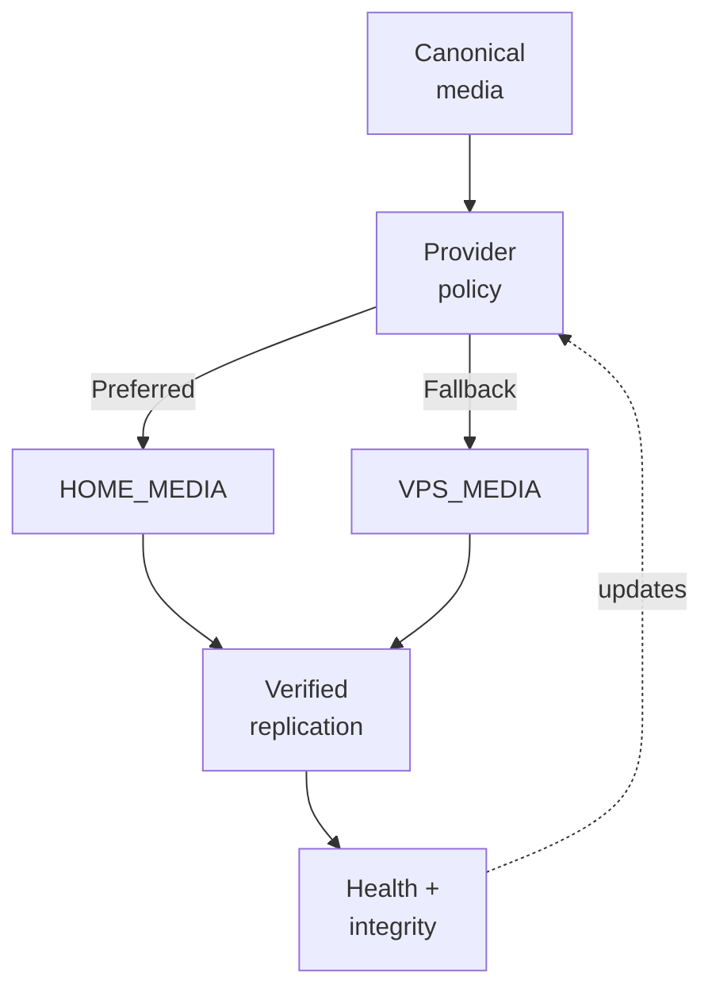

### HOME_MEDIA

The preferred provider when healthy, intended for larger long-term storage and higher-resolution processing/storage roles.

### VPS_MEDIA

An independent always-available fallback provider, intended to preserve practical playback/upload continuity rather than duplicate every possible high-resolution byte forever.

The current placement model keeps the normal persistent VPS production ceiling at 1080p while higher-resolution/creator-master storage belongs to HOME_MEDIA. Short preview and fallback-friendly assets can be duplicated where their cost is small enough to justify resilience.

The browser does not choose between HOME_MEDIA and VPS_MEDIA directly.

---

## 10. Provider selection and fallback

A new playback or upload decision is made against logical availability rather than by exposing physical storage details to the browser.

Conceptually:

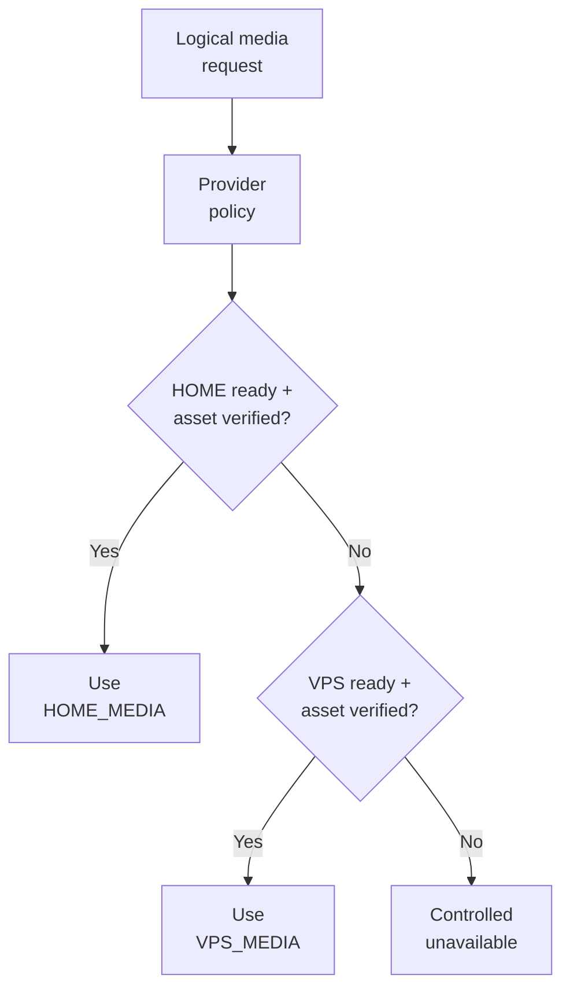

Important properties:

- preferred-provider failure does not redefine media identity;
- fallback is an application decision, not a client-side guessing mechanism;
- health and integrity are both relevant — a reachable provider is not sufficient if the required replica is missing or unverified;
- recovery to the preferred provider is for later/new work and must not create surprise state jumps in the active player;
- actual provider-delivery switching remains gated where player transport still owns unresolved semantics.

---

## 11. Persistence and state boundaries

The platform uses different persistence scopes for different jobs.

| Scope | Example state | Why separated |
|---|---|---|
| Catalogue / public metadata | releases, links, synchronized provider metadata | Stable public presentation data |
| Community persistence | accounts, posts, ownership, reactions, playlists, reports | Durable user/product state |
| Player workspace | current post/order/queue context | Restore playback context without persisting expiring capabilities |
| Media metadata | asset identity, renditions, lifecycle/readiness | Keep first-party media state separate from posts |
| Provider/replica state | location, verification, health/accounting | Physical storage can change without changing asset identity |
| Client logical feed state | ordered pages/tracks/materialization state | Allows DOM virtualization without losing feed identity |

A particularly important rule is that short-lived playback capabilities are **not** durable track identity. On restoration, the system resolves playback authority again from the post/media state instead of persisting an expiring transport URL as if it were canonical data.

---

## 12. Security boundary

The public architecture is intentionally explicit about **what** the system does, while operational secrets remain private.

Public-safe architecture may describe:

- server-owned authority decisions;
- short-lived capability concepts;
- logical provider routing;
- health-aware failover;
- integrity verification;
- replay resistance as a security goal;
- least-privilege boundaries;
- creator ownership checks;
- moderation/governance layers.

This document deliberately does not publish:

- production credentials or signing secrets;
- private IP addresses/hostnames;
- exact tunnel/port mappings;
- secret filesystem locations;
- privileged deployment commands;
- sensitive admin endpoints;
- private user/moderation records;
- bypass-enabling thresholds or operational recipes.

The architecture rule remains:

> **Show the system boundary. Do not publish the keys to cross it.**

---

## 13. Cross-system request examples

### Public playback

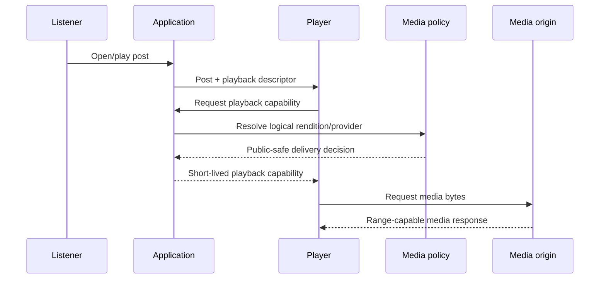

The sequence is intentionally logical. It does not expose production endpoints, secrets or exact capability format.

### Creator upload

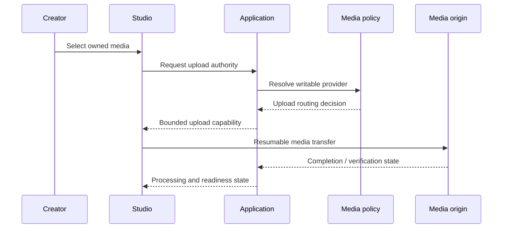

Again, provider details remain abstracted behind policy.

---

## 14. Architectural evolution

Millenova did not begin with this architecture fully formed.

The current structure emerged through a sequence of increasingly stateful requirements:

```text
artist site
  ↓
structured catalogue
  ↓
community persistence
  ↓
publishing + discovery
  ↓
persistent Stage/MPlayer + social state
  ↓
first-party native media
  ↓
distributed media infrastructure
```

That evolution explains several design choices that may otherwise look unusual. Server-rendered catalogue pages remain useful even as highly stateful client-side systems have grown around them. Provider adapters remain important even after native playback was introduced. Post identity remains stable even while storage and playback authority evolve.

The architecture is therefore **incremental and compatibility-conscious**, not a ground-up rewrite.

---

## 15. Current architectural gates

| Boundary | Current status |
|---|---|
| Server-rendered application + structured catalogue | **Shipped foundation** |
| Community identity/persistence | **Shipped foundation** |
| Public publishing/discovery | **Shipped** |
| Home logical store + virtualization foundation | **Shipped / active validation continues** |
| Native media asset model + native player | **Production-proven / complete core** |
| Stage/MPlayer native cutover | **Production complete** |
| DMN provider foundation, upload routing, replication, accounting | **Complete through DMN-8** |
| DMN real playback switching/recovery | **Gated on player transport dependencies** |
| Signals external-link product architecture | **Planned / queued** |
| Automated moderation service | **Planned / queued** |
| Whole-platform public-launch hardening | **Queued** |

The architectural record should keep these statuses explicit so a future diagram does not accidentally present planned systems as already shipped.

---

## 16. Why this architecture matters

The system is now solving several classes of problem at once:

- durable social identity and creator ownership;
- progressive/server-rendered public presentation;
- persistent cross-surface playback;
- first-party large-media ingest and rendition processing;
- provider-neutral playback adaptation;
- distributed storage/origin selection;
- feed virtualization with stable geometry;
- browser-native scroll/media behavior;
- mobile/desktop divergence where interaction physics differ;
- moderation and governance boundaries;
- verification across source, runtime, browser, physical device and production.

The core architectural strategy is not to centralize all of those concerns into one giant runtime. Instead, Millenova defines explicit authorities and contracts so each subsystem can evolve without silently taking ownership of another subsystem's state.

---

## 17. Related public documents

- [Engineering overview](ENGINEERING_OVERVIEW.md)
- [What is published here](../WHAT_IS_PUBLISHED_HERE.md)
- [Public facade implementation plan](../MILLENOVA_PUBLIC_FACADE_IMPLEMENTATION_PLAN.md)
- [Mermaid graph guide](../agents/MERMAID_GRAPH_GUIDE.md)

Next planned deep-dives separate this architecture into technology, native-media, Distributed Media Node, MPlayer, Signal Window, creator, social and governance documents.