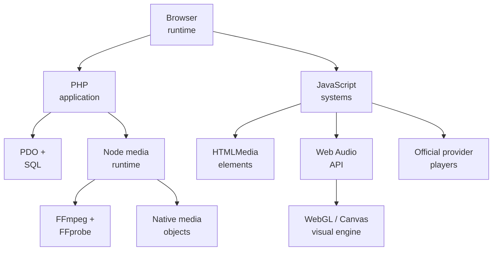

# Millenova Technology Map

**Status:** ✅ PF-5 approved · architecture correction applied 2026-10-13  
**Private implementation authority:** `wilderruiz/millenova`  
**Public publication authority:** `wilderruiz/millenova-project`  
**Publication rule:** architecture is public; exploitable configuration is private.

Millenova's technology choices are easiest to understand by asking **which state or workload each technology owns**. The current architecture combines a server-rendered PHP application, browser-native stateful systems, SQL persistence, a Node media runtime, FFmpeg/FFprobe processing, browser-native audio/video, an adaptive Web Audio/WebGL visual layer and separate provider-specific playback integrations.

---

## 1. Technology systems map

The diagram is intentionally logical. It does not expose production hosts, private network coordinates, ports, storage roots or credentials.

---

## 2. Core technology responsibility matrix

| Technology | Responsibility | Current role |
|---|---|---|
| **PHP** | Server rendering, Home/index orchestration, community authority, ownership, Studio endpoints, post capability classification, moderation and authorization boundaries | **Production core** |
| **Vanilla JavaScript** | Home state, virtualization, native MPlayer, Stage shell behavior, Studio interaction, provider-specific client integration and responsive state | **Production core** |
| **CSS** | Design system, responsive layout, Stage/Home surfaces, reduced-motion behavior and interaction presentation | **Production core** |
| **PDO + SQL** | Accounts, posts, ownership, reactions, playlists, player workspace, moderation, media metadata and audio-genome persistence | **Production core** |
| **SQLite** | Local executable schema/migration smoke and development persistence | **Development core** |
| **MySQL/MariaDB-compatible schema** | Production relational persistence | **Production core** |
| **Node.js core HTTP** | Resumable ingest, native-media byte delivery, audio sprite/generation building, media jobs, health and transport | **Production media core** |
| **node:test** | Media-runtime contract verification | **Testing core** |
| **FFmpeg / FFprobe** | Source inspection, normalization, audio generation/sprite work, video rendition processing and verification | **Production media core** |
| **HTMLVideoElement / HTMLAudioElement** | Browser-owned physical playback truth for native media | **Production playback core** |
| **Web Audio API / AnalyserNode** | Derive normalized audio-analysis frames for the Millenova Audio Visual Engine | **Production/active native-audio layer** |
| **WebGL / Three.js-style runtime patterns** | Adaptive reactive visual rendering for native audio where device capability permits | **Active visual-engine foundation** |
| **Canvas/CSS/static fallback** | Lower-cost visual fallback when WebGL, motion or device budgets require it | **Fallback architecture** |
| **Media Session API** | OS/browser playback metadata and native media-key command bridge | **Production enhancement** |
| **YouTube IFrame API / official YouTube player** | YouTube Stage playback | **Provider capability** |
| **Spotify supported embed/player surface** | Spotify Stage playback | **Provider capability** |
| **SoundCloud Widget/API** | SoundCloud Stage playback | **Provider capability** |
| **Google Identity Services + server validation** | External identity proof while Millenova keeps its own session/account authority | **Production identity integration** |
| **Bash + Linux tooling** | Deployment, preflight, runtime management, health verification and reports | **Production operations** |
| **Git + GitHub + ZGitPet** | Source history, repository safety, review boundaries and deliberate public/private publication | **Development process** |
| **Markdown + Mermaid** | Architecture, state machines and public engineering records | **Public engineering process** |

---

## 3. PHP owns Home/index and product authority

**The root Home is still server-rendered by design.** PHP composes the current index with Hero, release rail, viewer playlist/reaction state, track stats, public feed snapshot, Home search metadata, Stage deep-link state and shared resources before the browser enhancement layer starts. That keeps public chronology, creator ownership, moderation eligibility and post capability classification server-authoritative instead of making the DOM or provider widget the product database.

The newer Home architecture strengthens this boundary. `index.php` should route a canonical post into the correct Stage family, but it should not absorb YouTube, Spotify, SoundCloud, native-audio genome or rich-article internals into one giant page controller.

---

## 4. JavaScript owns stateful browser systems, not durable product truth

**Millenova uses purpose-specific browser subsystems rather than one monolithic frontend framework.** Home logical state, virtualization, native Stage/MPlayer, soft navigation, reactions, Studio workflows, diagnostic surfaces and provider integrations all live close to the browser behavior they coordinate. Custom events and explicit state owners allow those systems to cooperate without turning one global object into the authority for everything.

The architecture is now more explicit about provider boundaries: native MPlayer remains a Millenova-owned subsystem, while external-provider playback is moving into provider-scoped Stage families rather than being treated as permanent sub-adapters of one universal physical player.

---

## 5. SQL now stores audio-genome authority as well as community state

**Persistence has expanded beyond posts and media assets into native-audio evolutionary state.** The relational layer continues to own accounts, creator identity, posts, reactions, playlists, workspaces, moderation and first-party media metadata, but FP-7G.15 also introduces persistent concepts such as Artifact DNA evidence, stable semantic loci, alleles, membership/generation geometry and lifecycle state.

That distinction matters because encoded playback bytes are derived artifacts. SQL-backed immutable evidence and generation membership determine what the system is allowed to express; later playback manifests and media URLs are transient projections rather than canonical identity.

---

## 6. Node is the heavy native-media runtime, not the product database

**Large media transfer and processing do not belong inside ordinary PHP page rendering.** The Node runtime owns resumable ingest, range-capable media delivery, audio generation/sprite building, media jobs, health and other byte-heavy operations, while PHP remains the product/identity authority. Node does not become the canonical owner of creator/post/genome semantics merely because it processes the underlying media.

This split is particularly important for audio-genome work: Node may normalize audio or build a candidate encoded generation, but activation depends on application-owned immutable DNA references, membership/locus state and verification contracts.

---

## 7. FFmpeg and FFprobe are compute tools, not authorities

**Media tools can transform and inspect bytes, but they do not decide product truth.** FFprobe supplies codec, duration, sample and stream evidence; FFmpeg performs video rendition work, audio normalization and generation/sprite processing. A successful command exit is insufficient to make an output authoritative.

For video, readiness still requires lifecycle and rendition verification. For native audio, a candidate generation must remain consistent with immutable Artifact DNA and expected sample geometry; if proof fails, the system fails closed rather than rewriting the DNA evidence to make the output fit.

---

## 8. HTML media elements remain physical playback truth

**Native playback ultimately terminates at real browser media elements.** `HTMLVideoElement` and `HTMLAudioElement` own play/pause, current time, duration, seeking, buffering, volume and `ended`. MPlayer and logical audio adapters add product semantics around that truth instead of synthesizing their own clocks.

For sharded native audio, the logical adapter maps a track-local timeline onto a larger creator generation object. The listener still experiences an ordinary track even when the physical bytes are part of a longer encoded object.

---

## 9. Web Audio drives visualization, not playback authority

**The Millenova Audio Visual Engine listens to audio state; it does not own it.** The browser can route native audio analysis through the Web Audio API and `AnalyserNode` to derive energy, bass, mids, treble, waveform and transient/beat evidence for a reactive visual preset. Rendering can use an adaptive WebGL path on capable devices and degrade to lighter Canvas/CSS/static presentation when motion, GPU or device constraints require it.

The hard invariant is that audio continues if the visualizer fails. Reduced motion, WebGL failure or a constrained device may change presentation quality, never the canonical track timeline or queue semantics.

---

## 10. Provider technologies are becoming Stage-family technologies

**External providers remain supported, but the architecture now scopes them by Stage rather than pretending one player can own every capability uniformly.** YouTube uses its official player surface, Spotify uses supported Spotify playback/embed capability, and SoundCloud uses its supported widget/API. Millenova can share post metadata, reactions, reporting and shell presentation around those Stages, but it must not suppress required branding or manufacture unsupported transport behavior.

This also changes playlist semantics. Provider-scoped Millenova playlists can contain references from one provider family, while universal Saved/Collection remains a separate non-playback concept.

---

## 11. Home virtualization stays browser-native

**Home uses JavaScript to manage readiness and DOM cost without replacing browser scroll physics.** Deterministic cursor state and the logical Home store exist independently of mounted cards, while render-window virtualization, cached geometry and placeholders keep document shape stable. The browser remains the physical scrolling engine.

This becomes even more important as Home evolves into a hybrid artifact feed because rich cards, native media and provider cards may have different presentation sizes while still sharing one chronological and searchable public catalogue.

---

## 12. Identity and consent technologies remain separate concerns

Google Identity Services proves an external identity, but Millenova keeps its own account/session authority and server-side claim validation. Consent tooling similarly gates optional analytics rather than becoming product logic; analytics initialization remains fail-closed until the required consent state is present.

These boundaries are unaffected by the Stage-family or audio-genome shift because identity, consent and playback capability are intentionally separate authorities.

---

## 13. Verification technology has become more architecture-heavy

Millenova's validator surface now covers not only syntax and routes but also executable persistence invariants, media lifecycle boundaries, audio generation contracts, genome/locus state, provider scoping and public/runtime acceptance gates. PHP validators, SQLite migration smoke, Node tests, local runtime checks, browser acceptance and physical-device smoke are used where the underlying behavior cannot be proven by static inspection alone.

The active FP-7G work demonstrates why: repository structure can prove a DNA/locus schema exists, but real MP3/WAV upload, generation, logical boundary playback, Repeat/seek/Next and desktop/mobile behavior still require runtime evidence.

---

## 14. Current technology boundary

| Technology / direction | Status |
|---|---|
| PHP server-rendered Home/application | **Production** |
| Vanilla JavaScript + custom CSS | **Production** |
| PDO + SQL | **Production** |
| Node core HTTP media runtime | **Production** |
| FFmpeg / FFprobe | **Production** |
| Native HTML video playback | **Production** |
| Native logical MP3/audio generation path | **Complete foundation / runtime acceptance active** |
| Web Audio / Audio Visual Engine | **Complete foundation / runtime acceptance active** |
| Artifact DNA / loci / allele persistence | **Active architecture / implementation advancing** |
| DMN HOME/VPS native-media delivery | **Active; through DMN-4C complete, DMN-4D active** |
| Provider-scoped Stage families | **Approved next architecture** |
| Rich Post Stage | **Approved / queued** |
| CDN/edge layer | **Future option** |
| Cast / Remote Playback | **Later / non-blocking** |
| Python/CUDA/Mistral moderation service | **Planned later** |

---

## 15. Public technology boundary

This document publishes responsibilities and system choices while excluding credentials, private production addresses, exact ports/tunnel configuration, storage roots, signing material, privileged admin routes, private user data and bypass-enabling security detail.

For the corrected system relationships, see [`PLATFORM_ARCHITECTURE.md`](PLATFORM_ARCHITECTURE.md). For the broad current-state inventory, see [`ENGINEERING_OVERVIEW.md`](ENGINEERING_OVERVIEW.md).