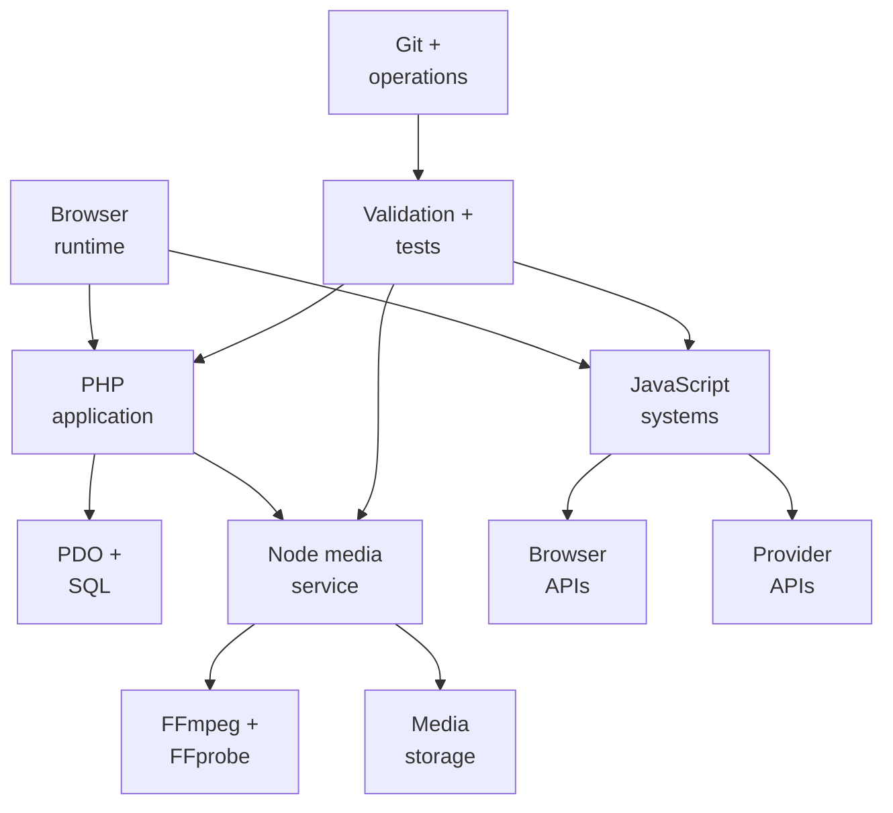
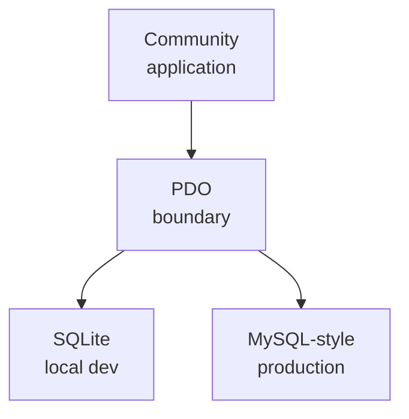
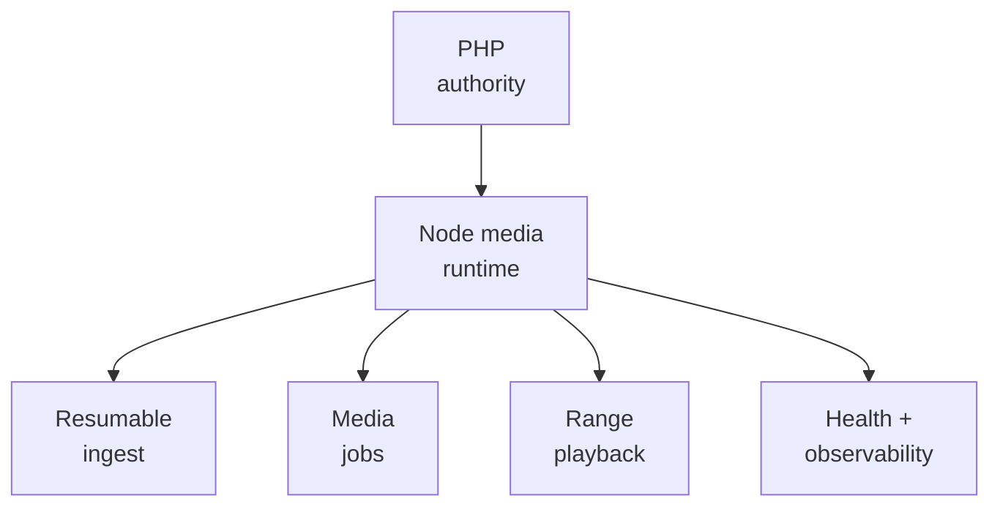
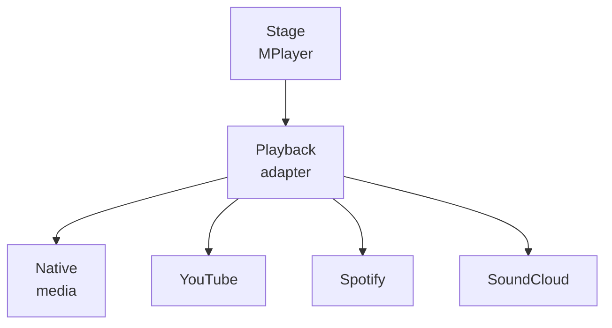

# Millenova Technology Map

**Status:** PF-5 draft — under Wilder review  
**Private implementation authority:** `wilderruiz/millenova`  
**Public publication authority:** `wilderruiz/millenova-project`  
**Publication rule:** architecture is public; exploitable configuration is private.

Millenova's technology choices are best understood by **responsibility**, not by turning the project into a vanity stack list. The platform deliberately combines a server-rendered web application, stateful browser subsystems, SQL-backed community persistence, a separate media runtime, browser-native playback and operational tooling around deployment and verification.

The important question for each technology is therefore:

> **What state or engineering problem does it own?**

---

## 1. Technology systems map



The diagram is deliberately logical. It does not expose production hosts, private network coordinates, filesystem paths or credentials.

---

## 2. Core technology responsibility matrix

| Technology | Responsibility in Millenova | Current role |
|---|---|---|
| **PHP** | Server-rendered pages, application bootstrap, community authority, creator ownership, post/social state, Studio endpoints, media metadata/authorization boundaries, moderation and public APIs | **Production core** |
| **Vanilla JavaScript** | Stateful browser subsystems including Stage/MPlayer, Home feed state, virtualization, soft navigation, reactions/playlists, provider adapters, Studio interactions and responsive behavior | **Production core** |
| **CSS** | Design tokens, layout, responsive behavior, player surfaces, Studio, feed, navigation, governance and device-specific interaction presentation | **Production core** |
| **PDO + SQL** | Durable account, post, identity, social, playlist, player-workspace, moderation, Hero, discovery and media metadata state | **Production core** |
| **SQLite** | Local development persistence and executable schema/migration smoke | **Development core** |
| **MySQL/MariaDB-compatible schema** | Production relational persistence model using InnoDB/utf8mb4 conventions | **Production core** |
| **Node.js** | First-party media runtime: ingest, resumable transfer, source/rendition jobs, playback/download delivery, health and media observability | **Production media core** |
| **Node core HTTP + node:test** | Lightweight media-server runtime and automated backend verification without a large web-framework dependency | **Production/testing core** |
| **FFmpeg / FFprobe** | Source inspection, codec/dimension/duration analysis, rendition processing and media verification | **Production media core** |
| **HTMLMediaElement** | Native first-party audio/video truth: play/pause, time, duration, seek, buffering, volume and `ended` | **Production playback core** |
| **Media Session API** | Provider-neutral OS/browser playback metadata and media-key command bridge back to MPlayer | **Production enhancement** |
| **Fetch / DOMParser / CustomEvent / observers** | Soft navigation, cross-subsystem state events, lazy/provider work, feed readiness and browser-native interaction orchestration | **Production browser infrastructure** |
| **Google Identity Services** | User sign-in UI and identity credential issuance | **Production identity integration** |
| **PHP OpenSSL + server-side claim validation** | Verification of Google identity credentials, issuer/audience/expiry/nonce and verified-email requirements | **Production identity security** |
| **YouTube / Spotify / SoundCloud browser APIs** | External-media compatibility while Millenova keeps queue/workspace/product state provider-neutral | **Production provider compatibility** |
| **Bash** | Deployment orchestration, preflight checks, runtime management and report generation | **Production operations** |
| **SSH / rsync / tmux / curl** | Controlled deployment/runtime transport, process supervision and health verification at an operational level | **Production operations** |
| **PHP validators + Node tests** | Contract enforcement across application, community, media, player, assets, accessibility and deployment boundaries | **Cross-cutting verification** |
| **CookieYes + GTM/GA4 bridge** | Consent-gated optional analytics; measurement remains disabled until analytics consent is granted | **Production analytics integration** |
| **Git + GitHub** | Source history, review boundaries, public/private repository separation and engineering publication | **Development core** |
| **ZGitPet** | Repository guardian and multi-project workflow accelerator for controlled Get / Save / Send and review-first publication | **Development accelerator** |
| **Markdown + Mermaid** | Public architecture, engineering records, state models and reviewable technical documentation | **Public engineering process** |

---

## 3. Server-rendered application: PHP by design

Millenova is not a single-page application with a PHP compatibility layer underneath it. The server-rendered application remains a deliberate architectural foundation.

PHP currently owns responsibilities including:

- shared bootstrap/configuration;
- public page rendering;
- catalogue adapters;
- community/session state;
- identity and authorization;
- post and creator ownership;
- reactions and playlists;
- player-workspace persistence;
- reporting/moderation;
- media asset metadata and lifecycle boundaries;
- creator-facing Studio endpoints;
- public-safe playback/upload authorization decisions.

Shared frontend resources are registered through a central resource manager rather than scattered direct tags. Local CSS/JavaScript resources receive application-version cache keys, while third-party resources can remain externally versioned.

This architecture gives Millenova two useful properties at once:

1. public content and metadata can remain server-authoritative;
2. stateful browser systems can become sophisticated without forcing the entire product into one client framework.

---

## 4. Frontend architecture: browser-native JavaScript rather than a large framework

The current frontend is built from purpose-specific JavaScript subsystems rather than React/Vue/Angular-style application ownership.

That is not the absence of frontend architecture. The browser layer has explicit state owners and contracts.

Examples include:

| Browser subsystem | Technology responsibility |
|---|---|
| **Soft navigation** | `fetch`, `DOMParser`, History API and version-aware resource refresh while persistent player/navigation surfaces remain mounted |
| **Home logical feed** | In-memory canonical feed order/state independent of mounted cards |
| **Home virtualization** | DOM measurement, placeholders, geometry preservation, observers and browser-owned native scrolling |
| **Stage/MPlayer** | Queue, workspace, transport and adapter orchestration |
| **Native media adapter** | `HTMLMediaElement` event/state bridge with superseded-request protection |
| **Media Session bridge** | OS/browser playback controls mapped back to one MPlayer command authority |
| **Provider adapters** | Spotify/SoundCloud/YouTube-specific mechanics kept outside queue/workspace state |
| **Social UI** | Event-driven reaction/playlist reconciliation across multiple surfaces |

Custom DOM events are used extensively as subsystem boundaries. This lets a player, analytics adapter, inline card, soft-navigation runtime or feed store exchange state without making one monolithic frontend object own everything.

---

## 5. CSS and responsive interaction architecture

Millenova uses a custom CSS system rather than a utility-framework dependency as its core styling model.

The CSS architecture includes:

- design tokens;
- global primitives;
- navigation/public-shell styles;
- component- and surface-owned styles;
- an ordered Stage/MPlayer stylesheet manifest;
- desktop/mobile-specific ownership where interaction differs materially;
- reduced-motion and accessibility behavior;
- native browser scrolling/snap behavior where appropriate.

Responsive design is treated as **interaction architecture**, not only viewport resizing. Mobile Home, player controls, touch scrolling, Stage composition and navigation may intentionally use different surface ownership from desktop.

---

## 6. Persistence: PDO with local SQLite and production SQL

The community layer uses PHP PDO as the persistence boundary rather than coupling application logic directly to one local database implementation.



Local development uses SQLite with foreign-key enforcement and schema upgrade helpers. The repository also maintains an InnoDB/utf8mb4 production schema and migration set for the deployed relational model.

Persisted domains include:

- users and provider identities;
- creator profiles;
- posts and structured metadata;
- reactions and playlists;
- player workspaces;
- reporting/moderation;
- Hero scheduling/history;
- short-form metadata and keyword intelligence;
- creator statistics;
- first-party media metadata and attachment state.

This dual-schema approach provides a lightweight local environment without pretending production persistence is just an opaque remote service.

---

## 7. Node media runtime: deliberately separate from the PHP application

First-party media introduced requirements that do not belong inside ordinary page rendering: large-object transfer, byte-range delivery, FFmpeg/FFprobe jobs, processing state and media health.

Millenova therefore uses a separate Node.js media runtime.

A notable current implementation choice is that the media package uses **Node core modules rather than a large HTTP framework dependency**. The service is built around the native HTTP runtime and a set of explicit media routes/services.

Conceptually:



This separation lets the PHP application remain the product/identity authority while Node owns media transport/processing mechanics.

---

## 8. FFmpeg and FFprobe: compute tools, not product authorities

FFprobe is used to inspect media properties such as streams, codecs, duration and dimensions. FFmpeg is used for rendition work.

The first-party media path uses those tools behind application-owned lifecycle state rather than treating successful transcoding as equivalent to product readiness.

For example, Millenova still distinguishes:

- upload completion;
- source analysis;
- processing;
- verified rendition output;
- attachment readiness;
- playback readiness;
- later cleanup/migration decisions.

The repository's validators also enforce media type/codec expectations, checksum behavior and private-storage boundaries around the processing path.

---

## 9. Browser-native media APIs

Native Millenova playback deliberately uses the browser's own media model instead of synthesizing time/ended state with application timers.

The native adapter observes `HTMLMediaElement` state/events including:

- metadata and duration changes;
- `timeupdate`;
- progress/buffering;
- play/pause;
- seeking/seeked;
- waiting/canplay/playing;
- volume/mute changes;
- `ended`;
- media errors.

The adapter also maintains a generation guard so an older asynchronous load/play operation cannot reclaim the media surface after the listener has moved to another item.

The Media Session API then mirrors the active MPlayer metadata/state to browser/OS controls while dispatching play, pause, seek, previous and next commands back to the universal player.

This is an example of a broader Millenova rule:

> **Use browser primitives as authoritative physical mechanisms; add product semantics around them.**

---

## 10. External provider technology remains an adapter layer

First-party native media does not eliminate external provider support.

Millenova currently integrates provider-specific playback mechanics for external media such as YouTube, Spotify and SoundCloud while preserving a provider-neutral product model around them.



Provider-specific SDK/widget behavior stays at the adapter boundary rather than leaking into queue, playlist or workspace identity.

That is particularly important because native first-party playback may become authoritative for a post while the original external provider remains useful as source/attribution metadata.

---

## 11. Identity technology

Google sign-in uses Google Identity Services in the browser, but Millenova keeps its own session and account authority.

The browser receives the provider credential and submits it with a nonce to the application. The PHP side validates the credential against Google's signing certificates and checks the security-relevant claims before linking or creating a Millenova identity.

At a public-safe level, the important technologies are:

```text
Google Identity Services
        ↓
provider credential
        ↓
PHP verification
OpenSSL / claim checks
        ↓
Millenova identity + session
```

The provider proves an external identity; it does not become the owner of Millenova creator/post/session state.

---

## 12. Consent, analytics and SEO tooling

Optional analytics are fail-closed.

The frontend initializes optional measurement storage as denied and injects Google Tag Manager only after CookieYes reports analytics consent. A separate event adapter maps stable Millenova domain events into `dataLayer` only when consent is active.

That means product features emit domain events without needing direct GA/GTM knowledge.

Technology responsibilities include:

| Tool / layer | Responsibility |
|---|---|
| **CookieYes** | User consent state |
| **Consent-aware bootstrap** | Keep optional analytics disabled by default |
| **GTM / GA4** | External measurement configuration after consent |
| **Millenova analytics adapter** | Stable `mn_*` domain-event bridge into `dataLayer` |
| **Server-rendered metadata** | Canonical metadata, social cards and structured data |
| **Sitemaps / robots policy** | Public discovery/indexing contract |
| **Validators** | Prevent accidental regressions in accessibility, asset versioning and analytics/SEO contracts |

GTM/GA4 container configuration remains external to the repository rather than being treated as application logic.

---

## 13. Verification technology

Millenova has a large validator surface because many product rules are architectural contracts rather than one isolated unit function.

Verification currently includes:

- PHP syntax checks;
- contract-oriented PHP validators;
- executable SQLite schema/migration smoke where available;
- Node syntax checks;
- Node's built-in `node:test` runner for media routes/services;
- deployment preflight checks;
- runtime health checks;
- browser integration smoke;
- physical-device smoke for touch/scroll behavior;
- production smoke for changes whose behavior depends on the real deployment path.

Examples of validator responsibilities include enforcing required routes, accessibility anchors, APP_VERSION resource loading, diagnostics gating, consent behavior, trusted-link rules, community contracts and first-party media lifecycle/security invariants.

The deeper testing philosophy is intentionally deferred to [`TESTING_AND_VERIFICATION.md`](TESTING_AND_VERIFICATION.md) later in the public-facade programme.

---

## 14. Deployment and runtime operations

Millenova uses Bash-based deployment/runtime tooling rather than hiding operational state behind an opaque one-click script.

At a public-safe level, the tooling performs work such as:

- deployment target selection;
- preflight lint/validation;
- separate site/media-runtime deployment responsibilities;
- file synchronization;
- runtime capability checks;
- health verification;
- process ownership checks;
- structured deployment logs/reports;
- failure classification by subsystem;
- stopping before production writes when preflight fails.

The media runtime is supervised using standard Linux tooling and performs startup checks for the Node and media-processing environment.

Exact production addresses, account names, ports, credentials and private filesystem coordinates are intentionally excluded from this public repository.

---

## 15. Git, GitHub and ZGitPet

Source control is also part of the engineering process rather than merely storage for code.

Git/GitHub provide:

- implementation history;
- reproducible review boundaries;
- private/public repository separation;
- commit-level documentation evolution;
- safe synchronization between local and remote work.

ZGitPet sits above that workflow as a repository guardian and multi-project accelerator. It helps keep active project scope and repository state visible while work is moving among Millenova, Zomniverse, deployment tooling and other projects.

For this public facade specifically:

```text
private implementation
       ↓
agent evidence audit
       ↓
public-safe draft
       ↓
Wilder review
       ↓
ZGitPet Save / Send
       ↓
public engineering record
```

ZGitPet accelerates the workflow but does not authorize publication and is not a Millenova production runtime dependency.

---

## 16. Current, active and future technology boundary

A public technology document must not make planned infrastructure look shipped.

| Technology / direction | Status | Interpretation |
|---|---|---|
| PHP server-rendered application | **Production** | Core application authority |
| Vanilla JavaScript + custom CSS | **Production** | Main interactive/browser layer |
| PDO + SQL | **Production** | Persistence boundary |
| SQLite | **Development** | Local persistence and migration smoke |
| MySQL/MariaDB-compatible production schema | **Production** | Deployed relational persistence model |
| Node.js core HTTP media service | **Production** | First-party media runtime |
| FFmpeg / FFprobe | **Production** | Media analysis/processing |
| HTMLMediaElement native playback | **Production** | First-party playback truth |
| Media Session API | **Production enhancement** | OS/browser media control bridge where supported |
| Google Identity Services | **Production** | External identity provider integration |
| YouTube / Spotify / SoundCloud adapters | **Production** | External provider compatibility |
| Home/VPS distributed-media provider layer | **Active** | Foundation/routing/replication/accounting established; real delivery switching remains gated |
| Short low-resolution hover rendition | **Planned / active media direction** | Intended to reduce card-preview bandwidth; not presented as universally deployed |
| CDN/edge delivery layer | **Future option** | Architecture allows it; not a current production dependency |
| Cast / remote playback | **Planned / gated** | Future player transport work |
| Python/CUDA/Mistral moderation service | **Planned** | Approved later moderation direction, not current production technology |

The final row is particularly important: Millenova may eventually reuse local-GPU patterns for moderation, but Python/CUDA/Mistral should **not** be read as part of today's production Millenova runtime.

---

## 17. Why this stack is intentionally heterogeneous

Millenova does not use multiple technologies for novelty. Each major technology sits near the kind of state or workload it handles well:

- PHP stays close to server-rendered product state and relational authority;
- JavaScript stays close to persistent browser interaction and media/feed state;
- SQL owns durable relationships and identities;
- Node handles long-lived/binary media transport and processing orchestration;
- FFmpeg/FFprobe perform specialist media computation;
- browser media APIs own the physical playback model;
- provider SDKs remain isolated adapters;
- Bash/Linux tools expose deployment/runtime state directly;
- validators and tests turn architecture decisions into executable contracts.

The engineering challenge is not choosing one fashionable stack. It is keeping these boundaries coherent as the product changes.

---

## 18. Public technology boundary

This document intentionally publishes technology responsibilities and architectural choices while excluding operational material that would weaken the live system.

It does not publish:

- secrets or credentials;
- production IPs/hostnames;
- private port mappings;
- private filesystem paths;
- signing keys/token-generation details;
- privileged admin access details;
- private user data;
- exact tunnel/firewall configuration.

For system relationships rather than technologies, see [`PLATFORM_ARCHITECTURE.md`](PLATFORM_ARCHITECTURE.md). For the broad engineering inventory, see [`ENGINEERING_OVERVIEW.md`](ENGINEERING_OVERVIEW.md).

The next public-facade step after review is the first deep media document: `media/NATIVE_MEDIA_ENGINEERING.md`.
