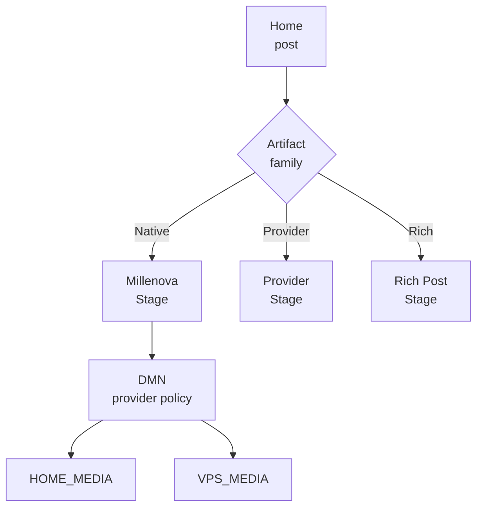
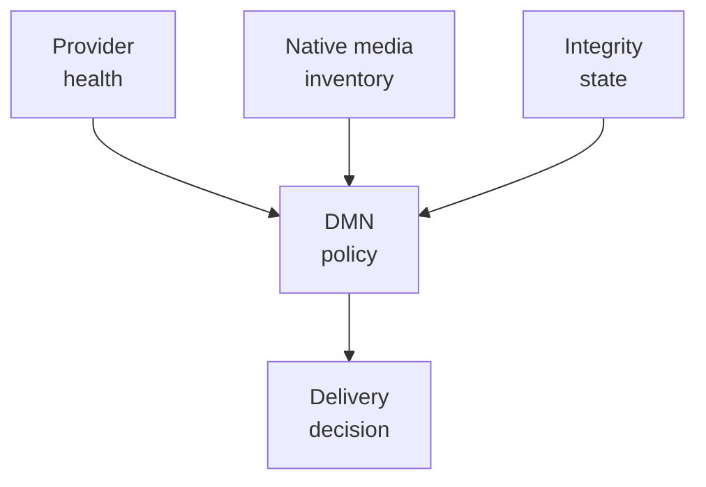
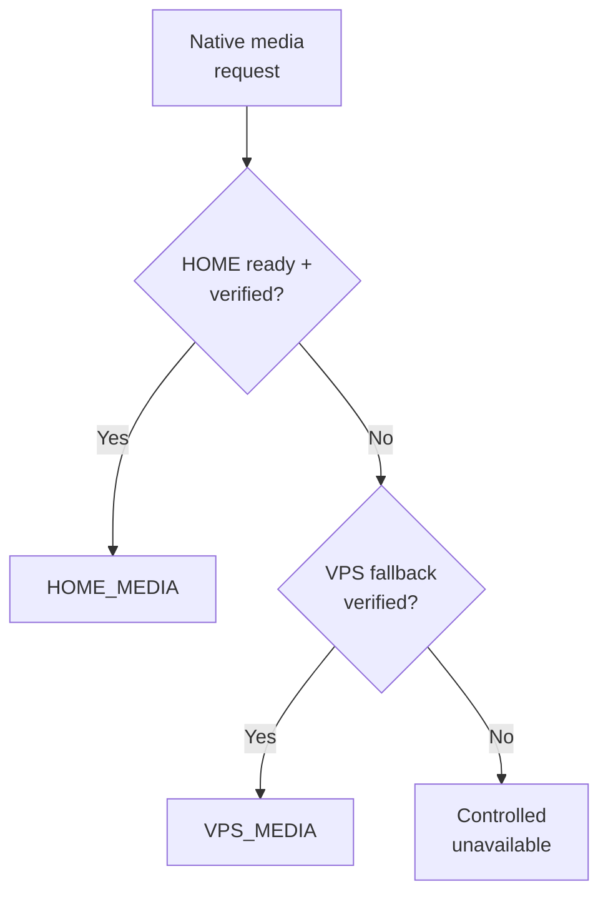

# Millenova Distributed Media Node

**Status:** ✅ PF-7 approved · architecture correction applied 2026-10-13  
**Private implementation authority:** `wilderruiz/millenova`  
**Public publication authority:** `wilderruiz/millenova-project`  
**Publication rule:** architecture is public; exploitable configuration is private.

The **Millenova Distributed Media Node (DMN)** separates native-media identity from the physical provider that stores or serves the bytes. That boundary remains correct after the wider platform architecture changed, but its scope is now clearer: **DMN belongs beneath Millenova-owned native media; it is not a router for official YouTube, Spotify or SoundCloud playback.**

> **Native Stage asks for logical media. Backend policy chooses the verified native provider.**

---

## 1. Current status has advanced

The earlier public version stopped at DMN-4A active. The private programme has moved forward: DMN-4A production HOME/VPS playback authorization is complete, DMN-4B real HOME byte-range playback is complete, DMN-4C verified VPS fallback with the hard 1080p ceiling is complete, and **DMN-4D Hero 1080p-only first-party routing is active**. DMN-1/2/3 and DMN-6/7/8 remain complete, while DMN-5 recovery/player-facing delivery truth stays downstream of the current delivery proof.

| Area | Current state | Meaning |
|---|---|---|
| **DMN-1** | **Complete** | HOME_MEDIA provider/read foundation |
| **DMN-2** | **Complete** | Private HOME↔VPS transport foundation |
| **DMN-3** | **Complete** | Health + preferred/fallback router policy |
| **Checkpoint B** | **Open** | Real delivery work authorized |
| **DMN-4A** | **Complete** | Production HOME/VPS authorization |
| **DMN-4B** | **Complete** | Real HOME range-capable production delivery |
| **DMN-4C** | **Complete** | VPS fallback with 1080p ceiling / no persistent VPS 4K |
| **DMN-4D** | **Active** | Hero 1080p-only routing on HOME/VPS |
| **DMN-5** | **Queued downstream** | Recovery + player-facing delivery truth |
| **DMN-6** | **Complete** | Upload routing foundation |
| **DMN-7** | **Complete** | Verified replication/recovery foundation |
| **DMN-8** | **Complete** | Storage/egress observability foundation |

---

## 2. Native-only infrastructure boundary

**Home can now contain many artifact families, but DMN only governs Millenova-owned native bytes.** A native video or native audio object may be served from HOME_MEDIA or VPS_MEDIA according to backend policy. A YouTube post remains a YouTube Stage concern, Spotify remains a Spotify Stage concern, SoundCloud remains a SoundCloud Stage concern, and rich content has no DMN playback dependency at all.



This boundary prevents the new Stage-family architecture from accidentally turning HOME/VPS infrastructure into a general-purpose proxy for third-party providers.

---

## 3. Product semantics remain above provider placement

**DMN can change where native bytes come from without changing what the listener is playing.** Post identity, native media identity, audio locus/allele identity, MPlayer queue state and social history all live above physical provider placement. HOME_MEDIA and VPS_MEDIA are delivery/storage roles beneath that product state.

The same rule now applies to native audio generations. Artifact DNA, active locus/allele and generation membership remain application/genome authority; DMN may store or deliver the resulting native bytes, but it does not redefine the genome or decide which allele is active.

---

## 4. Control plane vs data plane

**Policy state is cheap; video/audio bytes are not.** The control plane evaluates provider health, reachability, rendition/generation availability, replica integrity, storage readiness and routing decisions. The data plane carries uploads, range playback, audio-generation bytes, video renditions, preview objects and replication traffic.



Keeping these planes separate is what allows delivery infrastructure to evolve without rewriting native MPlayer or the audio-genome identity model.

---

## 5. HOME_MEDIA and VPS_MEDIA roles

**HOME_MEDIA is preferred high-capacity native storage/processing, not the sole product authority.** It owns durable creator masters and premium 2160p/4K placement while also carrying standard and preview material where appropriate. Its usefulness comes from privately owned capacity, but the design never assumes home hardware or residential connectivity is continuously available.

**VPS_MEDIA exists for independent continuity, not full duplication.** The persistent production ceiling remains 1080p; preview and standard fallback can live there, and temporary private ingest may be used when HOME is unavailable. Persistent/playable 2160p/4K catalogue media remains excluded from VPS by policy.

> **VPS persistent playable ceiling = 1080p. HOME owns durable creator masters and premium 4K.**

---

## 6. Canonical native media tiers

| Tier | Target | Purpose | Persistent placement |
|---|---|---|---|
| **Preview** | short low-resolution object | Card/hover preview | HOME + VPS |
| **Standard** | 1080p | Broadly available playback | HOME + VPS |
| **Premium** | 2160p / 4K | Highest-quality native Stage playback | HOME only |

The preview remains independent from full playback. A missing preview should not silently spend a complete 1080p stream merely because a tiny Home interaction asked for motion.

---

## 7. HOME outage degrades capability, not identity

**A temporary HOME failure should lower available quality without turning a successful creator upload into total failure.** When HOME is unavailable, VPS can preserve a private non-playable source long enough to derive useful preview/1080p output and later transfer the source safely to HOME. Premium 4K work becomes deferred rather than failed, and the creator should not need to upload the master again.

```text
preview READY + 1080p READY + 4K deferred
→ publishable / playable
→ HOME returns
→ verified source transfer
→ 4K processing resumes
```

Temporary VPS source retention is therefore a recovery mechanism, not permission to make VPS permanent master storage.

---

## 8. Provider selection requires verified usefulness

**A running process is not enough evidence to route playback.** DMN considers service health, private-path reachability and rendition/generation verification before selecting HOME or VPS. If HOME is healthy and the requested native object is verified, HOME may be preferred; otherwise a verified VPS fallback can preserve 1080p availability.



That is the logic DMN-4A through DMN-4C have now moved from architecture toward real production proof.

---

## 9. Replication is copy plus verification

**Transferred bytes are not automatically a valid replica.** The destination must prove checksum/integrity and expected media metadata before policy can treat it as usable. Source retirement or cleanup stays downstream of verified destination state rather than transfer start or transport-level success.

This rule is shared conceptually with the newer audio-genome model: derived bytes become trusted only after they are checked against authoritative evidence.

---

## 10. Recovery is not mid-session teleportation

**Fallback and recovery solve different problems.** VPS fallback preserves service while HOME is unavailable; recovery makes HOME eligible for later/new authorizations once health and integrity are re-established. Active playback should not jump origins merely because the preferred provider returned mid-session.

DMN-5 remains the downstream programme for automatic HOME recovery, public-safe delivery diagnostics and full physical failover/recovery smoke.

---

## 11. Hero has its own bandwidth policy

**Hero does not inherit Stage's maximum quality just because the asset has a 4K rendition.** Continuous rotation can create sustained egress, so the accepted policy caps Hero at 1080p on either provider. HOME 1080p may be preferred when healthy, with VPS 1080p as fallback.

DMN-4D is the active implementation slice that turns this policy into the current delivery architecture.

---

## 12. Storage and egress economics remain architectural inputs

A selective fallback model is cheaper than duplicating every master and premium rendition everywhere. Conceptually, if `M` is master bytes, `U` premium 4K, `H` standard 1080p and `P` preview, full duplication approaches `2 × (M + U + H + P)`, while the current placement model trends toward `HOME: M + U + H + P` and `VPS: H + P`, plus bounded temporary ingest when necessary.

Bandwidth is equally real. Home-owned storage does not make egress free; high-bitrate playback, Hero loops, audio-generation delivery and replication still consume capacity. That is why provider/tier bytes and fallback sessions belong in observability rather than being treated as invisible infrastructure.

---

## 13. Public diagnostics should expose decisions, not topology

Stats/diagnostics may eventually report non-sensitive facts such as delivery class, active quality, HOME recovery state or fallback readiness. They must not expose private addresses, ports, tunnel coordinates, storage paths, credentials or signing material.

The useful public truth is **what policy decided and what the listener is receiving**, not how to reach the private infrastructure directly.

---

## 14. Future edge/CDN remains possible

**The logical provider contract is intentionally not tied forever to the current transport topology.** A future edge/CDN layer could sit in front of native origins without changing post identity, Artifact DNA, MPlayer queue semantics or provider-scoped external Stages. That option remains future architecture, not a current production dependency.

---

## 15. Current DMN boundary

| Capability | Status |
|---|---|
| Logical HOME/VPS model | **Complete foundation** |
| HOME read/provider foundation | **Complete** |
| Private transport foundation | **Complete** |
| Health + router policy | **Complete** |
| Upload routing | **Complete** |
| Verified replication/recovery foundation | **Complete** |
| Storage/egress observability | **Complete** |
| Production HOME/VPS authorization | **Complete (DMN-4A)** |
| Real HOME byte-range delivery | **Complete (DMN-4B)** |
| VPS 1080p fallback / no VPS 4K | **Complete (DMN-4C)** |
| Hero 1080p-only provider routing | **Active (DMN-4D)** |
| Automatic recovery + player delivery truth | **Queued (DMN-5)** |
| CDN/edge | **Future option** |

---

## 16. Public security boundary

This document publishes the logical provider model, tier placement, health/integrity rules, fallback semantics and economics while omitting production IPs/hostnames, exact tunnel/port mappings, credentials, signing secrets, storage roots, privileged commands and private creator/media records.

For native product identity and the new audio-genome authority, see [Native media engineering](NATIVE_MEDIA_ENGINEERING.md). For corrected Home/Stage-family boundaries, see [Platform architecture](../PLATFORM_ARCHITECTURE.md).