# Millenova Distributed Media Node

**Status:** 🟡 PF-7 draft — under Wilder review  
**Private implementation authority:** `wilderruiz/millenova`  
**Public publication authority:** `wilderruiz/millenova-project`  
**Publication rule:** architecture is public; exploitable configuration is private.

The **Millenova Distributed Media Node (DMN)** programme separates logical media identity from the physical place where media bytes are stored, processed and served.

Its central rule is:

> **The player asks for logical media. The backend decides which verified provider can safely serve it.**

DMN does not create a second player, queue, post identity, reaction system or analytics stream. It operates underneath the existing first-party media and Stage/MPlayer contracts.

---

## 1. Why DMN exists

First-party media introduced a different infrastructure profile from ordinary web pages:

- creator masters may be large and high-bitrate;
- 2160p / 4K renditions are materially larger than ordinary application assets;
- 1080p needs to remain broadly available;
- card previews should be small independent media objects rather than full playback streams;
- continuously rotating media surfaces can create sustained egress;
- catalogue growth can exceed the practical storage/egress envelope of one VPS;
- a home-owned machine can contribute useful storage and processing capacity, but it must not become a single point of failure.

The resulting architecture treats physical media locations as **logical providers**.

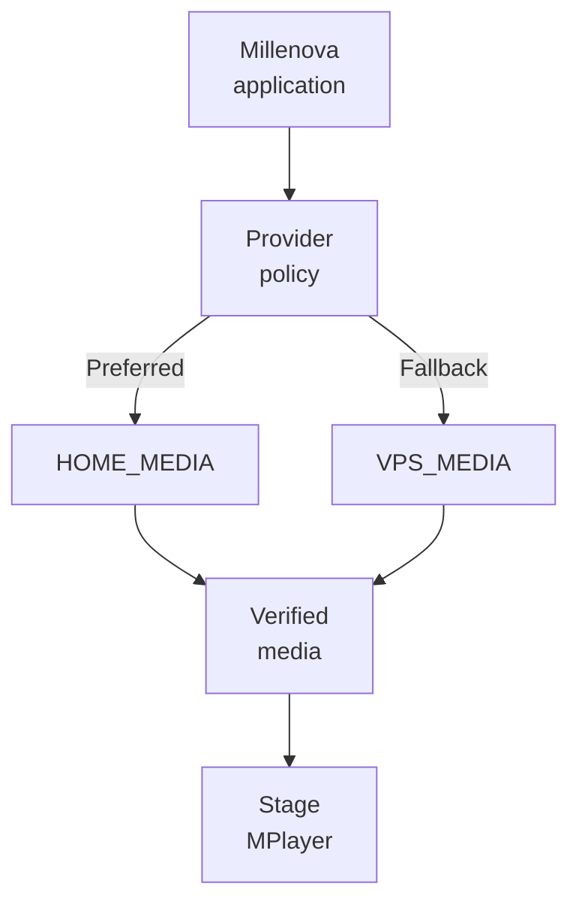

The browser does not select HOME or VPS directly. Provider selection remains a backend-owned policy decision.

---

## 2. Product semantics vs infrastructure semantics

The parent first-party media programme owns product/media meaning:

```text
post identity
media asset identity
renditions
attachment
playback authority
Stage / MPlayer
Studio upload lifecycle
Hero / Beats / Signals boundaries
```

DMN owns physical infrastructure mechanics:

```text
where bytes live
which provider is healthy
where processing may run
which replica is verified
which provider is preferred
which provider is fallback
how recovery works
how replication is verified
how storage / egress are measured
```

That separation prevents infrastructure work from silently redefining playback or social behavior.

> **DMN may change where verified bytes come from without changing what track the listener is playing.**

---

## 3. Current execution state

The DMN programme is intentionally checkpointed so infrastructure and player work do not create one combined failure domain.

| Area | Current state | Meaning |
|---|---|---|
| **DMN-1** | **Complete** | HOME_MEDIA provider foundation / read proof |
| **DMN-2** | **Complete** | Private HOME↔VPS transport bridge foundation |
| **DMN-3** | **Complete** | Provider health + preferred/fallback router policy |
| **Checkpoint B** | **Open** | Real playback-delivery integration is now authorized to proceed |
| **DMN-4A** | **Active** | First real production playback-authorization/provider-selection slice |
| **DMN-5** | **Queued behind DMN-4 proof** | Recovery and player-facing delivery truth remain downstream |
| **DMN-6** | **Complete** | Upload-provider routing foundation |
| **DMN-7** | **Complete** | Verified replication/recovery foundation |
| **DMN-8** | **Complete** | Storage/egress observability foundation |
| **Catalogue-scale gate** | **Gated** | Bulk migration waits for delivery/fallback/recovery proof |

This distinction matters: **provider architecture, replication and accounting are established, but the current production-delivery phase is still active rather than being presented as fully closed.**

---

## 4. Control plane vs data plane

DMN deliberately separates relatively small policy/state operations from heavy media-byte movement.

### Control plane

The control plane owns information such as:

- provider health;
- provider readiness;
- rendition inventory;
- replica verification;
- storage availability;
- upload routing;
- recovery state;
- deferred work;
- accounting and observability;
- playback/upload delivery decisions.

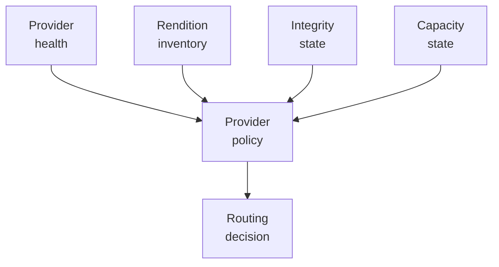

### Data plane

The data plane carries the expensive bytes:

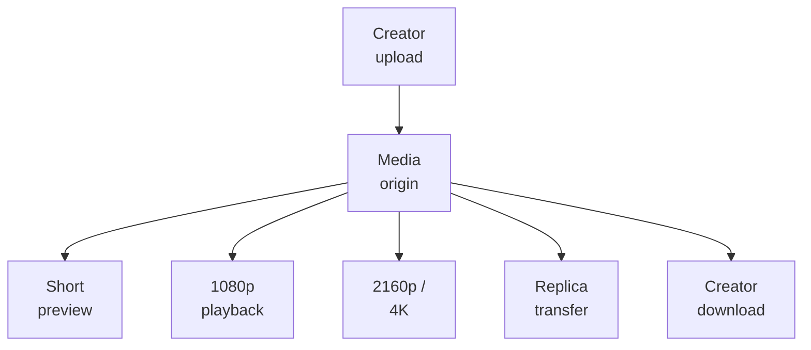

Keeping these planes separate makes future infrastructure changes possible without changing the player-facing media identity contract.

---

## 5. Provider roles

### HOME_MEDIA — preferred provider

HOME_MEDIA is the preferred high-capacity media provider when healthy and verified.

Its intended responsibilities include:

- creator-master storage;
- 2160p / 4K rendition storage;
- 1080p rendition storage;
- short low-resolution preview storage;
- poster/frame assets;
- media inspection/processing capacity;
- checksum verification;
- replication source capability;
- long-term catalogue storage.

HOME_MEDIA is useful because it can contribute privately owned storage and compute capacity, but the architecture does **not** assume that home hardware or residential connectivity is continuously available.

### VPS_MEDIA — independent fallback

VPS_MEDIA remains an independently available provider whose purpose is resilience rather than exact duplication of every HOME byte.

Its persistent catalogue role includes:

- 1080p playback fallback;
- short preview fallback;
- poster/frame assets;
- temporary private upload ingress when HOME is unavailable.

A key invariant is:

> **VPS_MEDIA persistent production catalogue ceiling = 1080p. HOME_MEDIA owns durable 2160p / 4K and creator-master storage.**

That policy limits expensive duplication while preserving a useful production fallback.

---

## 6. Canonical media-tier policy

For video that qualifies for the full rendition set, Millenova targets three different products rather than treating one file as suitable everywhere.

| Tier | Target | Purpose | Persistent placement |
|---|---|---|---|
| **Preview** | ~540p, ~20–30 seconds | Card/hover/fast preview loop | HOME + VPS |
| **Standard** | 1080p | Always-available production playback | HOME + VPS |
| **Premium** | 2160p / 4K | Highest-quality Stage playback | HOME only |

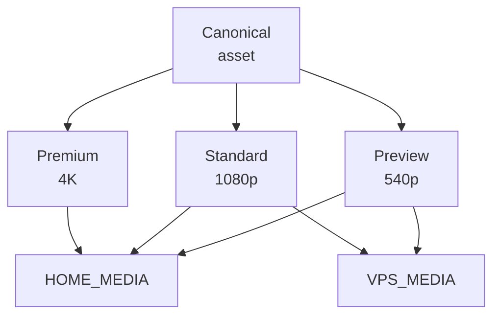

The preview is intentionally an independent short object. A missing preview must not silently cause a card hover to spend a full 1080p playback stream.

---

## 7. HOME available vs HOME unavailable upload paths

DMN is designed so a HOME outage lowers available capability without turning a valid creator upload into total failure.

### HOME available

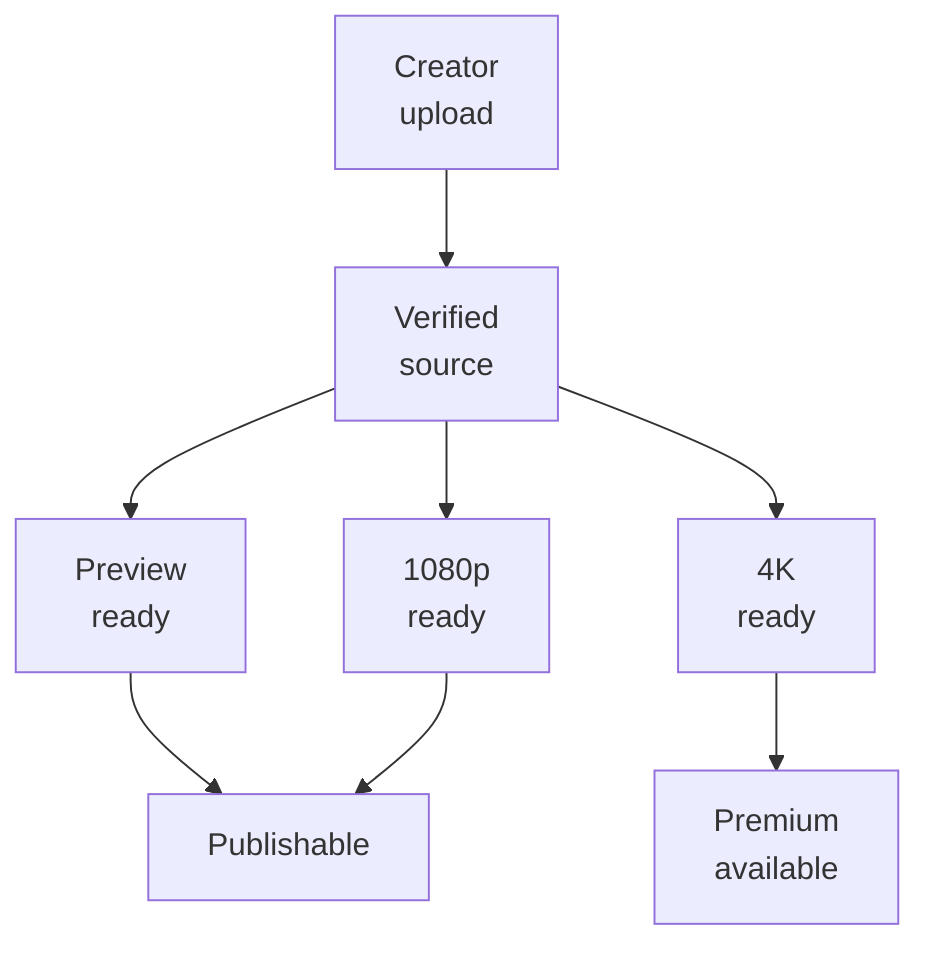

### HOME unavailable

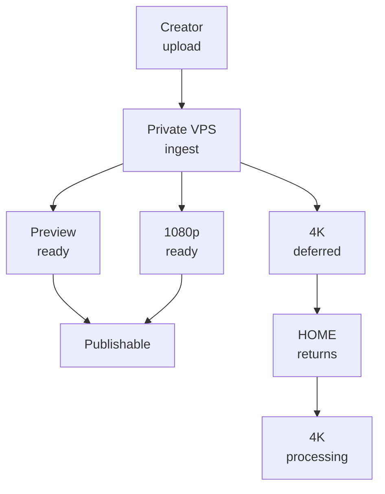

The creator should not need to upload again merely because HOME was temporarily unavailable.

A higher-resolution source may therefore exist temporarily on VPS as a **private, non-playable ingest object** until verified HOME receipt permits the deferred premium path to continue.

That temporary object is not a durable catalogue rendition and must not silently become permanent VPS master storage.

---

## 8. Deferred premium state is not failure

A key product/infrastructure distinction is:

```text
preview READY
1080p READY
4K pending because HOME is unavailable
        ↓
video is still publishable and playable
```

Conceptual restart-safe states include:

```text
PENDING_HOME_TRANSFER
PENDING_HOME_4K
HOME_TRANSFER_COPYING
HOME_TRANSFER_VERIFYING
4K_PROCESSING
4K_VERIFYING
4K_READY
```

The exact internal names may evolve, but the semantics must remain observable and durable.

The important rule is:

> **A HOME outage is a deferred enhancement when 1080p is valid, not a failed upload.**

---

## 9. Provider selection

For a new logical playback request, backend policy considers both provider health and verified rendition availability.

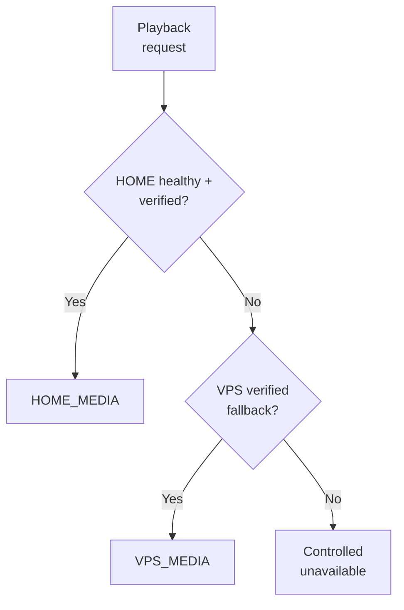

Reachability alone is not enough. A provider can be alive while the requested rendition is absent or unverified.

For premium Stage playback, the intended fallback behavior is straightforward:

```text
verified HOME 2160p available
        ↓ yes
serve premium rendition

otherwise
        ↓
verified VPS 1080p available
        ↓ yes
serve HD fallback
```

The current programme has opened the production-delivery checkpoint and is actively implementing this real provider-selection path; it should not yet be described as fully closed end-to-end.

---

## 10. Health, reachability and routing authority

DMN distinguishes **process supervision** from **routing authority**.

A process manager or transport supervisor may keep services alive, but it does not prove that a provider can serve the requested asset correctly.

Routing therefore depends conceptually on evidence such as:

- provider service health;
- private transport reachability;
- requested-rendition presence;
- replica verification;
- provider readiness state.

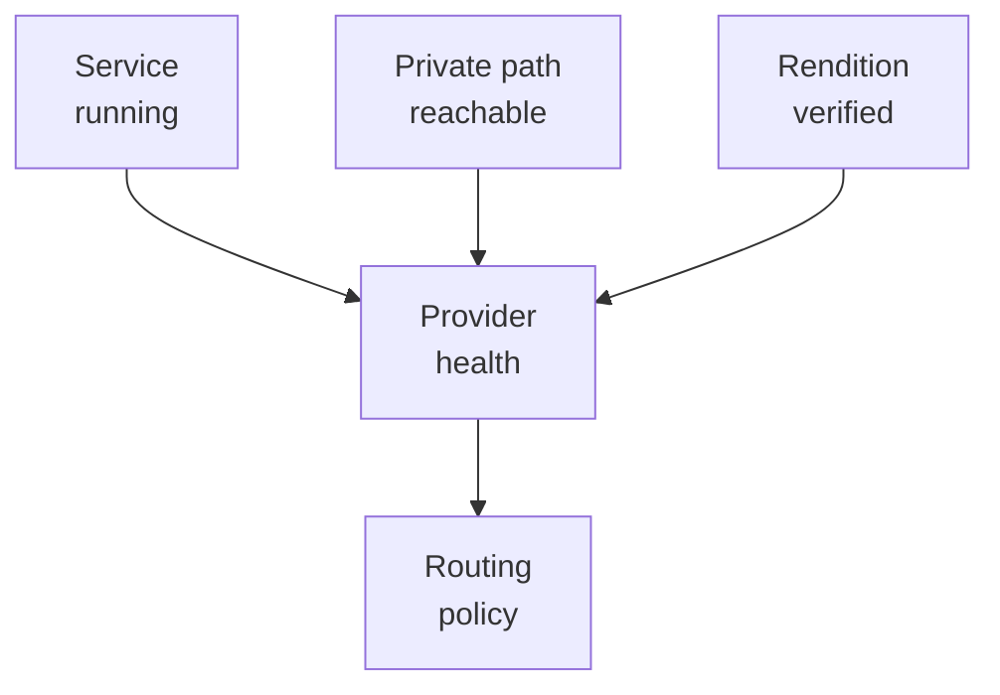

This prevents a superficial "process exists" signal from becoming the authority for production media delivery.

---

## 11. Replication is copy + verification, not copy alone

A distributed media system cannot call replication successful merely because bytes were transferred.

A useful replica lifecycle is:

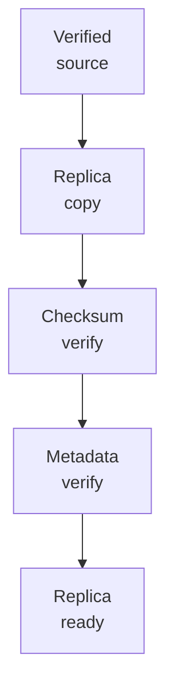

The destination must prove that the expected object arrived intact before provider policy treats that replica as usable.

This matters especially for destructive cleanup. Source retirement must remain downstream of verified destination state rather than transfer initiation.

---

## 12. Recovery semantics

DMN distinguishes **fallback** from **recovery**.

Fallback keeps the application useful while the preferred path is unavailable. Recovery restores preference for later/new work after HOME becomes healthy again.

```text
HOME healthy
   ↓
HOME preferred

HOME unavailable
   ↓
VPS fallback keeps 1080p available

HOME returns
   ↓
health + reachability + integrity re-established
   ↓
new authorizations may prefer HOME again
```

Active playback should not be jerked between origins merely because HOME recovered mid-session. Provider recovery is therefore a transport-policy problem, not a reason to rewrite current track identity.

The later DMN-5 work owns the detailed player-facing recovery behavior after the active DMN-4 production-delivery proof.

---

## 13. Hero is intentionally a different bandwidth policy

Highest available Stage quality and Hero delivery do not have to share the same ceiling.

The current DMN policy keeps **Hero at a maximum of 1080p on either provider**, even when HOME has a verified 4K Stage rendition.

That avoids spending premium-bandwidth media continuously on a rotating/looping surface where the product value may not justify the cost.

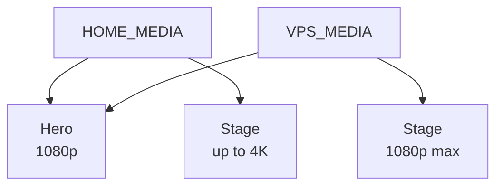

This is an example of media policy being surface-specific rather than assuming "maximum quality everywhere" is automatically correct.

---

## 14. Storage economics

A distributed design is partly an engineering response to storage shape.

If one video has:

- source/master bytes `M`;
- 4K rendition bytes `U`;
- 1080p rendition bytes `H`;
- preview bytes `P`;

then duplicating every tier across both providers would require roughly:

```text
2 × (M + U + H + P)
```

The current placement policy instead trends toward:

```text
HOME: M + U + H + P
VPS : H + P
```

plus bounded temporary ingest when HOME is unavailable.

That dramatically changes the marginal cost of keeping a fallback without pretending fallback means complete byte-for-byte duplication of premium/archive tiers.

---

## 15. Egress economics

Home-owned storage does not mean bandwidth is physically free.

For a rendition with average bitrate `b` bits/second and watch duration `t` seconds, approximate transferred bytes are:

```text
bytes ≈ (b × t) / 8
```

For `n` full plays:

```text
total bytes ≈ n × (b × t) / 8
```

A looping Hero or repeatedly replayed 4K video can therefore turn into sustained outbound traffic even when storage itself is inexpensive.

DMN accounting needs to make this visible rather than describing home egress as "free." Useful observability includes:

- bytes served by provider;
- storage used by media tier;
- temporary-ingest pressure;
- replica bytes transferred;
- fallback-session counts;
- deferred HOME work;
- premium-rendition availability.

---

## 16. Preview economics

Preview media is one of the simplest examples of architecture following economics.

A 20–30 second low-resolution preview is cheap enough to duplicate across HOME and VPS, while a full 1080p or 4K stream is not an efficient default for tiny card interactions.

This yields a useful product rule:

> **Use the cheapest media object that truthfully satisfies the surface.**

Stage needs full playback. A hover card usually does not.

---

## 17. Upload routing

DMN reuses the existing first-party upload lifecycle rather than creating a second upload system.

Conceptually:

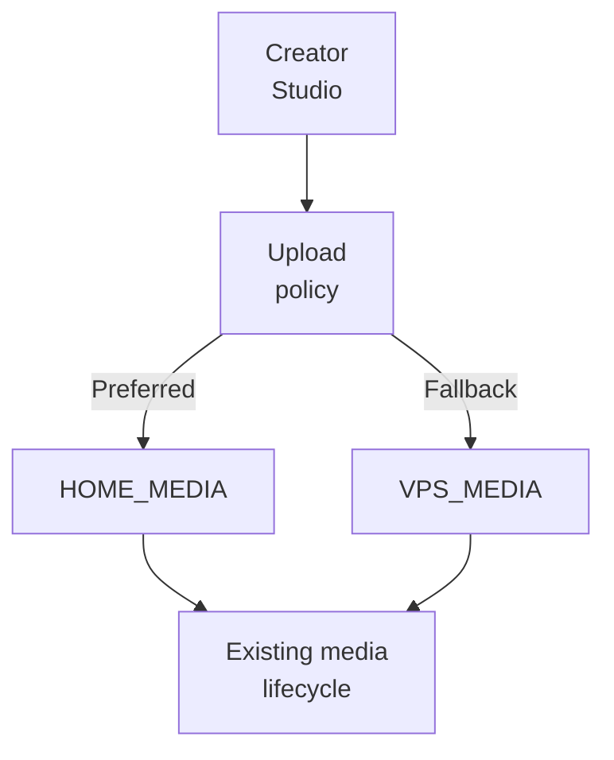

The upload-provider decision changes physical destination, not creator identity, post identity, media-asset lifecycle or rights semantics.

Checkpoint C has been completed in the private programme: upload routing, verified replication/recovery foundation and accounting are established. Broader public creator rollout remains a separate product/rights/moderation decision.

---

## 18. Diagnostics should expose truth, not topology

Player diagnostics may eventually show non-sensitive delivery truth such as:

```text
HOME active
VPS fallback
HOME recovering
active rendition = HD / 4K
fallback ready = yes / no
```

That can be useful in Stats for Nerds because it helps diagnose whether a quality change came from network policy, provider health or rendition availability.

Diagnostics must not expose:

- private addresses;
- private ports;
- tunnel coordinates;
- storage paths;
- credentials;
- signing material;
- privileged operational commands.

The goal is **observable behavior without publishing attack surface**.

---

## 19. Private transport and future edge/CDN evolution

The current architecture allows a private HOME↔VPS transport path for the initial proof, but the logical provider model does not require every future viewer byte to travel through one fixed topology forever.

That is why the public architecture talks in terms of:

```text
provider
health
capability
verified rendition
origin
replica
```

rather than baking one transport route into Stage/MPlayer.

A future edge/CDN layer could sit in front of one or both origins while preserving the same logical asset/provider contract.

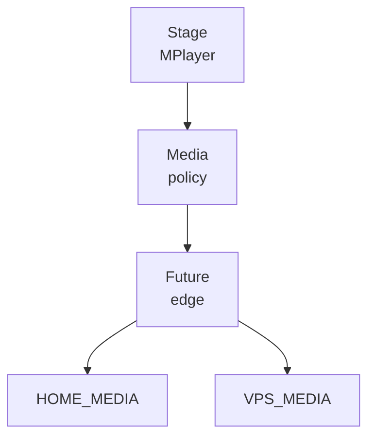

**Status:** edge/CDN delivery is a future architectural option, not a current production dependency.

---

## 20. Failure-domain model

| Failure | Desired behavior |
|---|---|
| HOME service unhealthy | Do not select HOME for new work |
| Private HOME path unreachable | Treat preferred provider as unavailable |
| HOME replica missing/unverified | Do not serve it merely because HOME is reachable |
| VPS fallback verified | Continue at fallback quality |
| Higher-resolution upload during HOME outage | Preserve private source; make preview/1080p useful; defer 4K |
| Replica transfer interrupted | Keep source; resume/retry safely |
| Destination checksum mismatch | Replica remains unusable |
| HOME recovers | Re-establish health/integrity, then prefer for later/new work |
| Observability unavailable | Do not let missing metrics redefine actual provider truth |
| Player transport unstable | Stop cross-system rollout rather than debugging provider and player semantics simultaneously |

This is why DMN is checkpointed instead of being introduced as one large infrastructure rewrite.

---

## 21. Why the design borrows from provider fallback but not blindly

The provider-selection idea came from an already useful pattern: keep one stable application contract, prefer a capable provider, fall back independently, then recover later.

Media adds a crucial difference: **the payload is much heavier**.

Provider health checks are cheap. A 4K play is not.

Therefore the architecture reuses the control-plane idea while introducing media-specific placement, replication, integrity, preview tiers and bandwidth accounting.

The lesson is not "copy another system." It is:

> **Reuse the proven control pattern; redesign the data plane for the actual workload.**

---

## 22. Current DMN status boundary

| Capability | Status | Public interpretation |
|---|---|---|
| Logical HOME_MEDIA / VPS_MEDIA provider model | **Complete foundation** | Physical provider identity is separated from media identity |
| HOME read/provider foundation | **Complete** | Preferred-provider mechanics have a dedicated foundation |
| Private HOME↔VPS bridge foundation | **Complete** | Private transport layer exists beneath provider semantics |
| Health + preferred/fallback router policy | **Complete** | Backend policy can model provider readiness/order |
| Upload routing foundation | **Complete** | Existing ingest lifecycle can be routed by provider policy |
| Verified replication/recovery foundation | **Complete** | Replica state is integrity-aware rather than copy-only |
| Storage/egress accounting foundation | **Complete** | Provider/tier economics can be observed |
| Checkpoint B | **Open** | Player-delivery integration is permitted to proceed |
| Production HOME/VPS playback authorization | **Active (DMN-4A)** | Real provider selection is the current implementation slice |
| Mid-playback/future-request recovery semantics | **Queued behind DMN-4 proof** | Do not present as fully shipped |
| Player-facing HOME/VPS diagnostics | **Queued with later DMN-5 work** | Public-safe delivery truth, not topology |
| Catalogue-scale migration | **Gated** | Waits for delivery/fallback/recovery gates |
| CDN/edge layer | **Future option** | Not current production dependency |

---

## 23. Public security boundary

This document intentionally exposes system architecture while withholding exploit-enabling operational detail.

It does **not** publish:

- production IP addresses or private hostnames;
- exact tunnel endpoints or private port mappings;
- SSH credentials/configuration;
- production signing secrets;
- storage-root filesystem paths;
- privileged deployment commands;
- private creator/media records;
- raw operational capability material;
- firewall rules or bypass procedures.

What is public is the engineering model: logical providers, server-side policy, verified replicas, fallback semantics, deferred premium work, tier placement, observability and recovery boundaries.

---

## 24. Related public documents

- [Native media engineering](NATIVE_MEDIA_ENGINEERING.md)
- [Platform architecture](../PLATFORM_ARCHITECTURE.md)
- [Technology map](../TECHNOLOGY.md)
- [Engineering overview](../ENGINEERING_OVERVIEW.md)
- [What is published here](../../WHAT_IS_PUBLISHED_HERE.md)
- [Public facade implementation plan](../../MILLENOVA_PUBLIC_FACADE_IMPLEMENTATION_PLAN.md)
- [Mermaid graph guide](../../agents/MERMAID_GRAPH_GUIDE.md)

The next publication step after PF-7 review is `../player/MPLAYER.md`, which moves upward from physical media-provider infrastructure to the persistent playback/queue/transport system that consumes the media contract.