# Millenova Distributed Media Node

**Status:** 🟡 PF-7 draft — under Wilder review  
**Private implementation authority:** `wilderruiz/millenova`  
**Public publication authority:** `wilderruiz/millenova-project`  
**Publication rule:** architecture is public; exploitable configuration is private.

The **Millenova Distributed Media Node (DMN)** programme separates logical media identity from the physical place where media bytes are stored, processed and served. First-party media made that separation necessary because large masters, multiple renditions and sustained playback create a very different infrastructure problem from ordinary web pages. DMN solves it by keeping one canonical media identity while letting backend policy choose the healthiest verified provider for each request. The result is a media system that can evolve its storage and delivery infrastructure without forcing Stage/MPlayer, playlists, reactions or discovery identity to care where the bytes physically live.

> **The player asks for logical media. The backend decides which verified provider can safely serve it.**

---

## 1. Why DMN exists

**First-party media turns storage into a systems problem rather than a file-upload feature.** Creator masters can be large and high-bitrate, 2160p renditions are expensive to keep everywhere, 1080p needs to remain broadly available, previews should be lightweight, and continuously rotating media surfaces can consume sustained egress. DMN addresses that pressure by treating physical media locations as logical providers rather than hard-coded paths or one permanently authoritative server. That gives Millenova room to use home-owned storage and processing capacity without turning the home machine into a single point of failure.

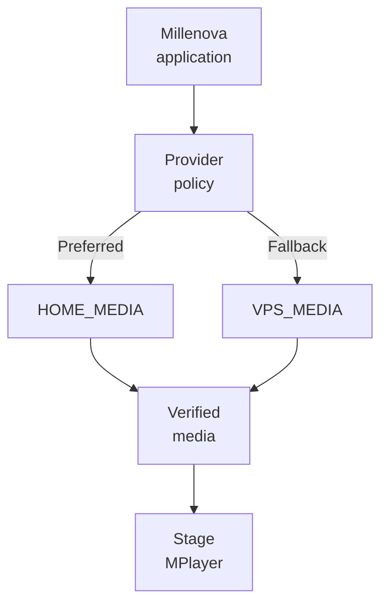

**The browser must never become the provider router.** If the client chose HOME or VPS directly, storage topology would leak into playback semantics and every infrastructure change would become a player change. DMN keeps that decision on the backend, where health, replica integrity and rendition availability can be evaluated together. The browser receives only the delivery result it needs, not the private operational details behind that choice.

---

## 2. Product semantics vs infrastructure semantics

**DMN works because product meaning and infrastructure placement are deliberately different concerns.** The first-party media programme owns post identity, media-asset identity, renditions, attachment, playback authority, Stage/MPlayer behavior, Studio upload lifecycle and the Hero/Beats/Signals boundaries, while DMN owns where bytes live, which provider is healthy, where processing may run, which replica is verified and how fallback or recovery is handled. This separation prevents storage engineering from silently redefining social behavior, queue semantics or player identity. In practical terms, DMN may change where verified bytes come from without changing what track the listener is playing.

---

## 3. Current execution state

**The DMN programme is intentionally phased so infrastructure work cannot destabilize the player by accident.** Provider foundation, the private HOME↔VPS transport bridge, provider-health policy, upload routing, verified replication and storage/egress observability are already established, while Checkpoint B is open for the first real delivery-integration work. DMN-4A is the active slice for production playback authorization/provider selection, and later DMN-5 recovery and player-facing delivery truth stay behind that proof. Catalogue-scale migration remains gated until delivery, fallback and recovery are demonstrated together.

| Area | Current state | Meaning |
|---|---|---|
| **DMN-1** | **Complete** | HOME_MEDIA provider foundation / read proof |
| **DMN-2** | **Complete** | Private HOME↔VPS transport bridge foundation |
| **DMN-3** | **Complete** | Provider health + preferred/fallback router policy |
| **Checkpoint B** | **Open** | Real playback-delivery integration is authorized to proceed |
| **DMN-4A** | **Active** | First production playback-authorization/provider-selection slice |
| **DMN-5** | **Queued behind DMN-4 proof** | Recovery and player-facing delivery truth remain downstream |
| **DMN-6** | **Complete** | Upload-provider routing foundation |
| **DMN-7** | **Complete** | Verified replication/recovery foundation |
| **DMN-8** | **Complete** | Storage/egress observability foundation |
| **Catalogue-scale gate** | **Gated** | Bulk migration waits for delivery/fallback/recovery proof |

**The status language matters because the architecture is ahead of the production rollout.** It would be misleading to describe the entire HOME/VPS delivery system as closed simply because the provider model, replication and accounting are already in place. The public record therefore distinguishes foundation from active delivery integration. That keeps the document technically ambitious without pretending the unfinished part is already solved.

---

## 4. Control plane vs data plane

**DMN becomes easier to reason about when policy state and heavy media traffic are treated as separate planes.** The control plane deals with provider health, rendition inventory, replica verification, storage readiness, upload routing, recovery state, deferred work, accounting and the final routing decision, while the data plane carries the expensive upload, playback, download and replication bytes. DMN keeps those responsibilities apart so provider policy can evolve without rewriting the mechanics of media transfer. This also leaves room for future transport changes, including a later edge/CDN layer, without changing canonical media identity.

### Control plane

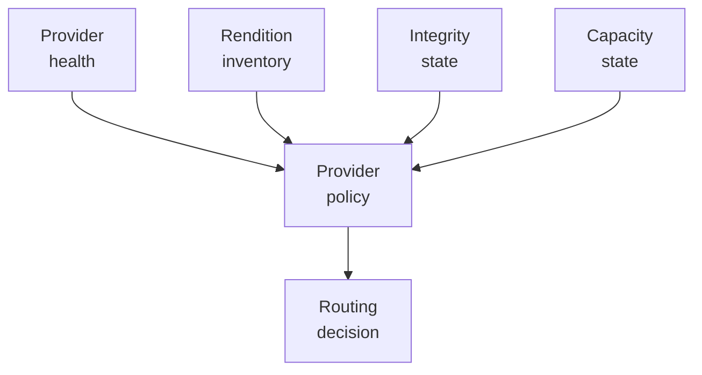

### Data plane

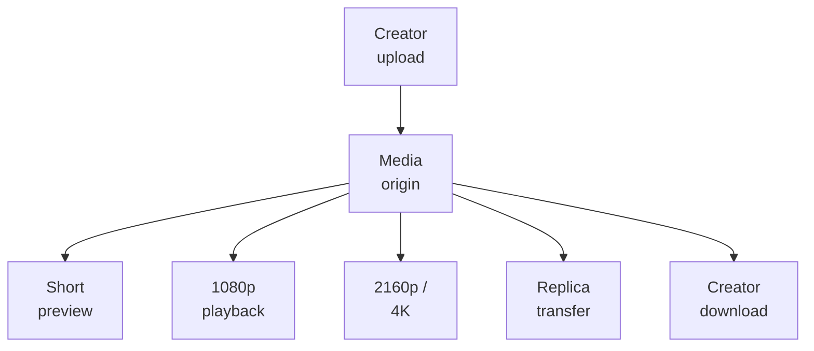

**This split is also an economics decision.** Health checks, metadata and integrity state are cheap compared with moving hundreds of megabytes of video. DMN can therefore make frequent control-plane decisions without pretending data-plane traffic is equally lightweight. That distinction is especially important for 4K playback, continuous Hero media and replica transfer.

---

## 5. Provider roles

### HOME_MEDIA — preferred provider

**HOME_MEDIA is the preferred high-capacity provider, not the sole source of truth for product identity.** The challenge is that Millenova wants to use privately owned storage and compute for creator masters, 4K, 1080p, previews, poster/frame assets, media inspection, processing, checksum verification and long-term catalogue growth without assuming the home machine or residential connectivity is continuously available. DMN solves that by making HOME preferred when healthy and verified while keeping all selection behind backend policy. This allows HOME to contribute substantial storage and processing capacity without becoming a hard dependency for basic playback continuity.

### VPS_MEDIA — independent fallback

**VPS_MEDIA exists to preserve service continuity, not to clone every HOME byte.** Duplicating masters and 4K renditions permanently on both providers would erase much of the storage advantage of the distributed design and create unnecessary cost. DMN therefore gives VPS a narrower persistent role: 1080p fallback, short preview fallback, poster/frame assets and temporary private upload ingress when HOME is unavailable. The hard invariant is that the persistent production catalogue ceiling on VPS is 1080p, while durable 2160p/4K and creator-master storage belong to HOME.

> **VPS_MEDIA persistent production catalogue ceiling = 1080p. HOME_MEDIA owns durable 2160p / 4K and creator-master storage.**

---

## 6. Canonical media-tier policy

**One rendition should not be forced to serve every product surface.** A hover card, an always-available Stage stream and a premium 4K playback session have different bandwidth and resilience requirements, so using one file everywhere would either waste bandwidth or sacrifice quality. Millenova therefore treats preview, standard and premium as distinct media products with different placement rules. The preview is a short low-resolution object on both providers, standard 1080p is also duplicated for fallback, and premium 2160p/4K remains HOME-only.

| Tier | Target | Purpose | Persistent placement |
|---|---|---|---|
| **Preview** | ~540p, ~20–30 seconds | Card/hover/fast preview loop | HOME + VPS |
| **Standard** | 1080p | Always-available production playback | HOME + VPS |
| **Premium** | 2160p / 4K | Highest-quality Stage playback | HOME only |

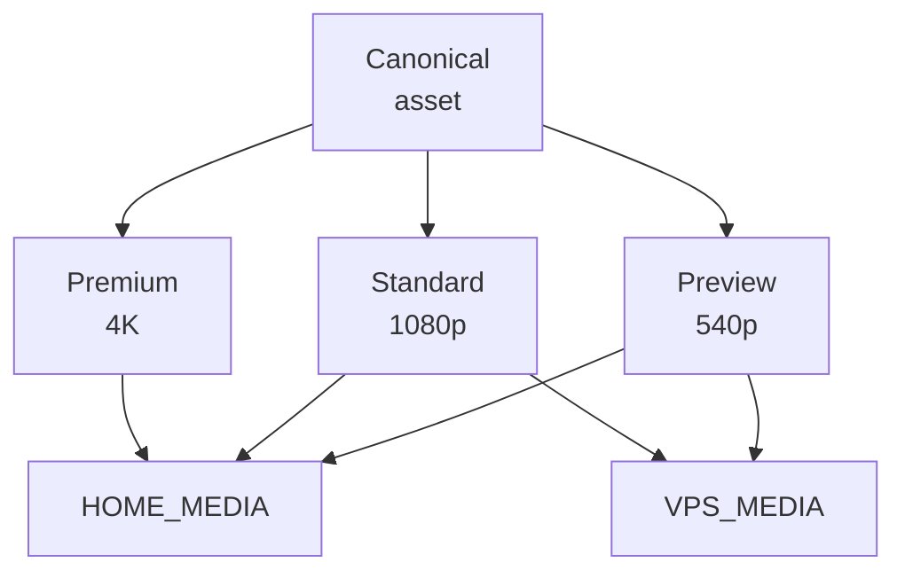

**The preview tier is intentionally independent of full playback.** If that lightweight object is missing, a card should not silently fall back to consuming a full 1080p production stream. The safer fallback is static artwork until the correct preview object exists. That keeps a small UI interaction from accidentally becoming a high-bandwidth media session.

---

## 7. HOME available vs HOME unavailable upload paths

**A HOME outage should reduce capability, not erase the value of a successful creator upload.** The difficult case is a high-resolution source arriving while the preferred provider is unavailable, because the platform still wants preview and 1080p readiness without losing the source needed for future true 4K. DMN solves that by allowing a bounded private VPS ingest path, deriving useful fallback outputs there, and deferring the premium HOME work until the preferred provider returns. The creator keeps a successful upload experience and does not need to repeat a multi-gigabyte transfer just because one infrastructure tier was temporarily down.

### HOME available

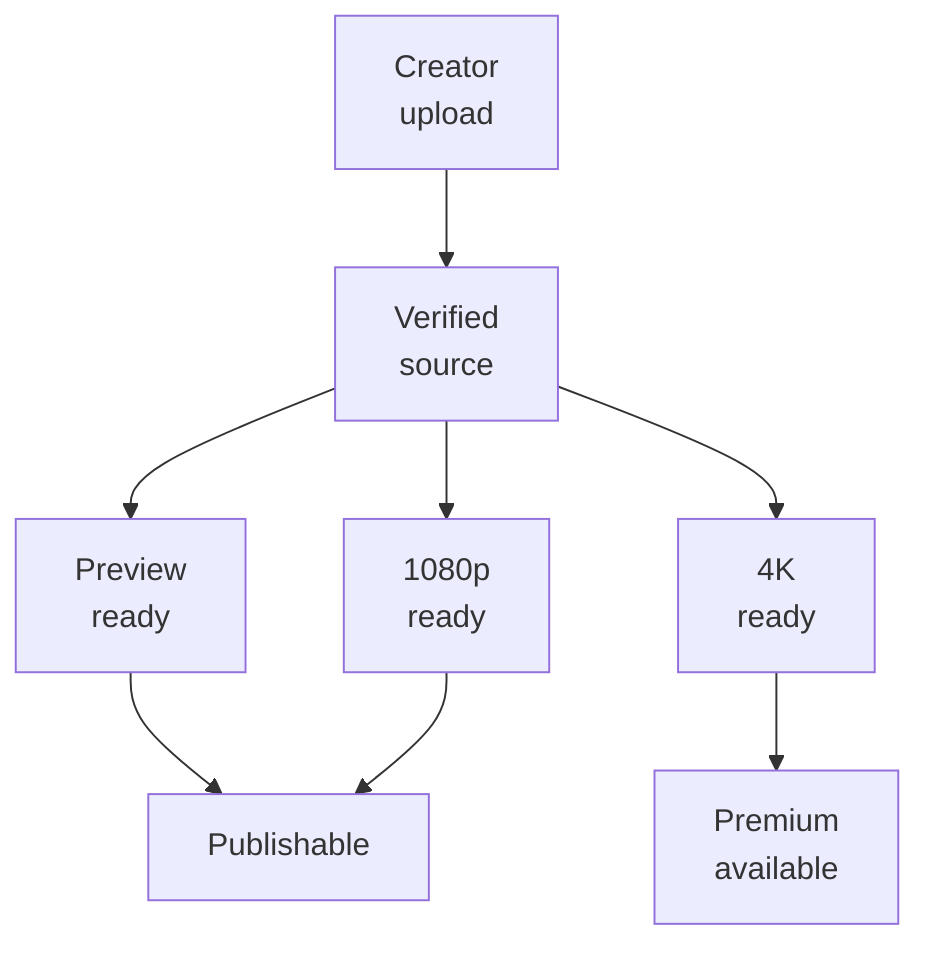

### HOME unavailable

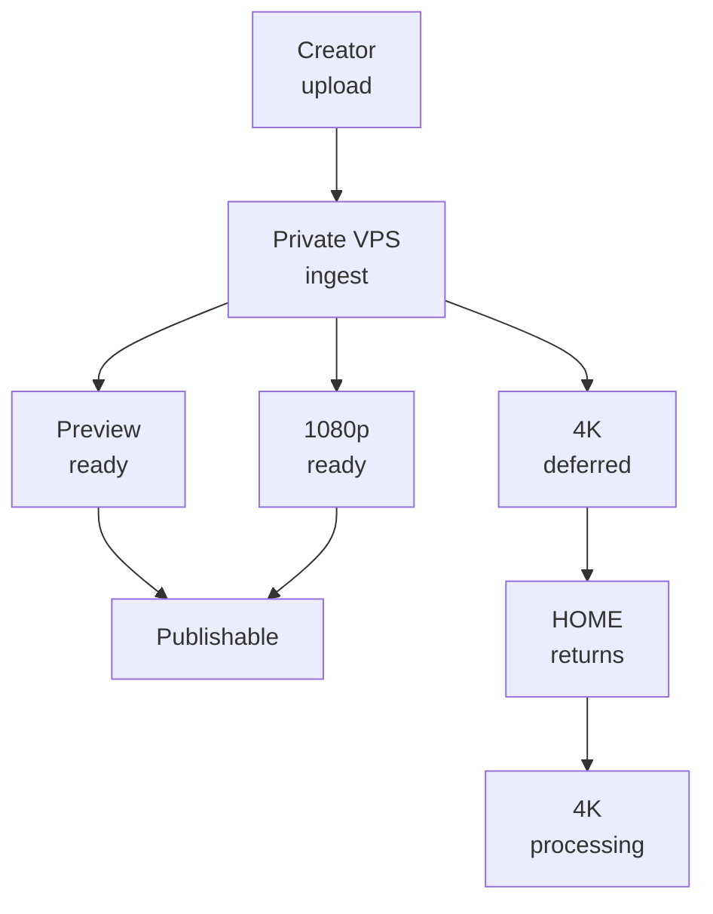

**Temporary VPS source retention is a recovery tool, not a storage-policy loophole.** A higher-resolution creator master may need to remain privately on VPS long enough to produce 1080p and later transfer safely to HOME, but that object is non-playable and is not a durable catalogue rendition. Once HOME receipt is verified, retention can move to its explicit cleanup gate. This keeps source safety separate from long-term placement policy.

---

## 8. Deferred premium state is not failure

**A valid 1080p video should not be marked failed simply because 4K is waiting for HOME.** Collapsing every incomplete rendition into one generic processing/error state would make a partial infrastructure outage look like a failed creator upload even when the standard production version is already healthy. DMN instead models premium work as a durable deferred enhancement, with restart-safe states for transfer, verification, processing and readiness. That means preview + 1080p can be publishable while 4K continues automatically later.

```text
preview READY
1080p READY
4K pending because HOME is unavailable
        ↓
video is still publishable and playable
```

```text
PENDING_HOME_TRANSFER
PENDING_HOME_4K
HOME_TRANSFER_COPYING
HOME_TRANSFER_VERIFYING
4K_PROCESSING
4K_VERIFYING
4K_READY
```

**The important product effect is that the creator is not asked to fix an infrastructure problem.** The exact internal state names may evolve, but the observable meaning must remain stable: 1080p works now, 4K is pending automatically, the source is safe and no re-upload is required. This is where infrastructure state becomes product experience. The system should present a deferred premium path, not a red failure state.

---

## 9. Provider selection

**A healthy process is not enough to make a provider eligible for playback.** HOME might respond to a health check while the requested rendition is absent, incomplete or unverified, so reachability alone would produce false confidence. DMN resolves a playback request by combining provider health with rendition-specific verification and only then selecting HOME or VPS. If neither verified path exists, the correct result is a controlled unavailable response rather than guessing.

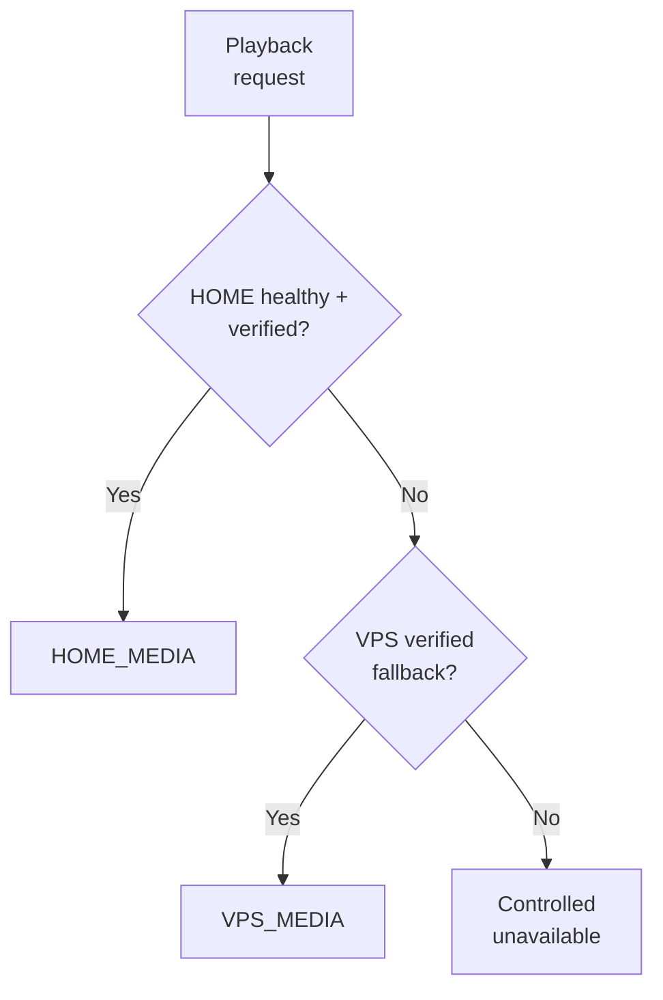

**Premium fallback is intentionally asymmetric.** If verified HOME 2160p exists, Stage may use it; if HOME is unavailable but verified VPS 1080p exists, Stage falls back to HD rather than trying to manufacture premium availability from the wrong provider. The current programme is actively implementing this production selection path under DMN-4A. It is therefore public as the target and active slice, not falsely labelled as fully closed end-to-end.

---

## 10. Health, reachability and routing authority

**Process supervision keeps services running, but routing authority must prove service usefulness.** A process manager can report that something is alive while the private path is broken or the requested rendition is missing, which would be a dangerous signal to treat as sufficient. DMN therefore bases readiness on the combination of service health, private-path reachability, verified media presence and provider state. This prevents superficial process existence from becoming the production-routing truth.

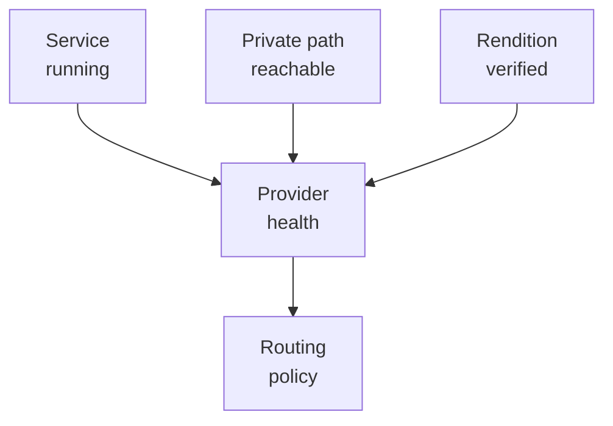

**This distinction also keeps operational tooling in its proper place.** A runtime supervisor may be essential for resilience, but it should never be the component that decides whether a viewer can safely receive a specific media object. Provider policy owns that judgment. The observable routing decision therefore reflects media truth rather than process-manager state.

---

## 11. Replication is copy + verification, not copy alone

**Moving bytes is not the same thing as creating a usable replica.** A transfer can complete with corruption, truncation, wrong metadata or the wrong object, so treating “copy finished” as “replica ready” would let damaged media enter the provider pool. DMN solves this by making checksum and metadata verification part of the replica lifecycle before the destination becomes eligible for routing. Source retirement remains downstream of verified destination state, not transfer initiation.

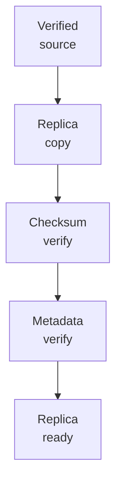

**This rule protects both resilience and cleanup safety.** A verified source should never be deleted merely because a destination transfer began or reported success at the transport layer. The receiving side must prove the expected bytes and media properties are actually present. That is what makes replication part of integrity management rather than simple file movement.

---

## 12. Recovery semantics

**Fallback and recovery solve different problems.** Fallback keeps the platform useful while HOME is unavailable, whereas recovery restores HOME as the preferred provider after health, reachability and integrity are re-established. DMN therefore keeps active playback stable instead of switching origins mid-session merely because HOME came back online. Later/new authorizations can prefer HOME again, while detailed player-facing recovery behavior remains owned by the later DMN-5 work.

```text
HOME healthy
   ↓
HOME preferred

HOME unavailable
   ↓
VPS fallback keeps 1080p available

HOME returns
   ↓
health + reachability + integrity re-established
   ↓
new authorizations may prefer HOME again
```

**The recovery model protects continuity from over-eager infrastructure automation.** A restored preferred provider is good news, but it should not create surprise state jumps for someone already watching a stable VPS-backed session. Recovery therefore changes eligibility for future policy decisions first. That keeps provider state separate from the identity and continuity of the current playback occurrence.

---

## 13. Hero is intentionally a different bandwidth policy

**Maximum quality is not automatically the correct policy for every surface.** Hero can rotate or loop continuously, so serving 4K there would multiply sustained egress without necessarily producing equivalent user value. DMN therefore caps Hero at 1080p on either provider while allowing Stage to reach 4K when HOME has a verified premium rendition. This makes bandwidth policy surface-specific instead of assuming every screen should request the largest available object.

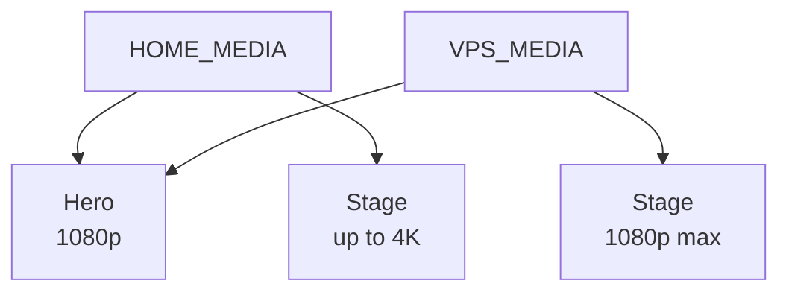

**The distinction also gives product design a clearer vocabulary.** Stage is a deliberate playback destination where premium quality may justify its cost, while Hero is a persistent ambient/featured surface where predictable bandwidth matters more. The same media asset can therefore have different delivery ceilings depending on the surface using it. That is policy, not inconsistency.

---

## 14. Storage economics

**A fallback strategy only helps if its duplication cost is controlled.** If every provider permanently held the creator master, 4K rendition, 1080p rendition and preview, total storage would grow roughly as `2 × (M + U + H + P)` for source/master bytes `M`, 4K bytes `U`, 1080p bytes `H` and preview bytes `P`. DMN instead keeps the expensive master and premium tier on HOME while duplicating the much cheaper standard and preview tiers on VPS. The practical shape trends toward `HOME: M + U + H + P` and `VPS: H + P`, plus bounded temporary ingest during outages.

**That placement model turns fallback into selective resilience rather than full mirroring.** The VPS carries enough durable media to preserve useful playback, but not every archive/premium byte. HOME keeps the high-capacity role where private storage economics are stronger. The result is lower duplication cost without pretending one provider can disappear with no quality trade-off at all.

---

## 15. Egress economics

**Cheap storage does not make video bandwidth free.** A rendition with average bitrate `b` bits/second watched for `t` seconds transfers approximately `(b × t) / 8` bytes, and `n` full plays scale that roughly to `n × (b × t) / 8`. DMN therefore treats egress as something to observe directly instead of assuming home-hosted playback has zero marginal cost. Looping Hero media, repeated 4K plays and replication traffic can all turn a storage win into a bandwidth bottleneck if left invisible.

```text
bytes ≈ (b × t) / 8

total bytes ≈ n × (b × t) / 8
```

**Useful accounting focuses on the decisions the system may actually need to change later.** Bytes served by provider, storage by media tier, temporary-ingest pressure, replica-transfer volume, fallback-session counts, deferred HOME work and premium-rendition availability all help show where the architecture is under pressure. These measurements should inform policy rather than merely decorate dashboards. That is why DMN-8 observability belongs in the architecture, not as an afterthought.

---

## 16. Preview economics

**Preview media is the clearest example of product behavior being shaped by infrastructure cost.** A 20–30 second low-resolution preview is cheap enough to duplicate across HOME and VPS, while launching a full 1080p or 4K stream for a tiny hover interaction wastes bandwidth and can compete with real playback. DMN solves that mismatch by treating preview as its own short media object with its own placement policy. The broader rule is simple: use the cheapest media object that truthfully satisfies the surface.

> **Use the cheapest media object that truthfully satisfies the surface.**

**This does not mean “always choose low quality.”** Stage still deserves full playback because the listener explicitly asked to watch or listen there, while a card hover usually does not. The architecture therefore preserves quality where it matters and saves bandwidth where the interaction is transient. That is a better fit than one universal rendition policy.

---

## 17. Upload routing

**DMN routes the existing upload lifecycle instead of inventing a second one.** The hard problem is physical destination choice, not creator identity, rights attestation, post identity or media-asset lifecycle, so rebuilding those semantics inside DMN would create duplicated authority. The provider policy therefore chooses HOME when appropriate and VPS when necessary, then hands the object back into the same first-party media lifecycle. Checkpoint C is already complete at the infrastructure level, while broad public creator rollout remains a separate product, rights and moderation decision.

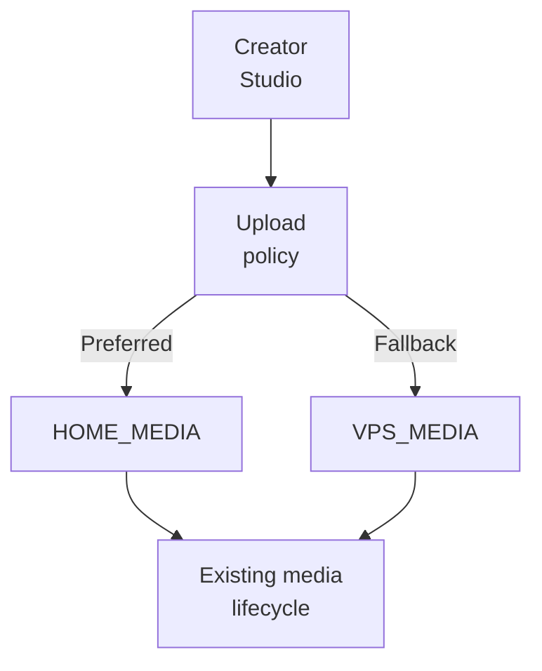

**This keeps one creator/media contract regardless of provider health.** A creator does not acquire a different kind of post because their upload was temporarily received through VPS, and the platform does not create a second rights model for fallback ingest. Provider selection changes physical placement only. Product identity remains stable.

---

## 18. Diagnostics should expose truth, not topology

**Good diagnostics should explain what the system decided without revealing how to attack it.** For player debugging it can be genuinely useful to know that HOME is active, VPS fallback is active, HOME is recovering, which rendition is playing or whether fallback is ready. DMN therefore aims to expose delivery class and readiness truth while withholding private addresses, ports, tunnel coordinates, storage paths, credentials, signing material and privileged commands. The result is observable behavior without publishing the operational topology behind it.

```text
HOME active
VPS fallback
HOME recovering
active rendition = HD / 4K
fallback ready = yes / no
```

**Stats for Nerds is the natural home for this public-safe truth.** It can help explain why a quality change occurred without forcing the user or engineer to inspect private infrastructure. That also makes diagnostics part of the provider contract rather than a collection of ad hoc debug strings. DMN-5 remains the later phase that turns this into player-facing delivery truth.

---

## 19. Private transport and future edge/CDN evolution

**The current private HOME↔VPS path should not become a permanent architectural prison.** The initial proof can use a private transport bridge, but if Stage/MPlayer depended on that topology directly, every future origin or CDN change would become a playback rewrite. DMN avoids that by expressing the public contract in terms of provider, health, capability, verified rendition, origin and replica. A future edge/CDN layer can therefore sit in front of one or both origins without changing canonical media identity or the player-facing contract.

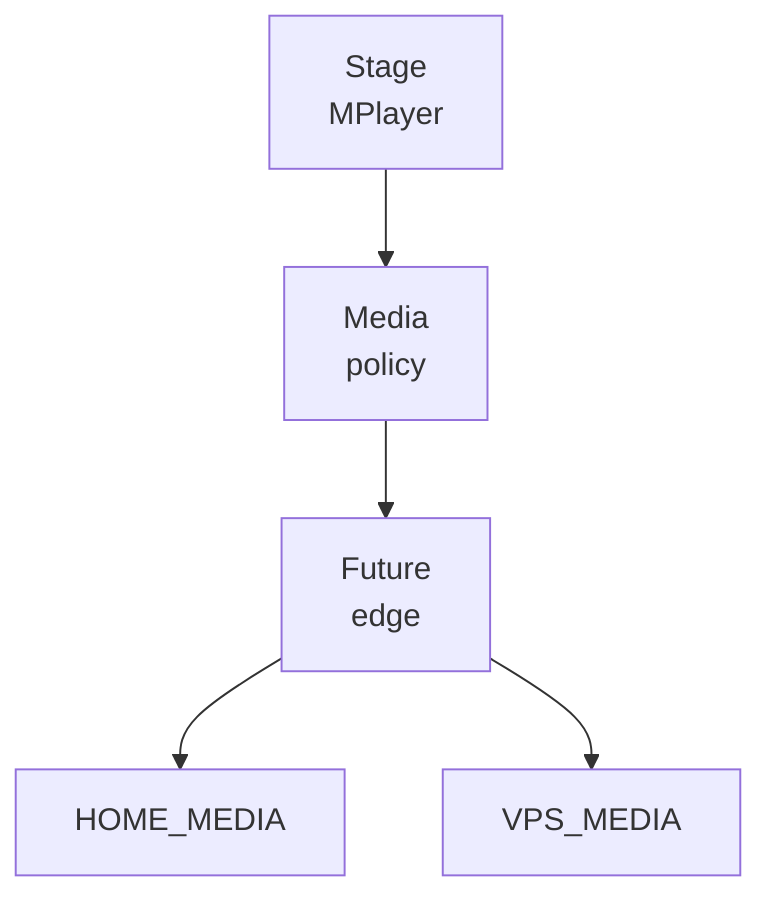

**Edge/CDN delivery is an architectural option, not a current dependency.** The public document includes it because the current abstractions are deliberately designed not to block that evolution later. No current production claim depends on an edge layer already existing. That distinction keeps the roadmap visible without mixing future architecture into present-state truth.

---

## 20. Failure-domain model

**A resilient media system should degrade by capability instead of collapsing into one generic failure.** HOME may be unhealthy, the private path may be unreachable, a replica may be missing, a transfer may be interrupted, a checksum may fail or the player may still be under transport stabilization, and each condition has a different correct response. DMN handles those cases by failing closed at the provider boundary, using verified VPS fallback where available, preserving source bytes during uncertain transfers and stopping cross-system rollout when another subsystem is not ready. This checkpointed approach makes failures diagnosable because provider, integrity, transport and player problems are not deliberately mixed together.

| Failure | Desired behavior |
|---|---|
| HOME service unhealthy | Do not select HOME for new work |
| Private HOME path unreachable | Treat preferred provider as unavailable |
| HOME replica missing/unverified | Do not serve it merely because HOME is reachable |
| VPS fallback verified | Continue at fallback quality |
| Higher-resolution upload during HOME outage | Preserve private source; make preview/1080p useful; defer 4K |
| Replica transfer interrupted | Keep source; resume/retry safely |
| Destination checksum mismatch | Replica remains unusable |
| HOME recovers | Re-establish health/integrity, then prefer for later/new work |
| Observability unavailable | Do not let missing metrics redefine actual provider truth |
| Player transport unstable | Stop cross-system rollout rather than debug provider and player semantics simultaneously |

**The table is intentionally a behavior map, not a list of implementation internals.** It shows what the system should do when each class of failure occurs without exposing private topology or bypass details. That makes the document useful for architectural review while preserving operational safety. It also gives later tests a clear set of behaviors to prove.

---

## 21. Why the design borrows from provider fallback but not blindly

**DMN reuses a proven provider-selection idea, not somebody else's data plane.** The useful pattern is to keep one stable application contract, prefer a capable provider, fall back independently and recover later, but media is fundamentally heavier than ordinary request/response workloads. DMN therefore keeps that control-plane idea while redesigning storage tiers, integrity verification, preview objects, replica policy and bandwidth accounting around large video payloads. The engineering lesson is to reuse the stable control pattern while adapting the byte-moving layer to the actual workload.

> **Reuse the proven control pattern; redesign the data plane for the actual workload.**

---

## 22. Current DMN status boundary

**The public record separates what is structurally complete from what is still being proven in production.** HOME/VPS provider identity, the read foundation, private transport bridge, health/router policy, upload routing, replication/recovery foundation and accounting already exist, while Checkpoint B is now open and DMN-4A is the active production authorization/provider-selection slice. Mid-playback recovery and player-facing diagnostics remain queued behind that proof, catalogue-scale migration is still gated, and CDN/edge remains a future option. This status boundary prevents the architecture diagram from being mistaken for a claim that every operational phase is already closed.

| Capability | Status | Public interpretation |
|---|---|---|
| Logical HOME_MEDIA / VPS_MEDIA provider model | **Complete foundation** | Physical provider identity is separated from media identity |
| HOME read/provider foundation | **Complete** | Preferred-provider mechanics have a dedicated foundation |
| Private HOME↔VPS bridge foundation | **Complete** | Private transport layer exists beneath provider semantics |
| Health + preferred/fallback router policy | **Complete** | Backend policy can model provider readiness/order |
| Upload routing foundation | **Complete** | Existing ingest lifecycle can be routed by provider policy |
| Verified replication/recovery foundation | **Complete** | Replica state is integrity-aware rather than copy-only |
| Storage/egress accounting foundation | **Complete** | Provider/tier economics can be observed |
| Checkpoint B | **Open** | Player-delivery integration is permitted to proceed |
| Production HOME/VPS playback authorization | **Active (DMN-4A)** | Real provider selection is the current implementation slice |
| Mid-playback/future-request recovery semantics | **Queued behind DMN-4 proof** | Do not present as fully shipped |
| Player-facing HOME/VPS diagnostics | **Queued with later DMN-5 work** | Public-safe delivery truth, not topology |
| Catalogue-scale migration | **Gated** | Waits for delivery/fallback/recovery gates |
| CDN/edge layer | **Future option** | Not current production dependency |

---

## 23. Public security boundary

**DMN is intentionally transparent about architecture while remaining strict about operational secrets.** The public document explains logical providers, server-side selection, verified replicas, fallback semantics, deferred premium work, tier placement, observability and recovery because those ideas are valuable engineering content. It omits production IP addresses, private hostnames, exact tunnel/port mappings, SSH configuration, signing secrets, storage-root paths, privileged deployment commands, private creator/media records and firewall/bypass details. That preserves the principle that architecture can be public without publishing the keys required to cross the production boundary.

---

## 24. Related public documents

The DMN document is most useful when read as the infrastructure layer beneath the already-published native-media and platform architecture material. [`NATIVE_MEDIA_ENGINEERING.md`](NATIVE_MEDIA_ENGINEERING.md) explains canonical media identity and playback, [`PLATFORM_ARCHITECTURE.md`](../PLATFORM_ARCHITECTURE.md) explains the broader state boundaries, and [`TECHNOLOGY.md`](../TECHNOLOGY.md) maps the runtime/tooling responsibilities. The public-facade plan and agent guides remain the process authority for how these documents are reviewed and advanced. The next publication step after PF-7 review is `../player/MPLAYER.md`, which moves upward from physical provider infrastructure to persistent playback, queue and transport semantics.
