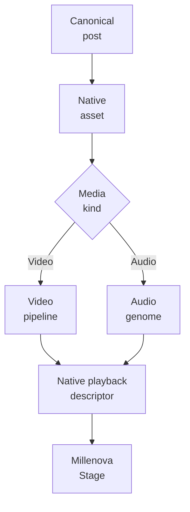
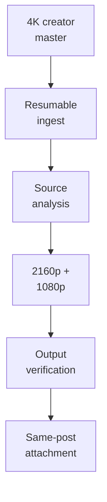
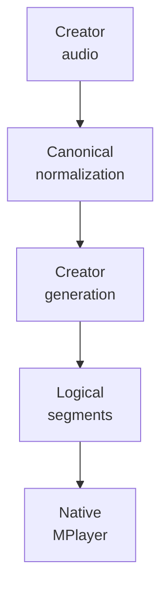
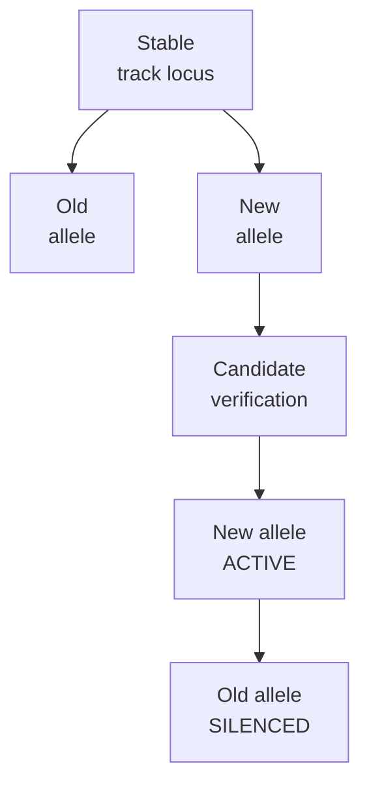
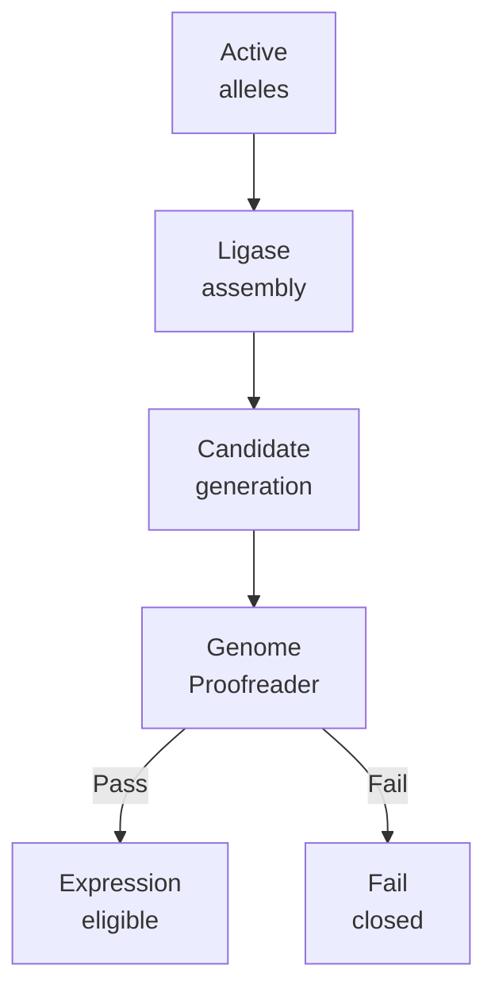
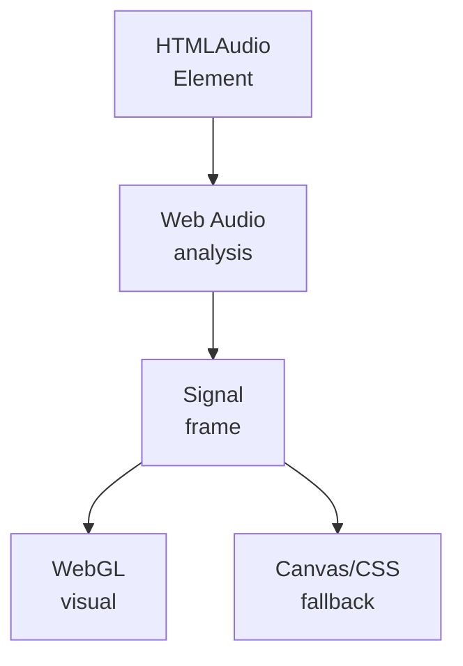

# Millenova Native Media Engineering

**Status:** ✅ PF-6 approved · architecture correction applied 2026-10-13  
**Private implementation authority:** `wilderruiz/millenova`  
**Public publication authority:** `wilderruiz/millenova-project`  
**Publication rule:** architecture is public; exploitable configuration is private.

Millenova's native-media architecture now has two mature first-party branches: **video**, where large masters become verified playback renditions, and **audio**, where accepted creator masters become immutable evidence that can be assembled into verified logical playback generations. Both branches preserve the same product rule: the post is the durable public identity, while media storage, processing artifacts and transient playback capabilities remain subordinate state.

> **A post is not a file. An accepted artifact is not a playback URL. A playback generation is not permission to rewrite ingest evidence.**

---

## 1. Shared native-media boundary



The shared boundary is ownership, rights, media identity and authoritative native playback. Video and audio then diverge because their processing economics and logical playback models are different. Millenova does not force MP4, MP3 and WAV through one artificial transformation pipeline merely to make the architecture diagram look uniform.

---

## 2. Video: large masters are normal input

**Native video is designed around real creator masters rather than already-optimized web files.** Multi-gigabyte 4K uploads can fail mid-transfer, browser sessions can reload and media services can restart, so a monolithic upload would repeatedly waste creator time and bandwidth. Millenova uses resumable chunked transfer, source analysis and explicit lifecycle state so transport failure is recoverable rather than destructive.

The production 4K pilot proved this with a real source a little over 1 GiB. The resumable path survived interruption, browser reload and media-runtime restart, and FFprobe then classified the source before rendition work began.



---

## 3. Video rendition policy is evidence-driven

**Transcoding is not success merely because FFmpeg exited with code zero.** The first video programme benchmarked representative samples, compared visual quality and then generated full verified 2160p and 1080p outputs. The accepted pilot settings favored browser compatibility, while source/master bytes remained protected behind an explicit cleanup decision rather than being deleted automatically after rendition success.

That separation still matters under DMN. Rendition readiness, post attachment and physical HOME/VPS placement are different state transitions, and each can fail or recover independently.

---

## 4. Audio: normalize first, then build logical generations

**Native audio needed a different architecture because concatenating arbitrary original MP3 files directly would make timing and boundaries fragile.** Millenova normalizes incoming audio into one canonical browser-safe profile and builds creator-owned sharded generations with an authoritative logical segment map. The listener experiences each segment as an ordinary track even though physical bytes can live inside a longer creator generation object.



This keeps seek, Repeat, Previous, Next and `ended` in track-local time while allowing storage and delivery to use larger shared audio objects underneath.

---

## 5. Artifact DNA freezes ingest truth

**The newest audio architecture treats accepted ingest evidence as immutable.** When a creator master crosses the trusted ingest boundary, Millenova records Artifact DNA describing that exact accepted artifact: checksum, canonical sample rate/channels, canonical sample count and duration, head/tail fingerprints, deterministic boundary identities and a boundary-contract version.

Later encoding, replacement or generation work may verify or reference that evidence, but it must not rewrite the old DNA simply because a derived playback object differs after normalization or lossy encoding. This makes the creator artifact an immutable historical fact rather than a mutable row that later processing can bend into whatever shape is convenient.

---

## 6. Stable loci make replacement evolutionary rather than destructive

**A published native track needs a stable semantic identity even when the creator replaces the master.** The biological model calls that identity a **locus** and the accepted artifact occupying it an **allele**. A replacement MP3/WAV therefore becomes a new independently sequenced allele at the same locus; the old allele is silenced only after the candidate evolved generation has been verified and atomically activated.



A failed replacement leaves the current healthy allele untouched. Historical generations continue referencing the old immutable allele, so replacement does not rewrite the past or reorder the track simply because the new upload arrived later.

---

## 7. Evolution, expression and decommissioning are separate

**Millenova deliberately separates building the active genome from playing it and from retiring obsolete bytes.** Evolution takes trusted creator material through ingest, sequencing, locus selection, generation assembly and proofreading. Expression derives a disposable playback manifest from verified active state. Decommissioning handles silenced or legacy material only after historical, rollback and recovery dependencies are proven safe.

```text
EVOLUTION
master → Immune Gate → Sequencer → Artifact DNA
      → Recombinase → Ligase → Genome Proofreader
      → verified active genome

EXPRESSION
verified genome → RNA Polymerase → mRNA manifest → Ribosome → playback

DECOMMISSIONING
silenced allele → Genome Custodian → quarantine
               → purge eligibility → Nuclease
```

The old genome is never rewritten in place. New verified generations are descendants, not edits to historical evidence.

---

## 8. Recombinase owns native-track replacement

**Replacement is recombination, not file overwrite.** The Recombinase concept identifies the published native locus, verifies owner authority, accepts a newly sequenced Artifact DNA allele, preserves semantic order, builds a candidate evolved generation and activates it only after verification. It never edits either artifact's immutable DNA record.

This corrects an older Studio assumption that a published native source must be permanently locked. External-provider identity rules can remain strict, but same-owner native MP3/WAV evolution needs a replacement route that preserves public post/locus identity without pretending the new master is the same artifact.

---

## 9. Ligase assembles generations; Proofreader verifies them

**Joining active audio members into an encoded generation is not enough to make that generation trustworthy.** Ligase deterministically assembles active members and sentinel guards using exact canonical sample counts, while the Audio Genome Proofreader decodes boundary windows from the candidate output and checks them against immutable Artifact DNA plus expected geometry.



The Proofreader can reject a candidate, but it cannot mutate DNA to make the candidate pass. Sentinel guards and creator transients are verification concerns, not permission to silently trim the creator's content.

---

## 10. RNA Polymerase creates disposable playback expression

**Playback should consume a derived manifest instead of raw ingest/storage state.** RNA Polymerase reads the active verified genome and projects the transient facts the runtime needs: post/locus identity, active allele, generation, content start/end sample geometry, logical duration and authorized playback capability. That manifest is the Millenova analogy to mRNA.

Because the manifest is disposable, workspace restore or future distributed execution can derive a fresh expression from current authoritative genome state without mutating Artifact DNA or persisting an expired URL as canonical track identity.

---

## 11. MPlayer is the Ribosome layer for native playback

**The runtime player expresses the manifest; it does not own the genome.** Native Stage/MPlayer consumes the logical playback descriptor, maps track-local time onto the underlying media object, and handles Play/Pause/seek/Repeat/Previous/Next/ended semantics. For video, the descriptor points to a verified rendition; for audio, it projects the logical segment inside a verified generation.

This is why an audio replacement can keep the same public track locus while later playback resolves to a new active allele. The player knows what to express now; it does not rewrite why that expression is authoritative.

---

## 12. Immune Gate keeps creator uploads inert

**Creator media is foreign input, not executable architecture.** Millenova owns the enzymes and control plane, while uploaded MP3/WAV/MP4 supplies inert media data only. Ingest therefore validates media/container agreement, codecs and streams, size/duration/chunk bounds, malformed-container behavior, path safety, checksums and authorization/ownership before content can become trusted native state.

The public architecture intentionally stops at that boundary. Exact operational limits, private endpoints and bypass-relevant configuration remain private.

---

## 13. Genome Custodian separates silencing from deletion

**Silenced does not mean deleted.** A replaced or legacy allele can be excluded from new expression while still being required by historical generations, rollback or recovery state. The Genome Custodian resolves those references, moves eligible material through quarantine and only marks it purge-eligible after the safety conditions are satisfied; the Nuclease concept represents the final physical purge step.

Canonical lifecycle language is:

```text
ACTIVE → SILENCED → QUARANTINED → PURGE_ELIGIBLE → PURGED
```

This gives Millenova a clean answer to a common media-system problem: historical reproducibility and storage cleanup can coexist without pretending they are the same operation.

---

## 14. Audio Visual Engine is optional expression presentation

**Native audio deserves a visual Stage, but audio cannot depend on graphics succeeding.** The Millenova Audio Visual Engine uses `HTMLAudioElement` plus Web Audio / `AnalyserNode` signal evidence to drive adaptive browser-side visuals. Capable devices may render a richer WebGL experience, constrained/reduced-motion devices can use a lighter path, and Canvas/CSS/static presentation remains a fallback.



The media element remains the physical playback authority throughout. If the visualizer fails, the song continues.

---

## 15. Playback capabilities are transport, not identity

**Short-lived playback authorization is allowed to expire because the post/media/genome identity does not.** The browser requests a current native playback capability, while server-side policy resolves the valid rendition or audio expression from canonical state. Persistent workspaces therefore store durable track/queue context and obtain fresh transport on restore.

This also keeps DMN below the product layer. HOME_MEDIA or VPS_MEDIA may serve native bytes, but physical origin selection does not redefine the post, audio locus or active allele.

---

## 16. Provider playback is now a sibling architecture, not native-media identity

**External provider posts may still coexist with native posts in Home, but they are not first-party media assets.** The approved Stage-family architecture gives YouTube, Spotify and SoundCloud their own capability-scoped Stages using official supported players. A provider reference can remain metadata or attribution around native content, but Millenova must not treat a provider URL as Artifact DNA, a native media asset or DMN-controlled bytes.

This corrects the older public wording that made provider adapters appear to be the permanent shape of one universal player.

---

## 17. Native media failure domains

| Failure | Correct authority |
|---|---|
| Upload interruption | Resumable ingest contract |
| Invalid/malformed source | Immune Gate / ingest validation |
| Video rendition failure | Video processing lifecycle |
| Audio generation boundary mismatch | Genome Proofreader |
| Failed replacement candidate | Recombinase/evolution layer; keep old allele active |
| Browser autoplay block | Native playback policy |
| Native origin outage | DMN provider policy |
| Visualizer failure | Presentation fallback; audio continues |
| Stale async completion | Native/MPlayer generation guard |

The goal is capability degradation rather than generic “media failed” collapse.

---

## 18. Current status boundary

| Capability | Status |
|---|---|
| Canonical media asset + same-post attachment | **Production foundation** |
| Resumable large video ingest | **Production-proven** |
| 2160p + 1080p video renditions | **Production-proven** |
| Native browser video playback | **Production complete core** |
| Native MP3 normalization/generation foundation | **Complete** |
| Logical native-audio Stage integration | **Complete foundation** |
| Millenova Audio Visual Engine | **Complete foundation / runtime acceptance active** |
| Artifact DNA + sentinel/boundary evidence | **Implemented / active validation** |
| Biological locus/allele evolution architecture | **Active canonical architecture** |
| Native replacement/Recombinase route | **Active implementation direction** |
| DMN-4A/B/C native delivery | **Complete** |
| DMN-4D Hero native routing | **Active** |
| Provider-scoped Stage families | **Approved next architecture** |
| Rich Post Stage | **Approved / queued** |

---

## 19. Public security boundary

This document publishes native-media state design, audio-genome concepts and verification logic while excluding production credentials, signing material, private addresses, exact ingest thresholds, storage roots, privileged endpoints, private creator records and bypass-enabling operational detail.

The public value is the architecture: immutable ingest evidence, stable semantic identity, verified generations, derived expression and failure isolation. The private implementation retains the keys and coordinates required to operate the live system.

---

## 20. Related public documents

- [Platform architecture](../PLATFORM_ARCHITECTURE.md)
- [Technology map](../TECHNOLOGY.md)
- [Distributed Media Node](DISTRIBUTED_MEDIA_NODE.md)
- [MPlayer](../player/MPLAYER.md)
- [Public facade implementation plan](../../MILLENOVA_PUBLIC_FACADE_IMPLEMENTATION_PLAN.md)

The next media-facing public work should continue to distinguish **native product identity**, **audio-genome authority**, **runtime expression**, and **physical provider delivery** instead of collapsing them into one media URL.