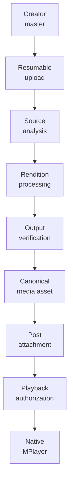
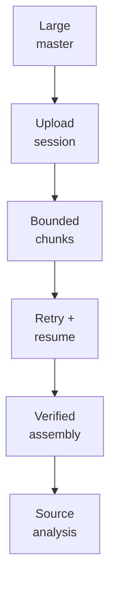
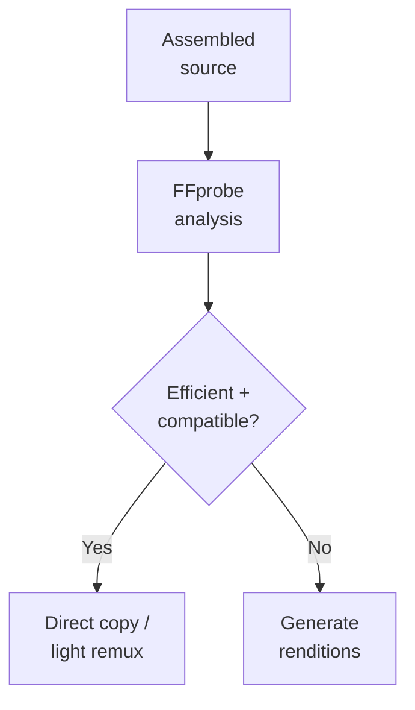
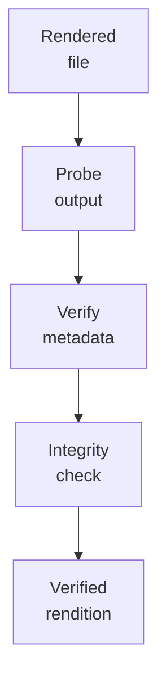
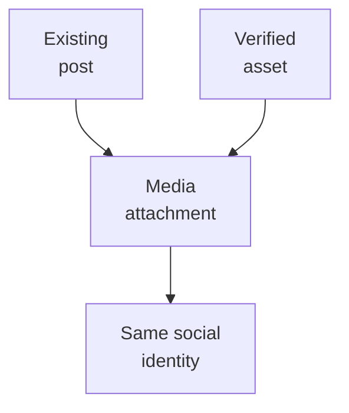
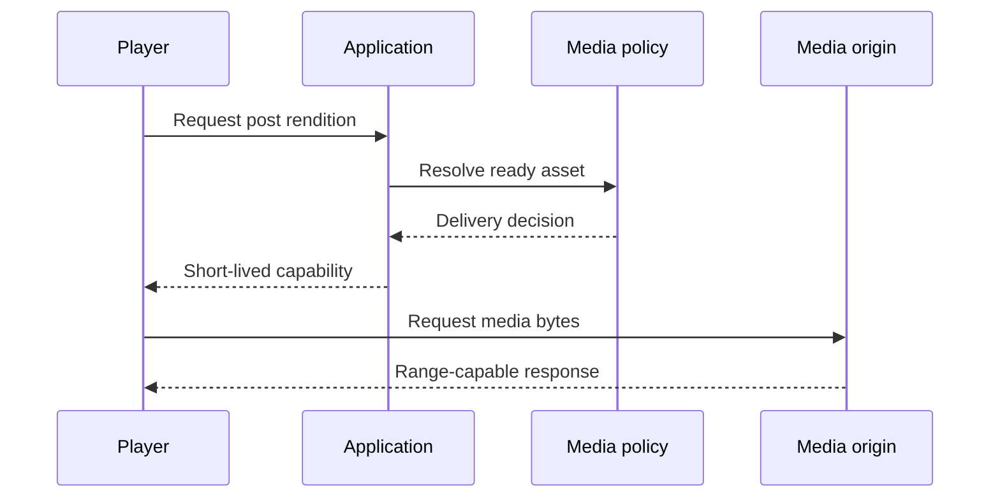
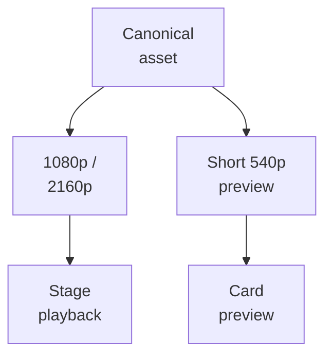
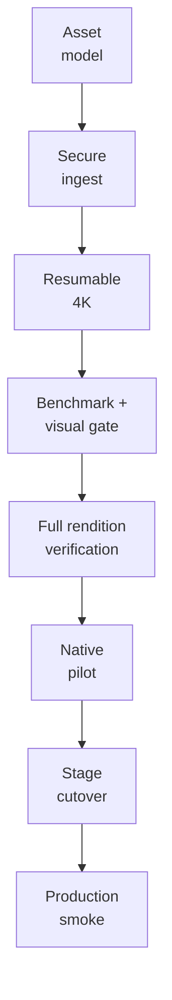

# Millenova Native Media Engineering

**Status:** 🟡 PF-6 draft — under Wilder review  
**Private implementation authority:** `wilderruiz/millenova`  
**Public publication authority:** `wilderruiz/millenova-project`  
**Publication rule:** architecture is public; exploitable configuration is private.

Millenova's first-party media programme changed the platform from a system that primarily orchestrated external providers into one that can also own the media lifecycle itself: creator upload, source analysis, rendition generation, verification, attachment and native browser playback.

The central engineering rule is:

> **A post is not a file, a media asset is not a provider location, and playback state is not storage state.**

Keeping those identities separate is what allows Millenova to evolve storage, quality, playback and distributed-media infrastructure without rewriting reactions, playlists, discovery identity or queue semantics.

---

## 1. End-to-end native-media path



Each stage has a different responsibility. Upload completion does not imply rendition readiness. Rendition generation does not imply post attachment. Attachment does not make a transport URL durable identity. Playback authorization does not move ownership away from the canonical post/media model.

---

## 2. Canonical identity model

Millenova separates public content identity from first-party media identity.

Conceptually:

```text
post
  │
  ├── title / creator / discovery identity
  ├── reactions / playlists / reports
  ├── queue and sharing identity
  │
  └── attached media asset
          │
          ├── source/master metadata
          ├── rendition metadata
          ├── checksums / dimensions / duration
          ├── processing/readiness state
          └── physical provider locations
```

The first-party schema therefore has a canonical media-asset entity plus an explicit post-to-asset attachment relationship rather than embedding one mutable file path directly into the post.

The media lifecycle uses explicit states such as `pending`, `processing`, `ready` and `failed`. Storage references are randomized logical keys rather than public filesystem locations, and creator/admin provenance and rights-attestation state are recorded separately from playback state.

This model provides two important invariants:

1. **post identity survives media evolution**;
2. **physical storage can change without redefining the asset**.

---

## 3. Upload design: large masters are the normal case

The media programme was designed around music-video masters rather than assuming every creator file is already a small web-ready object.

That changed the upload problem materially. A large 4K source must tolerate long transfer time, browser reloads, transient network interruption and backend restarts without forcing the creator to restart from byte zero.

The production-proven large-object path therefore uses resumable chunked transfer.



The 4K pilot used 32 MiB chunks and successfully demonstrated resume after interruption, browser reload and media-runtime restart. The real pilot assembled a source a little over 1 GiB, proving the transport with production media rather than only synthetic small fixtures.

The point of resumability is not merely convenience. It changes failure economics: an interrupted multi-gigabyte upload becomes a recoverable partial transfer rather than a complete loss of work and bandwidth.

---

## 4. Rights, ownership and ingest boundaries

First-party hosting creates responsibilities that do not exist when Millenova only points to an external provider.

The ingest boundary therefore keeps several concerns server-authoritative:

- creator/account ownership;
- upload authority;
- rights attestation;
- allowed media/container expectations;
- source inspection;
- asset lifecycle transitions;
- attachment permission;
- public playback eligibility.

The public engineering record intentionally describes these controls at the boundary level rather than publishing signing material, token construction, replay-state internals or privileged production endpoints.

At a logical level, production media actions use short-lived, scoped capabilities instead of turning permanent storage coordinates into public API identity.

---

## 5. Source analysis: classify before processing

Once a large upload is assembled, Millenova does not immediately transcode it blindly.

FFprobe-class source analysis records the properties needed to decide whether the source can be used efficiently as-is or whether a rendition set is required.

Typical classification inputs include:

- container/media kind;
- video/audio codec;
- duration;
- dimensions;
- bitrate and stream characteristics;
- presence and compatibility of expected audio/video streams.

For the first production 4K pilot, analysis identified a 3840×2160 H.264/AAC source at roughly 41.8 Mbps and classified it as requiring a rendition set.



This avoids an equally bad pair of defaults: transcoding everything unnecessarily, or serving every creator master unchanged regardless of bitrate and compatibility.

---

## 6. Rendition strategy and the first 4K benchmark

Rendition policy was selected through measurement and visual review rather than by choosing encode settings in the abstract.

Representative samples from the first 4K pilot were benchmarked and visually compared before the full file was rendered. The accepted pilot policy used broad browser compatibility as the baseline:

| Rendition | Pilot policy | Purpose |
|---|---|---|
| **2160p / 4K** | H.264, CRF 24, preset medium | High-resolution native playback |
| **1080p / HD** | H.264, CRF 22, preset medium | Compatible fast-start/fallback playback |
| **Audio** | AAC stream copy where suitable | Avoid needless audio recompression |

The full-file pilot then generated and verified both 2160p and 1080p outputs. The combined durable rendition set was about 25% smaller than the uploaded source while passing the owner's visual review, including no meaningful visible difference between the selected 4K rendition and the master under the review conditions.

That result is important because the optimization target is not "smallest possible file." It is:

> **reduce delivery/storage cost without inventing a visible quality regression merely to win a compression number.**

AV1/HEVC remain possible future additions, but the compatibility baseline is not replaced until capability detection and encode-cost evidence justify doing so.

---

## 7. Verification before readiness

A media-processing command exiting successfully is not enough to call an asset ready.

Millenova verifies outputs against the media contract before they become durable playback candidates. Verification includes properties such as:

- expected file existence and non-zero bytes;
- media probe success;
- codec/container expectations;
- dimensions and duration;
- checksums/integrity metadata;
- rendition identity;
- attachment-manifest consistency.

Conceptually:



The platform therefore distinguishes **processing finished** from **verified and publishable**.

---

## 8. Source/master preservation and cleanup policy

One of the highest-risk mistakes in a media pipeline is treating the first successful playback copy as permission to delete the creator's source.

Millenova deliberately keeps cleanup as a separate decision.

The lifecycle distinguishes:

```text
source received
      ↓
source analyzed
      ↓
renditions generated
      ↓
renditions verified
      ↓
attachment / playback proven
      ↓
cleanup decision — separate gate
```

During the first 4K pilot, the source master remained preserved after successful 2160p/1080p generation and playback proof. This is intentional: irreversible cleanup should follow verified migration/retention policy, not merely transcoder success.

Long term, oversized temporary ingest objects need not be kept forever when durable optimized renditions are safely verified, but deletion is an explicit lifecycle action rather than an implicit side effect.

---

## 9. Attachment: media joins an existing post

First-party media was introduced without creating a second social identity for the same track.

A verified media asset is attached to the existing post. The post keeps its title, reactions, playlists, share identity, moderation history and queue identity.



This is why the first production native-playback pilot could move from provider-backed playback to native playback without creating duplicate reactions, duplicate playlist items or a parallel queue model.

Attachment is therefore an identity-preserving transition:

> **the bytes change; the post does not become a different song.**

---

## 10. Playback authorization is transport, not identity

Public native playback uses a post-aware authorization step that resolves the currently valid first-party rendition and returns a bounded playback capability.

The browser does not store a permanent private media path as canonical track data.



This has a useful restoration property: a saved player workspace can persist post/queue context without persisting an expired playback capability. When playback resumes later, Millenova resolves the current transport again from canonical post/media state.

Security-sensitive capability format, signing keys and production routing details remain private.

---

## 11. HTTP range behavior and native seeking

Media delivery must cooperate with browser-native seeking rather than simulate seek in application code.

The Node media runtime owns byte delivery and supports the range-oriented behavior required by browser media elements. The browser then owns actual playback time, buffered ranges, seeking state and `ended`.

That separation is important:

```text
Node/media origin
    owns bytes + range responses

HTMLMediaElement
    owns decode/time/buffer/seek/ended

MPlayer
    owns queue/product transport semantics
```

This is a recurring Millenova design pattern: put physical truth at the layer that can actually observe it, then layer product semantics above it.

---

## 12. Native adapter: browser playback is the source of truth

The reusable native adapter wraps a real `HTMLMediaElement` rather than implementing its own playback clock.

It observes native events including metadata load, duration changes, time updates, progress, play, pause, seeking, seek completion, waiting, can-play, playing, volume changes, `ended` and errors.

The adapter also uses a generation counter. When a newer load supersedes an older asynchronous operation, the stale operation is prevented from reclaiming the media surface.

This solves a subtle class of player race:

```text
track A begins async load
        ↓
listener selects track B
        ↓
track B becomes current generation
        ↓
late track A completion arrives
        ↓
rejected as superseded
```

Without that guard, normal network timing could make an old request overwrite the user's newer selection.

---

## 13. Stage/MPlayer cutover without a second player

The native-media production cutover deliberately replaced the **playback heart**, not the entire product shell.

For a post with verified first-party media:

```text
post descriptor
      ↓
playback authority = native
      ↓
real browser video/audio
      ↓
existing Stage/MPlayer
      ↓
existing queue / playlist / reactions / sharing / workspace
```

Provider-backed posts continue through their existing adapters. There is still one Stage/MPlayer and one product-level queue authority.

The production closeout established native playback on desktop and mobile while preserving provider playback for YouTube, Spotify and SoundCloud.

---

## 14. Quality selection must be truthful

The production-native path supports verified 1080p and 2160p renditions.

Millenova distinguishes an explicit quality choice from AUTO policy:

- **manual HD/4K** is deterministic session preference;
- **AUTO** may begin with the efficient compatible rendition and promote only when measured conditions justify it;
- UI state must report what the player is actually using rather than what it hoped to use.

Production smoke demonstrated both sides of that rule: manual 4K was observed decoding at 3840×2160, while AUTO truthfully remained at 1920×1080 when measured throughput did not satisfy the required safety margin.

This principle also drives diagnostics: unsupported measurements display as unavailable rather than being fabricated.

---

## 15. Native autoplay is a browser policy problem

Autoplay is not guaranteed merely because application state says `autoplay=true`.

Browsers apply user-gesture and media-policy rules independently of Millenova. Native playback therefore has to treat `play()` as an asynchronous operation that may reject.

The accepted player behavior is to preserve the real browser outcome and recover in a policy-safe way rather than surfacing raw promise errors as if the media itself were corrupt.

This distinction matters because three different states can otherwise be confused:

- media cannot load;
- browser policy blocked audible autoplay;
- a newer player action superseded the request.

They require different recovery semantics.

---

## 16. Hover/card preview is a separate media product

A small card preview should not automatically consume the full playback rendition.

The current media direction is to generate a dedicated short, muted low-resolution preview — approximately 20–30 seconds around 540p — for card/hover surfaces, with static artwork as the fallback when no preview exists.



This is a bandwidth/product distinction, not simply another quality button. The preview has different duration, audio and interaction requirements from the full track.

**Status:** this dedicated preview-rendition policy is an active/planned media direction and must not be read as universally deployed across every current card.

---

## 17. Failure and recovery model

Native media spans several independent failure domains. Millenova therefore avoids collapsing every failure into one generic "video failed" state.

| Failure area | Example | Architectural response |
|---|---|---|
| Upload transport | network interruption | Resume bounded transfer rather than restart entire master |
| Source validation | malformed/incompatible media | Fail closed before rendition/attachment |
| Processing | rendition job fails | Preserve source; do not mark rendition ready |
| Verification | output metadata/integrity mismatch | Keep output out of publishable state |
| Attachment | ownership/state mismatch | Preserve post and asset separately; reject attachment |
| Authorization | capability cannot be issued | Keep canonical identity; report playback unavailable |
| Delivery | range/origin failure | Playback fails/retries at transport layer; future DMN work adds provider recovery |
| Browser policy | audible autoplay rejected | Recover through player/browser policy path rather than corrupt-media path |
| Async race | stale load completes late | Generation guard rejects superseded operation |

This table also shows why the Distributed Media Node work is a separate public document: native media defines the **product and playback contract**; DMN defines **where verified bytes may physically live and how provider failover works**.

---

## 18. Production verification trail

The native-media programme progressed through increasingly realistic gates rather than jumping directly from schema design to a production player rewrite.



Evidence in the private implementation record includes:

- canonical media-asset and attachment schema;
- secure MP3/MP4 ingest validation;
- production media runtime and health checks;
- resumable 4K transfer;
- real 4K source analysis;
- sample benchmark and owner visual gate;
- full 2160p + 1080p rendition generation and verification;
- native browser playback pilot;
- Stage/MPlayer native cutover;
- desktop/mobile production smoke;
- range/seek, quality, fullscreen, mute/volume and deep-link verification;
- creator-only rendition-download authorization boundaries;
- regression checks proving provider-backed playback remained intact.

The production FP-4 closeout records the native Stage/MPlayer core as complete through the accepted production release trail. Continuing transport/Cast work belongs to the player programme rather than reopening the native-media foundation.

---

## 19. Verification technology behind the media path

The private implementation repository keeps the media architecture executable through both PHP validators and Node tests.

The media backend's automated check surface covers areas including:

- media authorization contracts;
- resumable upload sessions/routes;
- ingest behavior;
- source analysis;
- rendition benchmarking/jobs/pipeline;
- rendition status/attachment;
- playback and download routes;
- attachment manifests;
- token/capability classes;
- syntax checks across the media runtime.

Public documentation does not copy those private tests wholesale, but their existence matters: lifecycle rules are enforced as code contracts rather than remaining documentation-only intentions.

---

## 20. Current media-status boundary

| Capability | Status | Public interpretation |
|---|---|---|
| Canonical first-party media asset model | **Production foundation** | Media identity is distinct from post/storage identity |
| Secure first-party ingest | **Production-proven** | Ownership/rights/type/lifecycle boundaries established |
| Resumable large-master transport | **Production-proven** | Real 4K pilot resumed across interruption/reload/runtime restart |
| Source analysis | **Production-proven** | FFprobe-driven classification used on real source |
| 2160p + 1080p rendition generation | **Production-proven** | Full verified pilot outputs exist |
| Source/master preservation | **Current safety policy** | Cleanup remains an explicit later decision |
| Same-post first-party attachment | **Implemented / proven** | Native media attaches without changing social post identity |
| Browser-native playback adapter | **Complete** | `HTMLMediaElement` owns playback truth |
| Stage/MPlayer native cutover | **Production complete** | Native media runs inside canonical player/product state |
| Manual HD/4K quality | **Production** | Verified rendition selection is available |
| AUTO quality policy | **Production** | Quality state follows bounded measured conditions |
| Dedicated short low-res card preview | **Planned / active direction** | Separate preview product; not universal yet |
| First-party Hero-native optimization | **Queued** | Separate future phase |
| Catalogue-scale owned-media migration | **Queued / gated** | Requires broader infrastructure gates |
| Adaptive modern-codec ladder | **Future** | Requires capability/encode-cost evidence first |
| Distributed media failover | **Separate active programme** | Documented next in PF-7 |

---

## 21. Public security boundary

This document intentionally explains the architecture while omitting material that would lower the cost of attacking the live media system.

It does **not** publish:

- signing secrets or token-generation internals;
- production hostnames/IPs/ports;
- private filesystem/storage roots;
- exact replay-store implementation details;
- privileged upload/admin endpoints;
- production credentials;
- private creator/media records;
- firewall/tunnel configuration;
- operational bypass procedures.

What is public is the engineering model: scoped short-lived authorization, creator ownership, explicit lifecycle state, integrity verification, range-capable delivery, canonical identity and failure isolation.

---

## 22. Related public documents

- [Engineering overview](../ENGINEERING_OVERVIEW.md)
- [Platform architecture](../PLATFORM_ARCHITECTURE.md)
- [Technology map](../TECHNOLOGY.md)
- [What is published here](../../WHAT_IS_PUBLISHED_HERE.md)
- [Public facade implementation plan](../../MILLENOVA_PUBLIC_FACADE_IMPLEMENTATION_PLAN.md)
- [Mermaid graph guide](../../agents/MERMAID_GRAPH_GUIDE.md)

The next publication step after PF-6 review is [`DISTRIBUTED_MEDIA_NODE.md`](DISTRIBUTED_MEDIA_NODE.md), which moves from the native-media product contract to physical provider placement, replication, failover and storage/egress economics.