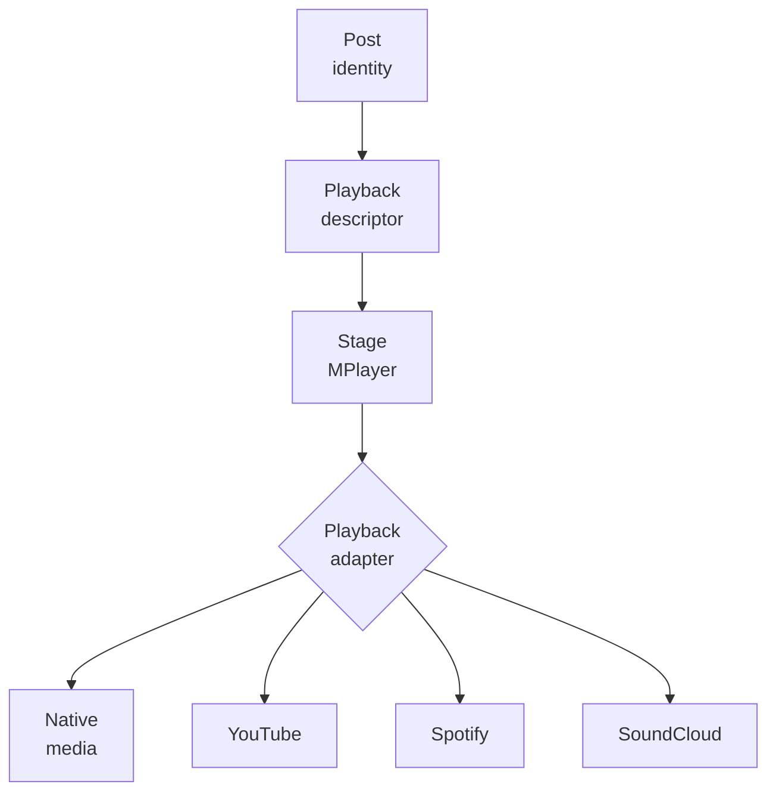
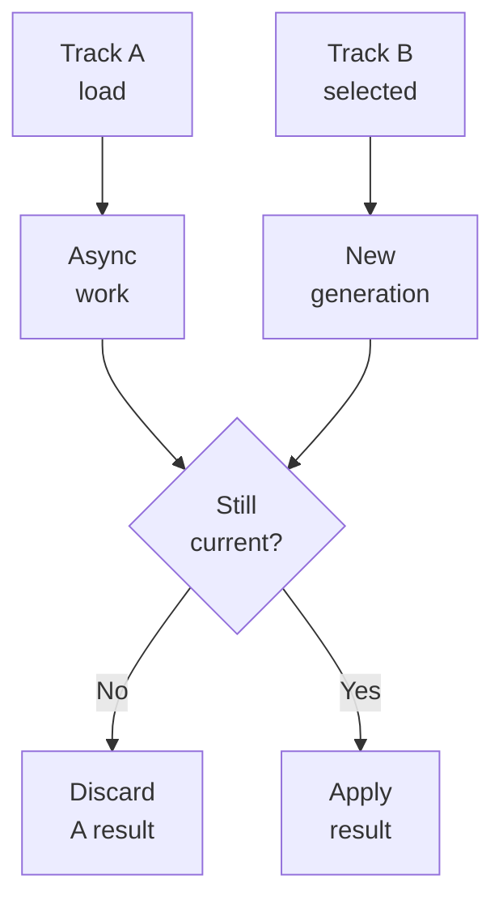
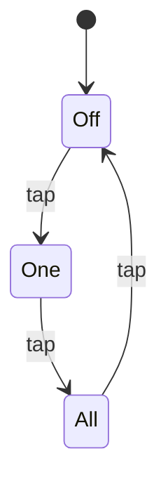

# Millenova MPlayer

**Status:** 🟡 PF-8 draft — under Wilder review  
**Private implementation authority:** `wilderruiz/millenova`  
**Public publication authority:** `wilderruiz/millenova-project`  
**Publication rule:** architecture is public; exploitable configuration is private.

Millenova's player is not a collection of provider widgets; it is one persistent product-level playback system that keeps queue identity, transport state, workspace continuity and Stage presentation coherent while different playback engines come and go underneath it. The hard problem is that native first-party media, YouTube, Spotify and SoundCloud do not expose identical timing, fullscreen, autoplay or remote-playback behavior. MPlayer solves that by owning product semantics above a provider-neutral adapter boundary while letting the real playback engine own physical media truth. That separation is why the player could move first-party posts from external providers to native browser playback without replacing playlists, reactions, queue state or navigation.

> **One product-level player, multiple playback adapters, one authoritative queue/transport state.**

---

## 1. One playback owner

**The central MPlayer rule is that Stage has one playback owner at a time.** Building a second queue or second transport whenever a new media type appears would split reactions, playlists, navigation and analytics into competing implementations. Millenova instead resolves each post to a playback descriptor and lets one canonical MPlayer runtime choose the appropriate adapter for that occurrence. Native video, YouTube, Spotify and SoundCloud therefore differ at the playback-mechanics layer while the user still experiences one Stage, one queue and one transport system.



**Playback authority can change without changing track identity.** A post that gains a verified first-party media attachment can switch from an external adapter to the native adapter while keeping the same post ID, playlist memberships, reactions, queue occurrence and social history. The original provider can remain attribution/source metadata without continuing to own playback. This is the player-side expression of Millenova's broader identity rule: product identity is more durable than transport identity.

---

## 2. Stage is a persistent workspace, not just a video box

**Stage exists to preserve listening context across the site.** A normal media element disappears when its page disappears, which would make navigation, search and feed browsing repeatedly destroy playback state. MPlayer separates the persistent Stage/workspace from transient page surfaces so the current post, queue context and transport state can survive soft navigation and Stage expansion/minimization. The result is closer to a persistent listening workspace than a page-scoped embed.

**Expanded Stage and minimized player are two presentations of the same state.** If those surfaces owned separate playback objects, minimizing or reopening Stage would risk duplicate audio, time jumps and divergent queue state. MPlayer therefore keeps one transport authority and lets UI surfaces project that state at different sizes. The media object and queue do not restart merely because the visual shell changes.

---

## 3. Physical playback truth stays with the real engine

**MPlayer deliberately does not fake timing that the browser or provider can report directly.** Synthetic clocks drift, become wrong after seeking and are especially fragile when buffering or autoplay policy interrupts the expected sequence. For first-party media, `HTMLMediaElement` owns current time, duration, buffering, seek state, play/pause, volume and `ended`; provider adapters expose equivalent operational state where their APIs permit it. MPlayer consumes that truth and adds queue, workspace, UI and product semantics around it.

```text
native/browser or provider adapter
        owns physical playback truth
                ↓
MPlayer
        owns product transport + queue
                ↓
Stage / mini player / playlist controls
        project one shared state
```

**This division also improves failure diagnosis.** A browser autoplay rejection, a provider API limitation and a corrupt media response are different failures even if they all look like “play did not start” from the outside. Keeping the adapter boundary explicit allows MPlayer to recover according to the actual cause instead of flattening everything into one generic player error. Diagnostics can then report the real architecture path without inventing state.

---

## 4. Async generation guards prevent stale playback from winning

**Fast user actions create races that are easy to miss in media software.** A native authorization or provider load can still be resolving when the listener immediately chooses another track, and a late completion from the old request could otherwise reclaim the Stage mount. MPlayer and the native adapter use generation/supersession checks so an older async operation cannot overwrite a newer selection. This protects rapid queue changes, provider switches, quality reloads and navigation from “ghost” playback returning after the user has already moved on.



---

## 5. Queue identity is richer than a list of rows

**A queue row is not only a track ID; it is an occurrence inside a playback context.** The same post can appear in different collections or be deliberately queued more than once, so treating post identity alone as queue identity would make reordering, Up Next and restore behavior ambiguous. MPlayer preserves queue occurrence/context separately from analytics/post identity and keeps collection semantics explicit instead of inferring them from how many rows happen to exist. That gives the player enough information to distinguish ordinary surface playback from a real playlist or reaction library.

**Collection context is a semantic flag, not a visual guess.** Saved playlists, reaction libraries and future named collections opt into collection transport explicitly, while Home/Fresh/Studio/single-surface temporary queues remain non-collection contexts. The context is persisted with Queue Semantics v2 in the existing workspace representation so reload/navigation does not silently turn a playlist into an ordinary queue. Unknown values fail closed rather than accidentally enabling playlist-only controls.

---

## 6. NEXT FROM and UP NEXT solve two different sequencing problems

**Automatic continuation and explicit listener intent must not compete for the same queue slot.** `NEXT FROM` represents the deterministic continuation implied by the current source/context, while `UP NEXT` represents items the listener deliberately queued ahead of that continuation. MPlayer gives pending Up Next entries priority and returns to deterministic NEXT FROM progression when that explicit queue is exhausted. This lets discovery surfaces keep their natural order without ignoring a user's direct “play this next” instruction.

```text
current item ends
      ↓
pending UP NEXT?
  yes → consume explicit queued occurrence
   no → advance deterministic NEXT FROM
```

**The separation also keeps feed virtualization from owning player order.** Home cards can be dematerialized from the DOM while logical feed state continues to supply the queue projection. MPlayer therefore does not need every source card to remain mounted in order to know what comes next. Queue continuity belongs to logical state, not to whatever elements happen to be visible on screen.

---

## 7. Repeat is one authoritative tri-state

**Repeat became simpler only after the state model became more explicit.** Separate local toggles for loop-one, loop-all or provider-specific repeat would allow different surfaces to disagree about what happens when the track ends. MPlayer normalizes repeat into one authoritative state — `off`, `one` or `all` — and projects that same state into Stage, playlist headers and mobile controls. The UI can therefore use one Repeat control while preserving three real transport semantics.



**Persistence is backward-compatible rather than destructive.** The canonical `repeat_mode` lives in Queue v2 workspace state, while the older loop projection remains compatible for legacy workspaces. Repeat One can persist without pretending it is Repeat All, and malformed new values fail closed to Off. This allowed the state model to improve without rewriting the database solely for a UI convergence.

---

## 8. Shuffle belongs to collections, not every launch

**Shuffle is meaningful only when the listener is inside a collection that has an order worth scrambling.** Showing Shuffle for a single Home track or arbitrary temporary surface would imply playlist semantics that do not actually exist. MPlayer therefore gates Shuffle and Repeat visibility on explicit collection context rather than row count. Saved playlists, Liked/Loved/Mad libraries and future named collections can opt in while ordinary track launches stay visually simpler.

**The same state is shared across desktop and mobile surfaces.** Desktop transport and collection headers can both expose Shuffle/Repeat without becoming independent controls, and mobile can use compact companion controls near the collection menu. Every surface dispatches to the same MPlayer state. That avoids the classic bug where one button looks active while another surface thinks the transport is off.

---

## 9. Native quality is a state, not decoration

**Quality UI is only useful when it tells the truth about the rendition actually playing.** First-party media can expose verified HD and 4K renditions, while AUTO may choose a lower tier when measured delivery conditions do not justify promotion. MPlayer therefore distinguishes manual HD, manual 4K and adaptive AUTO, and the visible state follows the actual active rendition rather than the requested ideal. Stats for Nerds remains the deeper diagnostic surface, while the everyday quality control can stay compact.

**Desktop and mobile present the same semantics differently.** Desktop uses a compact state-first quality control with richer hover/focus detail, while mobile keeps a simple tap cycle such as AUTO → 4K → HD → AUTO. The interaction differs because available space and touch behavior differ, but both surfaces operate on the same underlying quality authority. Presentation changes must never silently change the selected mode.

---

## 10. Stats for Nerds exposes runtime truth

**A complex player needs a way to distinguish product bugs from browser, network and media conditions.** Without diagnostics, a quality decision or buffering event can look arbitrary, and unsupported browser telemetry is easily mistaken for zero or false. MPlayer's Stats for Nerds surface reports real runtime information such as active rendition, network/probe state, frame/runtime data and architecture path while showing unavailable measurements as unavailable. It is deliberately diagnostic rather than a second transport panel.

**Desktop and mobile use different presentation mechanics because their clipping constraints differ.** Mobile needed a viewport-level portal so the diagnostics surface could escape the clipped video mount, while desktop can keep the console positioned naturally beside its trigger. That mobile fix is not treated as a universal layout rule. MPlayer keeps diagnostic semantics shared while allowing surface-specific rendering solutions.

---

## 11. Mobile controls follow touch physics rather than desktop geometry

**A good mobile player cannot be created by shrinking the desktop HUD.** Touch needs larger targets, browser gesture behavior differs, and an autoplay-safe muted start is useless if the listener has no obvious way to turn sound back on. MPlayer therefore gives mobile an explicit top-edge sound control, a centered five-button transport cluster and a bottom-edge progress bar while preserving the same command authority underneath. The control arrangement changes, but queue, time, quality and audio ownership do not.

```text
Previous   −10   Play/Pause   +10   Next
```

**Sound control follows real native state instead of optimistic icon state.** The mobile speaker control reflects whether the actual media is muted, and an explicit user tap can claim Millenova audio ownership and unmute in a browser-policy-safe way. Quality changes, queue advances and fullscreen transitions must preserve that state instead of resetting the UI. This reuses the proven behavioral pattern of browser-safe muted startup followed by explicit audio claim without coupling MPlayer to the Beats implementation namespace.

---

## 12. Audio ownership prevents double playback

**Persistent media surfaces become dangerous when more than one believes it owns audible output.** Stage, Hero, Beats and provider/native players can coexist in the application, so independent audio decisions could produce overlapping sound or confusing mute state. Millenova uses a shared audio-claim contract so an active player can become the audible owner while other surfaces yield appropriately. MPlayer participates in that system rather than assuming the existence of a video element automatically grants audio authority.

**Hero is intentionally not an MPlayer queue mode.** MPlayer may cause Hero to mute locally when it claims audible ownership, but it does not take over Hero's broadcast timeline, seek position or scheduling. That separation prevents the persistent global player from swallowing another subsystem's state just because both happen to render media. Cooperation happens at the audio boundary, not by merging timelines.

---

## 13. Autoplay recovery respects browser policy

**`autoplay=true` is an intention, not a guarantee.** Browsers can reject audible `play()` calls when the usable user-gesture window has expired, especially after asynchronous authorization or media loading. MPlayer treats `play()` as an asynchronous operation, distinguishes policy rejection from media failure and can recover through a muted browser-safe path rather than presenting a raw exception as if the asset were corrupt. This keeps browser policy visible in behavior without weakening it.

**The player also avoids turning muted fallback into a dead end.** Desktop retains normal native sound controls, and mobile gained an explicit sound affordance so the listener can intentionally restore audio. The accepted design does not force audible autoplay simply to make the UI look successful. It recovers within browser rules and gives the user a clear path to take control.

---

## 14. Workspace persistence stores durable identity, not expiring transport

**A player that survives navigation should restore what the listener was doing, not stale authorization material.** Short-lived playback capabilities, provider session handles and physical origin choices can expire or change between sessions. MPlayer therefore persists durable post/order/current-position/queue context and resolves the current playback authority again during restoration. A post can consequently restore as native today even if an older workspace originally encountered it through an external provider.

**Restore behavior is intentionally paused-safe.** Rehydrating queue identity does not imply that the browser will always allow immediate audible playback, and a refreshed page should not surprise the listener with uncontrolled sound. The workspace restores context first, then transport resumes through current browser/player policy. This keeps continuity separate from autoplay permission.

---

## 15. Provider adapters remain compatibility boundaries

**First-party native playback did not make external providers obsolete overnight.** Many catalogue posts can still rely on YouTube, Spotify or SoundCloud, and their SDKs/widgets expose different capabilities and limitations. MPlayer keeps those differences behind adapters instead of letting provider-specific assumptions leak into queue identity, collection transport or workspace state. Native media simply became another authoritative adapter for posts that have verified first-party bytes.

**The adapter boundary is also what makes future infrastructure work safer.** DMN can change which origin serves a native rendition without changing MPlayer's queue semantics, while provider-backed posts remain unaffected. Similarly, a future provider API change can be contained in its adapter without redefining playlist identity. The player stays stable by treating transport mechanisms as replaceable implementation detail beneath product state.

---

## 16. Failure recovery is layered rather than generic

**Player reliability improves when failures are classified by the layer that actually failed.** A stale async result, provider error, media authorization failure, range-delivery problem, browser autoplay rejection and queue-state corruption are not interchangeable and should not trigger the same recovery. MPlayer handles supersession at the generation layer, playback mechanics at the adapter layer, queue continuity at the product layer and provider/origin selection beneath the native-media contract. That layered model reduces the chance that one recovery path accidentally destroys another subsystem's valid state.

| Failure class | Authority that should respond | Product goal |
|---|---|---|
| Stale async completion | Generation guard | Keep newer selection authoritative |
| Browser autoplay block | Native/player policy path | Recover safely without labelling media corrupt |
| Provider/API error | Provider adapter | Preserve queue/workspace if possible |
| Native authorization/delivery error | Media contract / adapter | Preserve post identity and report unavailable playback |
| Queue-context corruption | MPlayer queue model | Fail closed to safe semantics |
| Origin/provider outage | DMN beneath native media | Select verified fallback for later/new authorization |

---

## 17. Production convergence was incremental

**MPlayer reached its current state through small convergence steps rather than a single player rewrite.** Native Stage cutover was production-proven first, then queue/repeat semantics, playlist-aware transport, mobile sound control, desktop HUD convergence and centered mobile transport were closed in separate phases. That sequencing kept playback-heart changes, UI changes and transport semantics from becoming one impossible debugging surface. It also made the DMN Checkpoint-B opening meaningful because the player prerequisites were already independently accepted.

| Area | Current status |
|---|---|
| Native Stage/MPlayer cutover | **Production complete** |
| PT-1 collection transport context | **Complete** |
| PT-2 tri-state Repeat authority | **Complete** |
| PT-3 playlist/reaction-library transport convergence | **Complete** |
| MOB-0 mobile native sound control | **Complete** |
| HUD-1 desktop native HUD convergence | **Complete** |
| MOB-1 centered mobile transport/progress | **Complete** |
| DMN-4/5 delivery integration | **Current system priority outside PF-8** |
| Cast / Remote Playback | **Later / non-blocking** |

---

## 18. Cast / Remote Playback remains evidence, not a shipped feature

**The browser has already shown that first-party native media may be remotely playable, but accidental browser capability is not the same as a Millenova Cast feature.** Physical Android Chrome smoke exposed a browser-provided remote-playback control with a compatible TV, yet Millenova has not defined the full controller, state, queue and failure contract required to claim the feature. The planned investigation starts with first-party native media and browser Remote Playback capability, adding a Cast SDK only if the browser API cannot meet the required control/state needs. Provider-specific remote playback remains a separate question rather than being assumed to work through the same path.

**Any future remote implementation must preserve MPlayer authority.** Connecting a TV should not create a second queue, lose the current post, restart from zero or leave the phone playing audible audio at the same time. The phone should become a controller, handoff should preserve approximate time/track identity, disconnect should restore local playback cleanly and errors should fall back without losing queue state. Quality selection must also become receiver-aware rather than blindly copying the phone's local HD/4K choice.

---

## 19. Public boundary

**The public MPlayer document can explain behavior deeply without publishing exploitable implementation details.** Queue semantics, adapter ownership, autoplay recovery, workspace persistence, collection transport, diagnostics, native/browser authority and future remote-playback boundaries are architectural knowledge rather than secrets. The public record therefore focuses on state models and accepted behavior while omitting private endpoints, signing material, privileged routes, production coordinates and any implementation detail that would materially lower the cost of attacking the live system. This keeps the player educational without turning its transport/security internals into an operational recipe.

---

## 20. Related public documents

[Native media engineering](../media/NATIVE_MEDIA_ENGINEERING.md) explains the first-party media lifecycle that the native adapter consumes. [Distributed Media Node](../media/DISTRIBUTED_MEDIA_NODE.md) explains physical origin selection beneath that native-media contract, while [Platform architecture](../PLATFORM_ARCHITECTURE.md) and [Technology map](../TECHNOLOGY.md) place MPlayer inside the wider application. The next publication step after PF-8 review is `../feed/SIGNAL_WINDOW.md`, which moves from persistent playback ownership to the logical feed/virtualization system that supplies discovery context without becoming the player itself.
