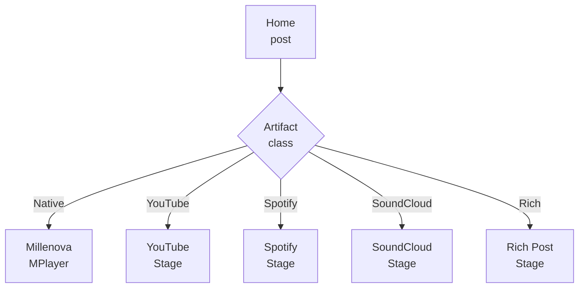
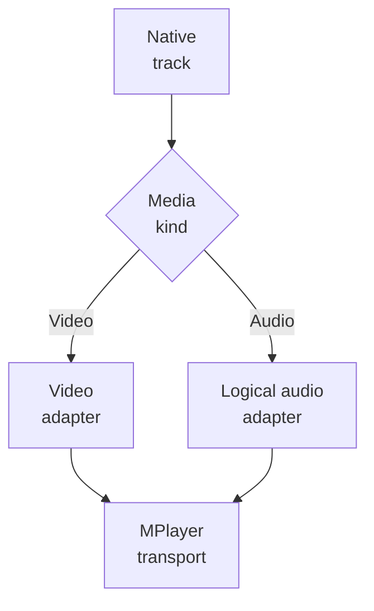
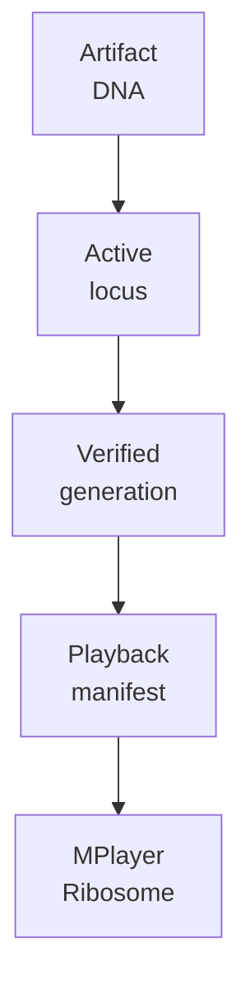
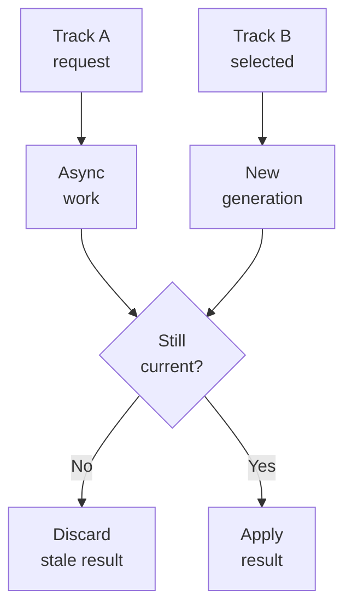

# Millenova MPlayer

**Status:** 🟡 PF-8 draft — architecture correction applied 2026-10-13  
**Private implementation authority:** `wilderruiz/millenova`  
**Public publication authority:** `wilderruiz/millenova-project`  
**Publication rule:** architecture is public; exploitable configuration is private.

MPlayer remains Millenova's persistent native playback and queue authority, but its role is now narrower and clearer than the earlier public draft implied. The approved next architecture no longer treats YouTube, Spotify and SoundCloud as permanent sub-adapters of one universal physical player. **MPlayer is the native Millenova playback system; external providers are moving into their own provider-scoped Stage families.**

> **One native Millenova player, one native queue/transport authority, provider-specific Stage families outside that native playback domain.**

---

## 1. What MPlayer owns now

**MPlayer owns the native Millenova listening workspace.** The existing production player already preserves current post identity, queue context, Up Next, Next From, repeat/shuffle state, quality, sound state, workspace continuity and Stage/minimized presentation around first-party native playback. That state must remain coherent even when Home cards are virtualized or navigation changes the surrounding page. MPlayer therefore remains a product subsystem rather than a page-scoped `<video>` or `<audio>` element.

The mature native player work is still valid: browser media elements own physical playback truth, generation guards reject stale async work, Queue Semantics v2 preserves logical context, mobile and desktop controls project the same transport state, and the player restores durable identity instead of persisting expiring authorization material.

---

## 2. The provider boundary changed

**The architectural correction is that external providers are no longer the long-term responsibility of the same physical MPlayer runtime.** The earlier compatibility layer could adapt YouTube, Spotify and SoundCloud underneath one Stage shell, but the accepted Stage Families plan now separates provider playback into provider-scoped environments using official supported players and provider-specific capability rules. This prevents one universal queue from inventing capabilities that a provider does not support and prevents mixed-provider playlists from implying continuous playback guarantees that are not real.



The current compatibility code remains useful during migration, but public architecture should not present it as the final target. Native MPlayer state and provider Stage state are becoming separate capability domains under one Home chronology.

---

## 3. Stage is a persistent native workspace

**Native Stage exists to preserve listening context across the product.** A normal media element would disappear when the page changes, which would make Home browsing, Studio navigation and search repeatedly destroy playback state. MPlayer separates the persistent playback/workspace authority from transient page surfaces so the same native occurrence can continue while Stage expands, minimizes or survives soft navigation.

Expanded Stage and minimized player are therefore two presentations of the same native playback state. They must not create duplicate media elements, duplicate queues or competing transport owners. This invariant becomes even more important as external providers move into separate Stage families, because native continuity should remain stable without forcing provider widgets into the same runtime lifecycle.

---

## 4. Native video and native audio share product transport, not media mechanics

**Native video and native audio now converge at MPlayer above two different physical media paths.** Video uses verified first-party renditions and normal browser video semantics; native audio can be expressed from creator-owned audio generations using a logical segment manifest and an `HTMLAudioElement` beneath the Millenova Audio Visual Engine. MPlayer should see both as logical native tracks even though the media processing and rendering paths are different.



The visualizer is never playback authority. If WebGL or the reactive visual layer fails, audio time, queue progression, Repeat, Previous/Next and ended semantics must remain correct because the browser audio element and logical audio adapter still own the physical timeline.

---

## 5. Native audio expression now comes from a genome-derived manifest

**For MP3/WAV, MPlayer should consume expression, not raw ingest evidence.** The active creator genome determines which allele is active at each semantic track locus, a verified generation preserves exact logical sample geometry, and a transient playback expression manifest projects the boundaries MPlayer actually needs. Conceptually the path is `Artifact DNA + locus + verified generation → RNA Polymerase → mRNA manifest → Ribosome/MPlayer`.



This makes replacement safer because MPlayer does not need to know that an old creator master was silenced and a new allele became active. It asks for the current valid expression of the stable semantic track and plays the resulting logical segment.

---

## 6. Physical playback truth stays with the browser

**MPlayer does not invent clocks when the browser can report the real state.** Native video and audio rely on browser media elements for current time, duration, seek state, buffering, play/pause, volume and `ended`, while MPlayer adds product semantics around that truth. The logical audio adapter maps generation/sprite offsets into track-local time so the user experiences an ordinary song rather than a giant creator sprite.

This separation also makes failure classification cleaner. A browser autoplay rejection, an audio-generation boundary problem, a DMN delivery outage and a queue-state error belong to different authorities even if all can result in playback not starting. MPlayer should recover at the correct layer rather than flattening them into one generic error.

---

## 7. Async generation guards remain non-negotiable

**Late asynchronous work must never reclaim the player after the listener has moved on.** Authorization, provider selection, range loading, audio expression resolution or quality changes may complete after a newer track has already become current. MPlayer and its native adapters use generation/supersession checks so stale work is discarded rather than mounted.



The same rule applies to both native video and genome-derived native audio. Durable track identity does not grant old async work permission to overwrite a newer user decision.

---

## 8. Queue identity is native-context identity

**A native queue occurrence is richer than a post ID.** The same native post may appear in different playlists, reaction libraries or explicit Up Next positions, so MPlayer preserves occurrence and collection context separately from canonical post identity. That is what allows deterministic Next From, user-controlled Up Next, reorder behavior and workspace restore to remain coherent.

The important correction is scope: this queue model is authoritative for **native Millenova playback collections**. Future YouTube, Spotify and SoundCloud playback playlists are provider-scoped objects and should not be silently projected into the native MPlayer queue merely because all their cards coexist in Home.

---

## 9. NEXT FROM and UP NEXT remain separate native semantics

**Automatic continuation and direct listener intent still solve different problems.** `NEXT FROM` represents deterministic continuation from the current native source/context, while `UP NEXT` is an explicit occurrence the listener asked to hear first. Pending Up Next wins, then normal Next From progression resumes.

```text
current native item ends
      ↓
pending UP NEXT?
  yes → consume explicit occurrence
   no → advance NEXT FROM
```

Home virtualization can dematerialize cards without breaking this sequence because the logical Home store or native collection context provides queue identity independently of mounted DOM. Under the Stage-family architecture, a Home route into a different provider Stage changes capability domain instead of pretending one native queue can continue across incompatible provider players.

---

## 10. Repeat and Shuffle remain collection semantics

**Repeat and Shuffle belong to actual collections, not arbitrary single launches.** MPlayer keeps one authoritative tri-state Repeat value — `off`, `one`, `all` — and one Shuffle state for native playlist-like contexts such as native saved playlists and native reaction libraries. Desktop, mobile and collection-header controls project the same state instead of becoming separate transport owners.

This behavior does not imply that YouTube, Spotify or SoundCloud Stages must expose identical controls. Provider-specific Stage families may only expose collection/queue semantics that are supported and explicitly designed for that provider capability domain.

---

## 11. Provider-scoped playlists are outside native MPlayer governance

**The new playlist invariant is provider scope.** A native playback playlist contains native Millenova media; a YouTube playback playlist contains YouTube references; Spotify and SoundCloud follow the same rule. Cross-provider insertion is rejected server-side even if a stale client tries it.

```text
playlist.provider_scope === item.provider_scope
→ continuous-playback membership allowed
```

A universal Saved/Collection object may eventually hold mixed Home artifacts because it is not promising continuous playback. This distinction is more precise than the earlier public model where one player-level playlist concept appeared to cover all provider types.

---

## 12. Native quality remains truthful state

**Quality UI should report the rendition actually playing, not merely the user's preference.** Native video can expose verified HD and 4K, while AUTO may remain at HD when delivery conditions or provider policy do not justify 4K. MPlayer distinguishes manual HD, manual 4K and adaptive AUTO, and Stats for Nerds remains the deeper technical surface.

DMN now owns more of the underlying delivery truth than the earlier draft captured. HOME/VPS authorization, HOME range delivery and VPS fallback through 1080p are complete through DMN-4C, with Hero-specific routing active in DMN-4D. MPlayer should consume the resulting native delivery contract rather than becoming the physical-provider router itself.

---

## 13. Mobile and desktop are different presentations of the same native state

**Touch interaction is not desktop interaction scaled down.** Mobile native Stage uses explicit sound control, centered transport and bottom-edge progress while desktop can expose richer HUD/diagnostic layout. Both presentations still dispatch to one native MPlayer state and must reconcile from the actual media element rather than optimistic UI state.

This separation remains valid after the Stage-family correction because it applies to Millenova-native playback. External provider Stages may retain provider-native controls and branding where policy or capability requires them.

---

## 14. Audio ownership remains cross-surface coordination

**Only one Millenova surface should own audible output at a time.** Native Stage, Hero, Beats and other media surfaces can coexist, so MPlayer participates in the shared audio-claim contract instead of assuming that having a media element automatically grants audible ownership. Hero can mute when MPlayer claims sound without becoming part of the MPlayer queue or transport timeline.

Provider-specific Stages must cooperate with the same product-level audible-ownership goals without Millenova faking unsupported provider controls. Shared audio coordination is a cross-surface contract, not proof that all surfaces belong to one player.

---

## 15. Autoplay recovery respects browser policy

**Autoplay is a browser permission outcome, not a product flag.** Native `play()` can reject after asynchronous work loses a user-gesture window, so MPlayer distinguishes policy rejection from media corruption and can recover through browser-safe muted behavior plus an explicit user sound action. The accepted design does not force audible autoplay merely to make a launch appear successful.

Native audio must follow the same rule. The visual engine cannot be used to bypass or conceal autoplay state, and genome-derived playback still terminates at a real browser media element subject to browser policy.

---

## 16. Workspace persistence stores durable native identity

**A persistent player should restore listening context, not stale transport capabilities.** Queue occurrence, native post identity, collection context and current position can persist, while playback capabilities, DMN origin choices and expression manifests are resolved again from current authoritative state. For native audio that means a restored semantic locus may resolve to a newer active allele/generation than the one that existed when the workspace was originally saved.

This is intentional. The workspace remembers **what the listener was listening to**, while the media/genome systems determine the current valid way to express that identity.

---

## 17. Failure recovery is layered

| Failure class | Authority | Desired result |
|---|---|---|
| Stale async completion | MPlayer/native generation guard | Keep newer selection authoritative |
| Browser autoplay block | Native playback policy | Recover safely without declaring media corrupt |
| Native video authorization/delivery | Media/DMN contract | Preserve post identity; use verified delivery policy |
| Native audio expression/boundary failure | Audio genome / Proofreader / adapter | Fail closed; never rewrite Artifact DNA to make playback fit |
| Queue-context corruption | MPlayer queue model | Fall back to safe native semantics |
| Provider-specific playback error | Provider Stage | Preserve Home/post identity without contaminating native queue state |

The architecture gets safer as these failure domains become more explicit. One recovery path should not silently rewrite another subsystem's valid state.

---

## 18. Current status boundary

| Area | Current status |
|---|---|
| Native Stage/MPlayer cutover | **Production complete** |
| PT-1 collection transport context | **Complete** |
| PT-2 tri-state Repeat authority | **Complete** |
| PT-3 collection transport convergence | **Complete** |
| MOB-0 mobile native sound control | **Complete** |
| HUD-1 desktop native HUD convergence | **Complete** |
| MOB-1 centered mobile transport/progress | **Complete** |
| Native MP3 logical audio + Audio Visual Engine integration | **Complete foundation / FP-7G runtime acceptance active** |
| Audio-genome Artifact DNA / locus evolution architecture | **Active architecture** |
| DMN-4A/4B/4C native delivery slices | **Complete** |
| DMN-4D Hero routing | **Active** |
| Provider-scoped Stage Families | **Approved next architecture / execution plan 2** |
| Rich Post Stage | **Approved / queued behind Stage Families** |
| Cast / Remote Playback | **Later / non-blocking** |

---

## 19. Cast remains evidence, not a shipped feature

**Browser remote-playback capability is useful evidence, but it is not yet a Millenova Cast product.** Any future implementation must preserve native queue identity, current track/time, single-audio ownership and clean local/remote handoff while remaining separate from provider-specific casting rules. Provider Stage families make this distinction even more important because Millenova cannot assume one remote-playback mechanism applies identically to YouTube, Spotify and SoundCloud.

---

## 20. Related public documents

[Platform architecture](../PLATFORM_ARCHITECTURE.md) defines the corrected Home/Stage-family boundary. [Native media engineering](../media/NATIVE_MEDIA_ENGINEERING.md) explains first-party video plus the newer native-audio/genome path, and [Distributed Media Node](../media/DISTRIBUTED_MEDIA_NODE.md) explains physical native-media origin selection beneath MPlayer. The next public feed document should describe Home/Signal Window as the discovery and virtualization system that supplies artifact context without becoming playback authority itself.